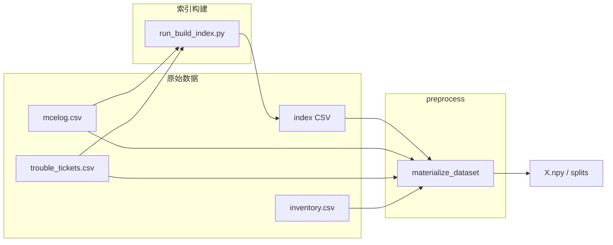

# 天池 DRAM 故障预测 · 空间热图 2D-CNN

本仓库为 **服务器 DRAM 相关故障二分类**：在每条样本的锚点时刻 `predict_time`，用 **时间窗口内 mcelog** 与 **inventory 台账** 预测：**未来 `label_horizon_seconds` 内**是否出现符合 `failure_type` 筛选的 **工单级** 故障（与 `trouble_tickets` 关联）。

- **默认预测目标**：**未来 5 分钟**（`label_horizon_seconds=300`）；可通过配置或不同索引表对比 30 分钟、1 小时等 horizon。
- **默认表示**（`grid_representation: spatial_heatmap`）：逻辑 **row/col 分箱** 为 **H×W=128×32**，**bankid 0–15** 为 **16 通道** + **inventory one-hot 15 通道** → **`X` 为 [N,31,128,32]**。
- **模型**：**GridCNN-Deep**（`model.yaml`，生产/全量）；冒烟基线实验用 **`model_smoke.yaml`**（同 C/H/W）；超参搜索见 **`configs/hpo/hpo.yaml`** + **`scripts/optuna.sh`**。

细字段见 **`docs/tianchi_pipeline.md`**、**`docs/data_processing_guide.md`**。**完整操作流程见 [`docs/user_guide.md`](docs/user_guide.md)**。切分与预处理目录以实验 YAML 的 `processed_dir` / `splits_dir` 为准（全量默认 `data/splits/`，冒烟默认 `data/splits_smoke/`，彼此隔离）。

---

## 项目概述

| 维度 | 说明 |
|------|------|
| **任务** | 二分类：锚点之后 horizon 内是否出现符合条件的故障工单 |
| **输入** | **`X`** `[N,C,H,W]`，默认 **C=31** |
| **标签** | **`y`**∈{0,1}，`predict_ts ≤ failed_ts ≤ predict_ts + label_horizon_seconds` |
| **模型** | **GridCNN-Deep**（`model.yaml`）；冒烟 **`model_smoke.yaml`** |
| **评价指标** | **F1**（`evaluate` / 赛题关注）；训练早停默认 **`best_f1`**（验证集阈值搜索）；工程实验可改为 **`avg_precision`** + `threshold_profile` |
| **验收** | 主实验部署阶段 F1≥0.6（已达标）；正式数字见 `outputs/tables/full_all_strategies_deployment_kpi.csv` |

---

## 核心概念

1. **索引表**：`(sid, predict_time)`；`predict_ts` 为 **相对秒**（全数据最早 raw 时刻 = 0）；由 **`scripts/build_index.sh`**（实现 `pipelines/run_build_index.py`）从 `data/raw` 生成。
2. **特征窗口**：半开区间 **`[predict_ts − window_seconds, predict_ts)`**（相对秒轴上计算）。
3. **标签窗口**：闭区间 **`[predict_ts, predict_ts + label_horizon_seconds]`**。默认 **300s**。
4. **索引策略**：正样本在 **`[ft−H, ft]`**（**ft 可晚于 mcelog 末尾**）按 `positive_sample_interval_seconds` 采样；近故障困难负样本 在 **`[ft−prefault, ft−H)`**；其余负样本在 **`[t_min+W, t_max−H]`** 内均匀/随机采样并逼近 `target_positive_ratio`。

---

## 端到端流水线



---

## 配置与目录

| 说明 | 位置 |
|------|------|
| 全局 device / GPU / DDP 默认 | `configs/base.yaml` |
| 数据 / horizon / 索引生成 | `configs/data.yaml` |
| 训练超参 / 不平衡 | `configs/train.yaml` |
| 推理 batch | `configs/infer.yaml` |
| GridCNN 结构 | `configs/model.yaml` |
| Optuna 搜索空间 | `configs/hpo/hpo.yaml` |
| 实验入口（overrides） | `configs/experiments/*.yaml` |

| 脚本 | 用途 |
|------|------|
| `scripts/build_index.sh` | 从 `data/raw` 生成真实索引（smoke / full） |
| `scripts/build_index.py` | 上述 shell 的 Python 便捷入口（实现见 `pipelines/run_build_index.py`） |
| `src/dram2cnn/utils/pipeline_helpers.py` | 笔记本流水线 断点标记/ preflight |
| `src/dram2cnn/utils/deployment_kpi.py` | 部署阶段评价指标汇总与 `full_all_strategies` 合并 |
| `scripts/build_horizon_indexes.sh` | 批量生成 5min / 30min / 1h 对比索引 |
| `scripts/preprocess.sh` | 预处理 + 切分（末尾 validate） |
| `scripts/validate.sh` | 配置与 splits 校验 |
| `scripts/train.sh` | 训练（自动 DDP + 80% 显存 batch） |
| `scripts/infer.sh` | 推理（同上） |
| `scripts/evaluate.sh` | 测试集指标与图表 |
| `scripts/train_ddp.sh` | 全量多卡训练入口（调用 `train.sh`） |
| `scripts/optuna.sh` | GridCNN-Deep 超参搜索（Optuna，trial 内 DDP） |
| `scripts/autotune.sh` | 预处理 → 训练 → 推理 → 评估 端到端链路检查 |
| `scripts/clean.sh` | 清理 runs、processed/splits、outputs、缓存（`--notebooks` 清输出；`--purge-indexes` 删全量索引） |
| `scripts/inspect_data.sh` | 原始 CSV / 索引 / 清单 快速体检 |
| `scripts/verify_ddp.sh` | 多卡 DDP 回归验证（需 ≥2 GPU） |

---

## 环境

```bash
cd /path/to/workspace
pip install -r requirements.txt
export PYTHONPATH=src
python3 -m pytest -q
```

---

## 推荐命令流

```bash
export PYTHONPATH=src

# 1. 生成索引（默认 5 分钟 horizon）
bash scripts/build_index.sh smoke
# 全量：bash scripts/build_index.sh full

# 2. 预处理（含末尾 validate）→ 训练 → 推理 → 评估（完整分步见 docs/user_guide.md §5）
# 冒烟实验 exp_baseline 使用轻量 configs/model_smoke.yaml + time_stratified 切分
bash scripts/preprocess.sh configs/experiments/exp_baseline.yaml
# 可选：单独复查 splits/清单 时再跑 validate.sh
# bash scripts/validate.sh configs/experiments/exp_baseline.yaml
bash scripts/train.sh configs/experiments/exp_baseline.yaml
bash scripts/infer.sh configs/experiments/exp_baseline.yaml
bash scripts/evaluate.sh configs/experiments/exp_baseline.yaml

# 3. 超参搜索（需已有 splits）
bash scripts/optuna.sh configs/experiments/exp_optuna_smoke.yaml

# 4. 端到端链路检查
bash scripts/autotune.sh

# 5. 多卡 DDP 回归（需 ≥2 GPU）
bash scripts/verify_ddp.sh
```

**Horizon 对比示例**（索引与实验 YAML 须一致）：

```bash
# 生成 30min/10min 步长冒烟索引（与 exp_horizon_30m.yaml 默认路径一致）
bash scripts/build_horizon_indexes.sh smoke
# 切换 horizon 前清空该实验的 processed/splits 目录（30min 冒烟示例）
rm -rf data/processed_horizon_30m_smoke/* data/splits_horizon_30m_smoke/*
bash scripts/preprocess.sh configs/experiments/exp_horizon_30m.yaml
```

---

## 文档索引

| 文档 | 内容 |
|------|------|
| **`docs/user_guide.md`** | **使用说明（完整操作流程，推荐首读）** |
| `docs/data_processing_guide.md` | 数据处理与索引设计 |
| `docs/tianchi_pipeline.md` | 规格速查 |
| `docs/project_configuration_reference.md` | 配置长篇说明 |
| `docs/troubleshooting.md` | 排错 |

演示索引重建：**`bash scripts/build_index.sh smoke`**

---

## 性能与并行（Linux 高核 / 多 GPU）

| 阶段 | 并行方式 | 配置 |
|------|----------|------|
| **预处理** | mcelog 按 sid 排序 + 填网格（小样本可 `fork` Pool；全量 compact 多为单进程） | `data.yaml` 默认 **`ram_budget_frac: 0.5`**；**全量实验 YAML 覆盖为 0.85 + `preprocess_workers: 1`** |
| **训练 / 推理** | 单卡或 **DDP 多卡** + 80% 显存 batch 探测 | `base.yaml` 的 `gpu` / `ddp`；`bash scripts/train.sh` / `infer.sh` |
| **DataLoader** | 多 worker 预取 | `train.yaml` 默认 **0**；全量实验（如 `exp_full_f1_ddp`）覆盖 **2** |

脚本会自动 `source scripts/lib/env_perf.sh`（`OMP_NUM_THREADS=1` 等），避免 fork 与 BLAS 线程冲突。

```bash
# 全量 + 3 卡 DDP（示例）
bash scripts/build_index.sh full
# 全量 F1：exp_full_f1_ddp.yaml 已默认指向全量索引；须清空旧输出后 preprocess：
rm -rf data/processed/* data/splits/*
bash scripts/preprocess.sh configs/experiments/exp_full_f1_ddp.yaml
CUDA_VISIBLE_DEVICES=0,1,2 bash scripts/train_ddp.sh configs/experiments/exp_full_f1_ddp.yaml
```

详见 `docs/data_processing_guide.md` §9 与 `docs/project_configuration_reference.md` §5.10。

---

## Docker / JupyterLab

仓库提供 GPU 开发容器（JupyterLab 端口 **9999**）：

```bash
docker compose up --build
# 浏览器访问 http://localhost:9999（无 token/password，仅本地开发用）
```

容器内工作目录为 `/root/workspace`（挂载当前仓库），已设置 `PYTHONPATH=/root/workspace/src` 及 `OMP_NUM_THREADS=1` 等性能相关环境变量。终端内可直接运行 `bash scripts/autotune.sh` 等脚本。

**笔记本**：浏览器中打开 `notebooks/04_run_pipelines.ipynb`，按 **冒烟 → 全量 time → 全量 sid（可选）** 执行；说明见 [`notebooks/README.md`](notebooks/README.md) 与 [`docs/user_guide.md`](docs/user_guide.md) §6 / §12。
