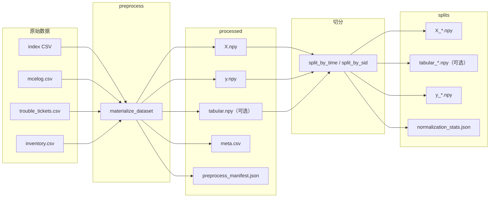

# 天池 DRAM 故障预测 · 空间热图 Grid CNN

本仓库为 **服务器 DRAM 相关故障二分类**：在每条样本的锚点时刻 `predict_time`，用 **时间窗口内 mcelog** 与 **inventory 台账** 预测：在 `label_backtrace_seconds` 回溯窗口内是否出现符合 `failure_type` 筛选的 **工单级** 故障（与 `trouble_tickets` 对齐）。

- **默认表示**（`configs/data.yaml` → `grid_representation: spatial_heatmap`）：将逻辑 **row/col 分箱** 为 **H×W=128×32**（`row_bin_size`×`col_bin_size` 默认 1024×32），**bankid 0–15** 为 **16 个通道** 累计 CE 后 `log1p`；可选将 **inventory one-hot** 平铺为 **15 个空间通道** 与 bank 热图拼接，即 **`X` 为 [N,31,128,32]**，此时尚无独立 `tabular.npy`，`model.tabular_dim=0`。
- **调试/兼容**（`configs/experiments/exp_baseline.yaml`）：`legacy_rc_et` 为 **原始 row/col 下标 + read/scrub/type0 三通道** 等旧行为，并保留 **独立 `tabular.npy`**（`tabular_dim=15`）。

细字段、打标与配置见 **`docs/tianchi_pipeline.md`**；**从原始表到张量的分步说明**见 **`docs/data_processing_guide.md`**。训练/推理只读 **`data/splits/*.npy`**，不直接读 `data/raw`；**改数据或 `grid_representation` / 窗口 / 网格后须重跑 preprocess**。

---

## 项目概述

| 维度 | 说明 |
|------|------|
| **任务** | 二分类：回溯窗口内是否出现符合条件的故障工单 |
| **输入（预处理后）** | **`X`**：`[N,C,H,W]`；默认 **C=31**（16 bank + 15 inventory 通道）或 **legacy 下 C=3 + `tabular` [N,15]** |
| **标签** | **`y`**∈{0,1}，由工单 `failed_time` 与 `predict_time` 按配置对齐 |
| **模型** | **`GridCNN`**：Conv-BN-ReLU-Pool → 全局池化 →（`tabular_dim>0` 时与 tabular 融合）→ MLP 头 |

---

## 核心概念（精简）

1. **索引表**：每行一条样本，至少 **`sid`**, **`predict_time`**（解析为 Unix 秒 `predict_ts`）；行数与顺序完全由索引 CSV 决定。
2. **事件窗口**：半开区间 **`[predict_ts − window_seconds, predict_ts)`**。默认 **`window_seconds=21600`（6h）**；`exp_baseline` 等为冒烟可用 300s。
3. **网格 `X`**：
   - **spatial**：仅默认累计 **`error_type`∈{1,2}**（Read/Scrub），需 `mcelog` 含 **`bankid`**（缺列则视为 0）；坐标超出分箱范围会 clip 到网格边界。
   - **legacy**：`error_type<3`，按原始 `(row,col)` 落入网格；见 `docs/tianchi_pipeline.md`。
4. **工单标签**：同一 `sid` 若存在 **`predict_ts ≤ failed_ts ≤ predict_ts + label_backtrace_seconds`** 且类型命中列表则 **y=1**。默认回溯 **7 天**（`604800` 秒）。
5. **Inventory**：15 维 one-hot；拼入 **`X` 通道** 或写入 **`tabular.npy`** 由 **`inventory_as_grid_channels`** 决定。

---

## 端到端流水线



1. **`materialize_dataset`**：读 mcelog 建按 sid 时间序事件 → 按索引行填 **`X`** / 可选 **`tabular`** → `processed/`；manifest 记录 **`grid_shape`、`schema`、`tabular_dim`** 等。Linux 上可对「按 sid 排序」「填网格」并行（见 manifest 中 `preprocess_*_parallel`）。
2. **切分**：仅用 train 拟合 **网格与 tabular** 的标准化（若存在 tabular）。
3. **`train_model` / infer**：读 `splits`；**`tabular_dim=0`** 时 DataLoader 仅返回 **`x, y`**。

---

## 配置与目录（速查）

| 说明 | 位置 |
|------|------|
| 数据与网格模式 | `configs/data.yaml`（`grid_representation`、`window_seconds`、`row_bin_size` 等） |
| 模型输入形状 | `configs/model.yaml`（须与 **`preprocess_manifest.json` 中 `grid_shape`** 一致） |
| 冒烟 / 全量实验 | `configs/experiments/exp_baseline.yaml`、`exp_full_best_ddp.yaml` |
| 字段详解 | `docs/data_dictionary.md`、`docs/tianchi_pipeline.md` |
| 排错 | `docs/troubleshooting.md` |

| 路径 | 内容 |
|------|------|
| `src/dram2cnn/` | `data/`（`tianchi_build`、`splitter`、`inventory_encode`）、`models/grid_cnn`、`engine/`、`pipelines/`、`utils/` |
| `scripts/` | `preprocess.sh`、`validate.sh`、`train.sh`、`train_ddp.sh`、`infer.sh`、`evaluate.sh`、`build_demo_index.py` |
| `data/processed/` | `X.npy`、`y.npy`、`meta.csv`、`preprocess_manifest.json`；**`tabular.npy` 视配置可有可无** |
| `data/splits/` | 切分后的 `X_*`、`y_*`、可选 `tabular_*`、`normalization_stats.json` |
| `runs/<run_name>/` | 训练/推理会话产物 |

---

## 环境

- Python ≥3.9（`pyproject.toml`），依赖见 `requirements.txt`。

```bash
cd /path/to/workspace
pip install -r requirements.txt
export PYTHONPATH=src
python -m pytest -q
```

---

## 推荐命令流

1. 将 `mcelog.csv`、`trouble_tickets.csv`、`inventory.csv` 放入 `data/raw/`（或配置绝对路径）。
2. 索引 CSV：`index_features_path`；演示可用 `data/index_stubs/features_5m_index_demo.csv`，全量请换真实路径。
3. 选择实验配置；与 **默认 spatial** 不一致的旧 **`processed`/`splits`** 应删除后重跑。

```bash
export PYTHONPATH=src
bash scripts/preprocess.sh configs/experiments/exp_full_best_ddp.yaml
bash scripts/validate.sh configs/experiments/exp_full_best_ddp.yaml
bash scripts/train.sh configs/experiments/exp_full_best_ddp.yaml
```

若尚未 preprocess、暂无 `data/splits/`，可先 **`bash scripts/validate.sh configs/experiments/exp_full_best_ddp.yaml --no-require-splits`** 仅校验配置与原始文件是否存在。

小样本调试可用 **`exp_baseline.yaml`**（legacy + 行数上限）。多卡：`scripts/train_ddp.sh`。版本化运行目录见 `configs/base.yaml` 中 `versioned_runs`。

---

## Notebooks 与文档索引

| Notebook | 用途 |
|----------|------|
| `01_eda.ipynb` | 原始表体量与列 |
| `02_feature_analysis.ipynb` | `X` 粗统计 |
| `03_error_analysis.ipynb` | 预测误差分析 |
| `04_run_pipelines.ipynb` | 带 marker 的流水线 |

详见 **`notebooks/README.md`**。分析产出默认在 **`outputs/`**（`.gitignore` 忽略生成文件）。

| 文档 | 内容 |
|------|------|
| `docs/tianchi_pipeline.md` | 约定式规格说明（权威速查） |
| `docs/data_processing_guide.md` | **数据集处理思路与全流程详解（新手推荐阅读）** |
| `docs/data_dictionary.md` | 表结构与产物形状 |
| `docs/troubleshooting.md` | C/H/W、tabular、预处理与训练常见问题 |

演示索引重建：**`PYTHONPATH=src python3 scripts/build_demo_index.py`**。

---

## Docker（可选）

`docker/Dockerfile`：构建后挂载本仓库，容器内 **`export PYTHONPATH=src`**，并按挂载路径修改 `configs/data.yaml`。

---

## 许可与引用

见 `pyproject.toml`。引用时请写明数据来源及与本仓库一致的 **样本定义、窗口与网格模式**（`preprocess_manifest.json`）。
