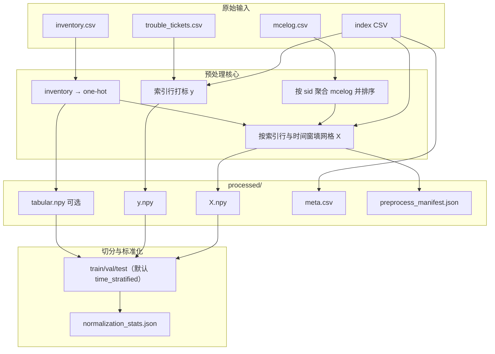

# 数据集处理详解：从原始表到训练张量

本文面向希望理解 **本仓库如何将天池式原始数据转为模型输入** 的读者，按「概念 → 流程 → 产物 → 配置」顺序展开，并与实现代码、配置文件一一对应。更精简的规则速查见 `[tianchi_pipeline.md](./tianchi_pipeline.md)`；字段级清单见 `[data_dictionary.md](./data_dictionary.md)`；**算法与数据层面的完整技术说明（含参数原理、流程图与算例）**见 `[dataset_processing_specification.md](./dataset_processing_specification.md)`。

---

## 1. 任务设定与术语

**预测目标**：在已知服务器标识 `sid`、锚点时刻 `predict_time` 的前提下，判断该服务器在随后 `label_horizon_seconds`**（默认 5 分钟）** 内是否会出现 **符合筛选条件的故障工单**（二分类标签 `y∈{0,1}`）。

**核心思想**：不把手工统计特征（如固定时间窗内的计数、MTBF 等）直接写入表格，而是先把「一段时间内的可纠正错误（CE）」在空间与类型上 **聚合为一张固定尺寸的二维网格张量**（可选叠加硬件 one-hot），再交给卷积网络学习 **空间模式**；工单标签仍由业务规则从 `trouble_tickets` 对齐得到。

下表列出后文反复出现的符号：


| 符号 / 字段                   | 含义                                                                                       |
| ------------------------- | ---------------------------------------------------------------------------------------- |
| `predict_time`            | 样本锚点；CSV 中为可读 ISO 字符串（**1970-01-01 + 相对秒**）；预处理中 `predict_ts` 为 **相对秒**（全局最早 raw 时刻 = 0） |
| `window_seconds`          | 事件窗口长度（秒）。窗口为半开区间 `[predict_ts − window_seconds, predict_ts)`，即 **仅使用锚点时刻之前** 的日志        |
| `label_horizon_seconds`   | 预测 horizon（秒）：**未来**多久内是否故障。默认 **300（5 分钟）**                                             |
| `label_backtrace_seconds` | 与 `label_horizon_seconds` 同义（字段别名）                                                       |
| `error_type`（mcelog）      | 本仓库在 spatial 默认下通常只累计 **Read CE(1)、Scrub CE(2)**；legacy 模式另含 type0 通道                    |
| `bankid`                  | DRAM Bank 编号（0–15），spatial 模式下作为 **通道维** 区分不同 Bank 上的错误密度                                |


---


## 2. 四类原始输入及其角色

处理流水线 **不人为枚举** 所有 `(sid, t)` 组合；**样本集合完全由「索引表」的行数与顺序决定**。其余三表用于构造特征与标签。

### 2.1 索引表（`index_features_path`）

- **最少列**：`sid`，`predict_time`。
- **每一行 = 一条训练/推理样本**：锚点为 `(sid, predict_time)`。
- 通常来自天池侧特征流水线导出的 `features_5m_*.csv`（名称可变），或自建脚本；仓库演示路径为 `data/index_stubs/features_5m_index_demo.csv`。
- **时间格式**：强烈建议使用 **ISO 8601**（含四位年）。若写入非标准年份字符串，pandas 可能解析错位，导致 `y` **全为 0** 或窗口取错（详见 `[troubleshooting.md](./troubleshooting.md)`）。


### 2.2 机器检错日志 `mcelog.csv`

- 核心列：`sid`，`row`，`col`，`error_type`，`error_time`；**空间热图模式**下建议使用 `bankid`（缺失时实现上视为 0）。
- 按 **服务器** `sid` 聚合后，在每条样本的时间窗口内截取子序列，用于填充网格。
- 数据量往往极大（数千万至亿级行），实现上采用 **分块** `read_csv` 控制内存，并对「按 sid 建桶 → 按时间排序」阶段在 Linux 上可选 **多进程**（见第 8 节）。


### 2.3 故障工单 `trouble_tickets.csv`（或配置中的 `tickets_path`）

- 用于生成 **标签** `y`，而非直接作为网格输入。
- 需含：`sid`，`failure_type`，`failed_time`（实现中映射为 `failed_ts`）。
- 仅 `failure_type` **落在** `label_failure_types` **配置列表中** 的工单参与打标。


### 2.4 硬件台账 `inventory.csv`

- 提供服务器级 **机型 / DIMM 容量档 / 厂商** 等离散类别，编码为 **固定 15 维 one-hot**（与竞赛侧类别集合一致，见 `dram2cnn.data.inventory_encode`）。
- 用途有两种（由配置决定，见第 5 节）：**拼入网格通道** 或 **单独** `tabular` **向量并在池化后与 CNN 特征融合**。

---


## 3. 端到端处理管线（鸟瞰）

下列流程对应 `python3 -m dram2cnn.pipelines.run_preprocess`（源码：`src/dram2cnn/pipelines/run_preprocess.py`）：先 **物化** `processed/`（可选丢弃空 mcelog 窗负样本），再 `split_by_time_stratified` **/** `split_by_time` **/** `split_by_sid` 写入 `data/splits/` 并 **robust 归一化**。




默认配置 `window_seconds = label_horizon_seconds = 300`**（5 分钟）**，特征窗长度与预测 horizon 一致；负样本索引步长 `sample_interval_seconds=300`（正样本区另用 `positive_sample_interval_seconds=60`，见 §3.5）。Horizon 对比实验（30m/1h）须 **W=H=1800/3600** 且 **重建索引 sidecar**（`label_horizon_seconds` / `window_seconds` 与 YAML 一致）。

---


## 3.5 索引表生成（`dram2cnn.pipelines.run_build_index`）

索引表仅含 `sid`**,** `predict_time`，行数与正负比例由构建策略决定（**真实打标**，非 stub 随机数）：


| 原则     | 实现                                                                                                                                                         |
| ------ | ---------------------------------------------------------------------------------------------------------------------------------------------------------- |
| 固定步长采样 | 负样本 / 近故障区：`sample_interval_seconds`（默认 300）                                                                                                               |
| 正样本区采样 | 工单失败**之前** **H 秒**内 `[ft−H, ft]` 密集取锚点；**打标**看锚点**之后**闭区间 `[predict_ts, predict_ts+H]` 是否含工单                                                               |
| 近故障负样本 | `[ft−prefault, ft−H)` 内按 `sample_interval_seconds` 取点；打标 **y=0**；负采样不足时**补齐**负类池                                                                           |
| 负样本平衡  | 全量 `uniform` 均匀采样；冒烟 `random`；目标 `target_positive_ratio`（smoke preset **0.08**）；正样本过多时按 `max_rows×ratio/(1−ratio)` 下采样                                     |
| sid 覆盖 | 负采样优先全部工单 sid，再覆盖 mcelog 其余 sid                                                                                                                            |
| 时间范围   | **负样本 / 近故障区** clamp 在 `[t_min+W, t_max−H]`；**正样本区**在 `[ft−H, ft]`（ft 可 > t_max）；bounds 扫描与 preprocess 同 **CE 过滤**（spatial 默认 `[1,2]`）；无 mcelog 的工单 sid 无法生成正锚点（`_valid_predict_bounds` 为 None） |
| 冒烟规模   | `max_rows=500` 时负样本会补满至上限；`mcelog_scan_rows` 须与实验 `mcelog_max_rows` 一致（默认 **800000**）                                                                      |


### 3.5.1 `predict_time` 步长 vs 墙钟「整 5 分钟」

常见做法之一是把锚点对齐到墙钟边界（如 3:05:00、3:10:00），以便模拟「每 5 分钟定时批跑推理」。**本仓库默认不采用墙钟对齐**，而采用：

- **正样本区**：每个故障时刻前 **H 秒**（`label_horizon_seconds`）内按 `positive_sample_interval_seconds`（默认 60s）取锚点；
- **近故障区**：再向前至 `positive_prefault_seconds`（`index_build` 基础默认 3600s；**full preset** 覆盖为 86400s/24h）按 `sample_interval_seconds` 取 hard negative 候选；
- **负样本全局**：从各 sid 合法时间轴均匀 / 随机采样，逼近 `target_positive_ratio`。

因此索引 CSV 中 `predict_time` 的**秒分量通常不是 :00/:05/:10**，属预期行为。任务语义仍为：在锚点 `predict_ts` 用 `[predict_ts−W, predict_ts)` 的 mcelog 预测 `[predict_ts, predict_ts+H]` 内是否故障；与锚点是否墙钟对齐无关。若需与线上 cron 严格一致，可在索引构建阶段另行增加墙钟 snap（当前实现未包含）。

```bash
export PYTHONPATH=src
bash scripts/build_index.sh smoke   # 推荐：写入 features_5m_index_demo.csv（~500 行）
```

Horizon 对比须先生成与实验 YAML 一致的索引，再更新 `index_features_path` 并 **重跑 preprocess**：

```bash
bash scripts/build_horizon_indexes.sh smoke   # 冒烟 stub → data/index_stubs/
bash scripts/build_horizon_indexes.sh full      # 全量 → data/raw/（耗时长）
# 切换 horizon 前清空该实验 YAML 的 processed_dir / splits_dir（30min 冒烟示例）：
rm -rf data/processed_horizon_30m_smoke/* data/splits_horizon_30m_smoke/*
bash scripts/preprocess.sh configs/experiments/exp_horizon_30m.yaml
```

---


## 4. 时间处理与事件窗口


### 4.1 统一时间基准（相对秒）

raw CSV（mcelog / tickets / 遗留索引）中的时间先解析为 **绝对 Unix 秒**，再减去全局最早时刻 `t₀`（`time_epoch_offset_absolute`，见 `preprocess_manifest.json`），得到 **相对秒**：

```text
predict_ts = t_absolute − t₀    （全数据最早事件 → 0）
```

实现见 `dram2cnn.data.time_axis` 与 `tianchi_build.materialize_dataset`。索引 CSV 的 `predict_time` 以 **1970-01-01 00:00:00 + 相对秒** 的 ISO 字符串存储（便于阅读；读回后数值即 `predict_ts`）；`build_index` 同时写入 sidecar `*.csv.stats.json`（`time_axis`、`time_epoch_offset_absolute`），preprocess 优先据此识别格式。**窗口、打标、时间切分**只依赖相对先后与秒级差值，与是否使用公历 1970/0001 无关。

**区间约定**（实现与文档一致）：

- 特征窗：**半开** `[predict_ts − W, predict_ts)`（锚点时刻的事件 **不** 进入特征）
- 标签窗：**闭** `[predict_ts, predict_ts + H]`


### 4.2 半开区间 `[t_end − W, t_end)`

对样本 `i`，记锚点 `t_end = predict_ts`，窗口长度 `W = window_seconds`。

- **落入窗口的事件**满足：`t_end − W ≤ error_time < t_end`（实现上用 `searchsorted` 在已排序的时间数组上取切片，复杂度接近窗口内事件条数）。
- **不使用锚点之后的日志**，避免信息泄漏；这与「在 `predict_time` 时刻做预测」的设定一致。

默认 `window_seconds = label_horizon_seconds = 300`**（5 分钟）**。Horizon 实验须同步改 W/H 并重建索引（见 §3.5 与 `build_horizon_indexes.sh`）。

### 4.3 合法锚点区间（索引构建）

对每个 sid，mcelog 观测时间为 `[t_min, t_max]`（相对秒）。**负样本 / 近故障区 / 均匀网格**锚点须满足：

```text
t_min + W ≤ predict_ts ≤ t_max − H
```

**正样本区**在每条工单失败时刻 **ft** 前的 `[ft−H, ft]` 密集采样；**ft 可晚于 t_max**（故障在 mcelog 观测结束之后仍可能打 y=1，特征窗或为空，由 preprocess 保留正样本空窗）。

右界 `t_max − H` 为右删截：避免**无工单先验**的锚点其标签窗 `[predict_ts, predict_ts+H]` 超出以 mcelog 为 proxy 的数据末尾。

实现见 `index_builder._valid_predict_bounds`；preprocess 会校验索引 sidecar 的 `window_seconds` / `label_horizon_seconds` 与当前 YAML 一致。

---


## 5. 网格表示：两种模式（配置：`grid_representation`）

本仓库支持两种互斥（由配置选择）的 **从事件到张量** `X[i]∈ℝ^{C×H×W}` 的映射。初学者可按下表对照：


| 模式            | 配置值               | 典型 `X` 形状（默认 model）                  | 适用场景                     |
| ------------- | ----------------- | ------------------------------------ | ------------------------ |
| 空间热图 + 硬件通道拼接 | `spatial_heatmap` | `[31, 128, 32]`                      | 全量、对齐天池 132973 空间建模报告    |
| 原始坐标 + 误差类型通道 | `legacy_rc_et`    | `[3, H, W]`（如 256×256）+ 可选 `tabular` | 单元测试与 legacy 调试（非默认冒烟路径） |


以下分述。

### 5.1 `spatial_heatmap`（默认）

**动机**：DRAM 逻辑地址在 **row / col / bank** 上具有物理邻接关系；将海量 `(row,col)` 映射到固定大小的 **二维分箱（bin）**，在每个 bin 内按 **Bank** 累计 CE 次数，得到「热图」；再对计数做 `log1p` 压缩动态范围，便于神经网络与标准化。

**分箱尺寸（与逻辑地址空间对齐）**

- 典型逻辑地址范围：**row ∈ [0, 131071]，col ∈ [0, 1023]**（以天池公开 schema 为例）。
- 取 `row_bin_size=1024`，`col_bin_size=32`，则：
  - **竖直方向 bin 数** \(H = \lceil 131072 / 1024 \rceil = 128\)
  - **水平方向 bin 数** \(W = \lceil 1024 / 32 \rceil = 32\)

对每条事件，计算：

\[
\text{rowbin} = \left\lfloor \frac{\text{row}}{\text{row\_bin\_size}} \right\rfloor,\quad
\text{colbin} = \left\lfloor \frac{\text{col}}{\text{col\_bin\_size}} \right\rfloor
\]

并在 `[0, H-1]×[0, W-1]` 内截断（clip），避免偶发越界地址破坏张量形状。

**Bank 通道**

- 对每个 `(row_bin, col_bin, bankid)` 位置累计事件条数（默认仅统计 `error_type ∈ {1,2}`，可由 `mcelog_error_type_filter` 修改）。
- 得到 `num_bank_channels`**（默认 16）** 个平面，每个平面是一张 **H×W** 的热图；再对每个平面逐元素 `log1p`。

**Inventory 与网格的两种结合方式**

1. `inventory_as_grid_channels: true`**（默认）**
  将长度为 15 的 one-hot **按通道复制到整张 H×W**（即对每个空间位置相同），得到 15 个额外通道，与 16 个 Bank 通道拼接 → `C = 31`。  
   此时 **不写** `tabular.npy`，模型侧 `tabular_dim = 0`，硬件信息完全由 **卷积早期层** 与空间模式联合建模。
2. `inventory_as_grid_channels: false`
  `X` **仅含 Bank 通道（C=16）**，inventory 仍以 `tabular.npy`（`[N,15]`）保存，在 **全局池化后** 与网格向量融合（`tabular_dim=15`）。


### 5.2 `legacy_rc_et`（调试）

**动机**：在小样本或回归测试中，可用较小网格快速验证流水线。

- 将窗口内事件的 **原始** `row`**、**`col` 直接当作网格索引（并与 `grid_max_row/col`、`model.grid_height/width` 联合约束），按 `error_type` 分到 **最多 3 个通道**（read / scrub / 以及 type0 可选）。
- 与 spatial 的 **分箱 + bank** 语义不同；切换模式后 **必须重跑 preprocess**，否则 `preprocess_manifest.json` 与 `model.yaml` 会与磁盘张量不一致。

---


## 6. 标签生成（`y`）

对每条索引样本：

1. 读取工单表中 `failure_type ∈ label_failure_types` 的记录；
2. 对同一 `sid`，将所有候选工单的 `failed_ts` **排序**；
3. 判断是否存在工单满足：
  `predict_ts ≤ failed_ts ≤ predict_ts + label_horizon_seconds`
4. 若存在则 `y=1`，否则 `y=0`。

实现上使用 `searchsorted` 在一次顺序扫描内完成判定，避免对每条样本线性扫描全表工单（见 `merge_ticket_labels`）。

默认 `label_horizon_seconds = 300`**（5 分钟）**：若存在工单满足 `predict_ts ≤ failed_ts ≤ predict_ts + label_horizon_seconds`，则 `y=1`。字段 `label_backtrace_seconds` 与之同义。可按业务改为 1800、3600 等，并同步重建索引表。

---


## 7. 预处理产物说明（`data/processed/`）


| 文件                         | 含义                                                                                                                                                         |
| -------------------------- | ---------------------------------------------------------------------------------------------------------------------------------------------------------- |
| `X.npy`                    | `float32`，形状 `[N, C, H, W]`，与 `model.yaml` 及 manifest 一致                                                                                                   |
| `y.npy`                    | `int64`，长度 `N`                                                                                                                                             |
| `tabular.npy`              | 若配置写出存在，`float32`，`[N, 15]`；spatial 且 inventory 已拼入通道时常 **不存在**                                                                                            |
| `meta.csv`                 | 样本级元数据：`sid`，`predict_time`，`label`，`predict_ts`，`empty_mcelog_window`（1=特征窗内无 mcelog 事件）                                                                  |
| `preprocess_manifest.json` | **权威元数据**：`grid_shape`、`schema`、`n_samples`、`pos_rate`、`drop_empty_mcelog_windows`、`n_empty_grids`、`n_empty_grids_dropped`、`n_empty_grids_kept_positive` 等 |


**注意**：修改 `configs/data.yaml` **或** `configs/model.yaml` **中与形状相关的项** 后，务必**清空** `processed/`、`splits/` 并重跑预处理，否则后续 `validate` 或训练会报 **C/H/W 或 tabular 维不一致**。

---


## 8. 切分与标准化（`data/splits/`）

1. **划分策略**（`split_strategy`）：默认 `time_stratified`；跨服务器泛化用 `sid`（见 `exp_full_f1_sid.yaml` / `exp_full_recall_sid.yaml`，可 `bash scripts/resplit.sh` 在已有 `processed/` 上重切分）。
2. **归一化**（`normalization_method`）：默认 `robust`（median / IQR，仅用 train 拟合）；可选 `zscore`。归一化后默认 **clip 到 ±**`normalization_clip`（20）。见 `splitter.normalize_split_features_by_train`。
3. **空窗样本**（`drop_empty_mcelog_windows`，默认 true）：丢弃 **负样本** 中空 mcelog 窗行。**正样本** 默认保留空窗；工程模式 `drop_empty_positive_windows: true` 时正样本空窗也丢弃（见 `exp_full_recall_`* / Notebook **05**）。manifest 记录 `n_empty_grids_dropped` / `n_empty_grids_kept_positive`。

由此得到 `X_train.npy` 等及 `normalization_stats.json`（含 `method: robust|zscore`）。

---


## 9. 性能与并行（简要）

全量数据下，耗时主要来自：

1. **顺序遍历** `mcelog.csv`（构建每个 `sid` 的事件桶）；
2. **对每个** `sid` **的事件按时间排序**；
3. **对每条索引样本切片窗口并填网格**。

在 **Linux** 上，(2)(3) 在满足 sid 数、样本数等阈值时可使用 `fork` **多进程**（见 manifest 中 `preprocess_events_finalize_parallel`、`preprocess_grid_fill_parallel`）。**顺序读 CSV** 本身仍为单线程流式；非 Linux 环境为稳妥起见上述并行常关闭。

并行进程数由 `preprocess_workers`（显式整数）或 `null` **+** `preprocess_parallel_frac`（按 `os.cpu_count()` 比例推算，**默认约 60%**）控制。全局 `ram_budget_frac: 0.5` 按样本数/网格/mcelog 自动 `min(CPU, RAM)` 限 worker（系统内存峰值 ≤50%，非显存）。各入口脚本会 `source scripts/lib/env_perf.sh`，设置 `OMP_NUM_THREADS=1` 等，避免 fork 与 BLAS 多线程叠加。

**训练阶段**：`train.num_workers` / `prefetch_factor` 控制 DataLoader 预取（全量 DDP 默认 **2** worker）；多卡见 `bash scripts/train_ddp.sh`。

---


## 10. 下游模型：GridCNN（`model.yaml` / `model_smoke.yaml`）

预处理产出的 `X` 为固定尺寸 `[N, C, H, W]`（默认 `[N, 31, 128, 32]`）。**GridCNN-Deep**（`configs/model.yaml`）将其视为多通道「故障密度图像」；**冒烟 baseline** 使用更浅的 `model_smoke.yaml`（同 C/H/W，参数量约 1/4）。

**结构概要**（实现见 `src/dram2cnn/models/grid_cnn.py`）：

1. **Stem Conv**：将 31 通道映射到 `stem_channels`（默认 64）；
2. **4×Stage（默认）**：每 stage 含 `blocks_per_stage` 个卷积/残差块 + **MaxPool(2)**，空间尺寸逐级减半（128×32 → 64×16 → … → 8×2）；Optuna 可搜 **3～4 stage**（见 `configs/hpo/hpo.yaml` 的 `backbone_depth`）；
3. **Global Average Pooling**：将任意 stage 输出压成长度 = 末 stage 通道数的向量；
4. **MLP 头**：Linear → ReLU → Dropout → Linear → **2 类 logits**。

**与数据管道的关系**：


| 配置项                                        | 须与预处理一致                                                 |
| ------------------------------------------ | ------------------------------------------------------- |
| `in_channels`, `grid_height`, `grid_width` | `preprocess_manifest.json` / `X.npy`                    |
| `tabular_dim`                              | manifest 中 tabular 维；spatial 默认 inventory 已拼入通道时为 **0** |


**注意**：修改 `backbone_channels`**、**`blocks_per_stage`**、**`use_residual` 等**仅影响模型结构**，**不必重跑 preprocess**，但**须重新训练**（checkpoint 须与当前 backbone 结构一致）。修改 **C/H/W** 相关项则须重跑 preprocess。

默认 spatial 配置约 **19 个 Conv2d、~5.9M 参数**。结构超参可由 `scripts/optuna.sh` 搜索（见 `configs/hpo/hpo.yaml`）。

---


## 11. 与验证、训练衔接

- `scripts/validate.sh`：检查配置、路径及 **processed/splits 张量形状**是否与 `model.yaml` 一致。若尚未生成切分，可使用 `--no-require-splits` 仅做配置级检查（见 `[troubleshooting.md](./troubleshooting.md)`）。
- **训练**读取 `data/splits/` 下 `X_`*、`y_*` 及可选 `tabular_*`；`tabular_dim=0` 时 DataLoader 仅提供 `(x, y)`。

---


## 12. 建议阅读顺序（新手）

1. 本文 **第 2–6 节**（输入与时间、标签）。
2. `[dataset_processing_specification.md](./dataset_processing_specification.md)`（算法向完整说明、参数原理与算例）。
3. `[tianchi_pipeline.md](./tianchi_pipeline.md)`（配置字段速查）。
4. `[data_dictionary.md](./data_dictionary.md)`（列名与产物形状）。
5. `[troubleshooting.md](./troubleshooting.md)`（常见配置错误与时间格式问题）。

实现入口：`dram2cnn.data.tianchi_build.materialize_dataset`、`dram2cnn.data.splitter`。

---


## 13. 修订说明

本文档随仓库默认配置（`spatial_heatmap`**、5 分钟特征窗与预测 horizon**）编写；若你修改 `configs/data.yaml` / `experiments/*.yaml`，请以当前 `preprocess_manifest.json` 为运行期事实来源。