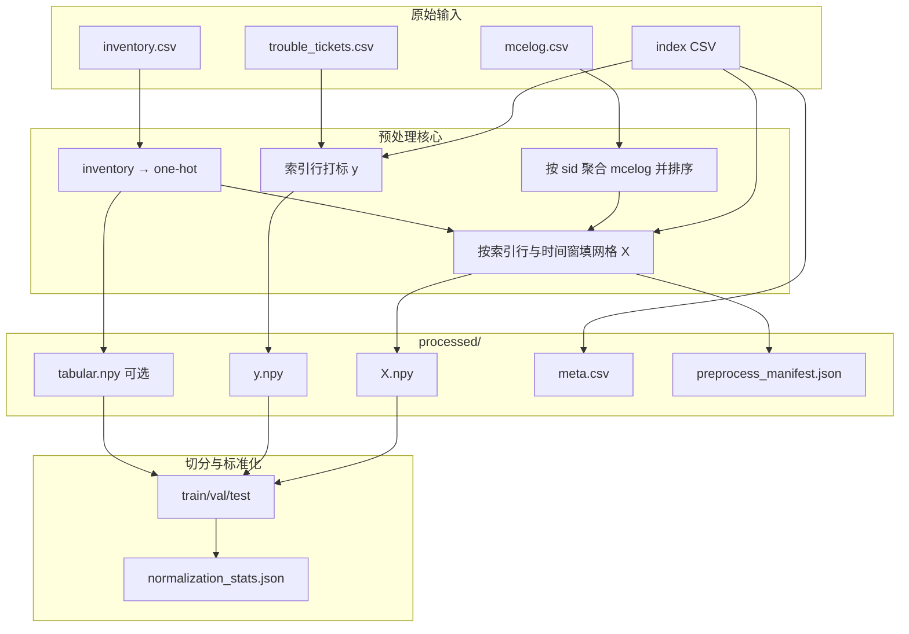

# 数据集处理详解：从原始表到训练张量

本文面向希望理解 **本仓库如何将天池式原始数据转为模型输入** 的读者，按「概念 → 流程 → 产物 → 配置」顺序展开，并与实现代码、配置文件一一对应。更精简的规则速查见 [`tianchi_pipeline.md`](./tianchi_pipeline.md)；字段级清单见 [`data_dictionary.md`](./data_dictionary.md)。

---

## 1. 任务设定与术语

**预测目标**：在已知服务器标识 `sid`、锚点时刻 `predict_time` 的前提下，判断该服务器在随后一段 **配置的回溯时间** 内是否会出现 **符合筛选条件的故障工单**（二分类标签 `y∈{0,1}`）。

**核心思想**：不把手工统计特征（如固定时间窗内的计数、MTBF 等）直接写入表格，而是先把「一段时间内的可纠正错误（CE）」在空间与类型上 **聚合为一张固定尺寸的二维网格张量**（可选叠加硬件 one-hot），再交给卷积网络学习 **空间模式**；工单标签仍由业务规则从 `trouble_tickets` 对齐得到。

下表列出后文反复出现的符号：

| 符号 / 字段 | 含义 |
|-------------|------|
| `predict_time` | 样本锚点，CSV 中为可读时间字符串，预处理中解析为 Unix 秒 `predict_ts` |
| `window_seconds` | 事件窗口长度（秒）。窗口为半开区间 **`[predict_ts − window_seconds, predict_ts)`**，即 **仅使用锚点时刻之前** 的日志 |
| `label_backtrace_seconds` | 打标用回溯长度（秒）。若存在工单满足 **`predict_ts ≤ failed_ts ≤ predict_ts + label_backtrace_seconds`**，则 `y=1` |
| `error_type`（mcelog） | 本仓库在 spatial 默认下通常只累计 **Read CE(1)、Scrub CE(2)**；legacy 模式另含 type0 通道 |
| `bankid` | DRAM Bank 编号（0–15），spatial 模式下作为 **通道维** 区分不同 Bank 上的错误密度 |

---

## 2. 四类原始输入及其角色

处理流水线 **不人为枚举** 所有 `(sid, t)` 组合；**样本集合完全由「索引表」的行数与顺序决定**。其余三表用于构造特征与标签。

### 2.1 索引表（`index_features_path`）

- **最少列**：`sid`，`predict_time`。
- **每一行 = 一条训练/推理样本**：锚点为 `(sid, predict_time)`。
- 通常来自天池侧特征流水线导出的 `features_5m_*.csv`（名称可变），或自建脚本；仓库演示路径为 `data/index_stubs/features_5m_index_demo.csv`。
- **时间格式**：强烈建议使用 **ISO 8601**（含四位年）。若写入非标准年份字符串，pandas 可能解析错位，导致 **`y` 全为 0** 或窗口取错（详见 [`troubleshooting.md`](./troubleshooting.md)）。

### 2.2 机器检错日志 `mcelog.csv`

- 核心列：`sid`，`row`，`col`，`error_type`，`error_time`；**空间热图模式**下建议使用 **`bankid`**（缺失时实现上视为 0）。
- 按 **服务器 `sid`** 聚合后，在每条样本的时间窗口内截取子序列，用于填充网格。
- 数据量往往极大（数千万至亿级行），实现上采用 **分块 `read_csv`** 控制内存，并对「按 sid 建桶 → 按时间排序」阶段在 Linux 上可选 **多进程**（见第 8 节）。

### 2.3 故障工单 `trouble_tickets.csv`（或配置中的 `tickets_path`）

- 用于生成 **标签 `y`**，而非直接作为网格输入。
- 需含：`sid`，`failure_type`，`failed_time`（实现中映射为 `failed_ts`）。
- 仅 **`failure_type` 落在 `label_failure_types` 配置列表中** 的工单参与打标。

### 2.4 硬件台账 `inventory.csv`

- 提供服务器级 **机型 / DIMM 容量档 / 厂商** 等离散类别，编码为 **固定 15 维 one-hot**（与竞赛侧类别集合一致，见 `dram2cnn.data.inventory_encode`）。
- 用途有两种（由配置决定，见第 5 节）：**拼入网格通道** 或 **单独 `tabular` 向量并在池化后与 CNN 特征融合**。

---

## 3. 端到端处理管线（鸟瞰）

下列流程对应脚本入口 `pipelines/run_preprocess.py`：先 **物化 `processed/`**，再 **`split_by_time` 或 `split_by_sid`** 写入 `data/splits/`。

**要点**：`X` 与 `y` 的第 `i` 行严格对应索引表第 `i` 行；`meta.csv` 保存 `sid`、`predict_time`、`label`、`predict_ts` 便于追溯。

---

## 4. 时间处理与事件窗口

### 4.1 统一时间基准

所有时间列经 pandas 解析后，在代码中统一转为 **Unix 秒（浮点）**，避免混用 `datetime64` 精度与错误整数除法。实现见 `tianchi_build._series_to_unix_seconds`。

### 4.2 半开区间 `[t_end − W, t_end)`

对样本 `i`，记锚点 `t_end = predict_ts`，窗口长度 `W = window_seconds`。

- **落入窗口的事件**满足：`t_end − W ≤ error_time < t_end`（实现上用 `searchsorted` 在已排序的时间数组上取切片，复杂度接近窗口内事件条数）。
- **不使用锚点之后的日志**，避免信息泄漏；这与「在 `predict_time` 时刻做预测」的设定一致。

默认配置将 `window_seconds` 设为 **6 小时（21600 秒）**（与天池 132973 分析报告中推荐的聚合尺度一致）；调试或对齐旧实验可改为 300 秒（5 分钟）。

---

## 5. 网格表示：两种模式（配置：`grid_representation`）

本仓库支持两种互斥（由配置选择）的 **从事件到张量 `X[i]∈ℝ^{C×H×W}`** 的映射。初学者可按下表对照：

| 模式 | 配置值 | 典型 `X` 形状（默认 model） | 适用场景 |
|------|--------|------------------------------|----------|
| 空间热图 + 硬件通道拼接 | `spatial_heatmap` | `[31, 128, 32]` | 全量、对齐天池 132973 空间建模报告 |
| 原始坐标 + 误差类型通道 | `legacy_rc_et` | `[3, H, W]`（如 256×256）+ 可选 `tabular` | 小数据冒烟、与旧 notebook 对齐 |

以下分述。

### 5.1 `spatial_heatmap`（默认）

**动机**：DRAM 逻辑地址在 **row / col / bank** 上具有物理邻接关系；将海量 `(row,col)` 映射到固定大小的 **二维分箱（bin）**，在每个 bin 内按 **Bank** 累计 CE 次数，得到「热图」；再对计数做 **`log1p`** 压缩动态范围，便于神经网络与标准化。

**分箱尺寸（与逻辑地址空间对齐）**

- 典型逻辑地址范围：**row ∈ [0, 131071]，col ∈ [0, 1023]**（以天池公开 schema 为例）。
- 取 `row_bin_size=1024`，`col_bin_size=32`，则：
  - **竖直方向 bin 数** \(H = \lceil 131072 / 1024 \rceil = 128\)
  - **水平方向 bin 数** \(W = \lceil 1024 / 32 \rceil = 32\)

对每条事件，计算：

\[
\text{row\_bin} = \left\lfloor \frac{\text{row}}{\text{row\_bin\_size}} \right\rfloor,\quad
\text{col\_bin} = \left\lfloor \frac{\text{col}}{\text{col\_bin\_size}} \right\rfloor
\]

并在 `[0, H-1]×[0, W-1]` 内截断（clip），避免偶发越界地址破坏张量形状。

**Bank 通道**

- 对每个 `(row_bin, col_bin, bankid)` 位置累计事件条数（默认仅统计 `error_type ∈ {1,2}`，可由 `mcelog_error_type_filter` 修改）。
- 得到 **`num_bank_channels`（默认 16）** 个平面，每个平面是一张 **H×W** 的热图；再对每个平面逐元素 **`log1p`**。

**Inventory 与网格的两种结合方式**

1. **`inventory_as_grid_channels: true`（默认）**  
   将长度为 15 的 one-hot **按通道复制到整张 H×W**（即对每个空间位置相同），得到 15 个额外通道，与 16 个 Bank 通道拼接 → **`C = 31`**。  
   此时 **不再写出** `tabular.npy`，模型侧 **`tabular_dim = 0`**，硬件信息完全由 **卷积早期层** 与空间模式联合建模。

2. **`inventory_as_grid_channels: false`**  
   **`X` 仅含 Bank 通道（C=16）**，inventory 仍以 **`tabular.npy`**（`[N,15]`）保存，在 **全局池化后** 与网格向量融合（`tabular_dim=15`）。

### 5.2 `legacy_rc_et`（调试）

**动机**：在小样本或回归测试中，可用较小网格快速验证流水线。

- 将窗口内事件的 **原始 `row`、`col`** 直接当作网格索引（并与 `grid_max_row/col`、`model.grid_height/width` 联合约束），按 **`error_type`** 分到 **最多 3 个通道**（read / scrub / 以及 type0 可选）。
- 与 spatial 的 **分箱 + bank** 语义不同；切换模式后 **必须重跑 preprocess**，否则 `preprocess_manifest.json` 与 `model.yaml` 会与磁盘张量不一致。

---

## 6. 标签生成（`y`）

对每条索引样本：

1. 读取工单表中 **`failure_type ∈ label_failure_types`** 的记录；
2. 对同一 `sid`，将所有候选工单的 `failed_ts` **排序**；
3. 判断是否存在工单满足：

   **`predict_ts ≤ failed_ts ≤ predict_ts + label_backtrace_seconds`**

4. 若存在则 **`y=1`**，否则 **`y=0`**。

实现上使用 **`searchsorted`** 在一次顺序扫描内完成判定，避免对每条样本线性扫描全表工单（见 `merge_ticket_labels`）。

默认 **`label_backtrace_seconds = 604800`（7 天）**，与常见「未来一周是否故障」预测 horizon 表述一致；可按业务缩短或延长。

---

## 7. 预处理产物说明（`data/processed/`）

| 文件 | 含义 |
|------|------|
| `X.npy` | `float32`，形状 `[N, C, H, W]`，与 `model.yaml` 及 manifest 一致 |
| `y.npy` | `int64`，长度 `N` |
| `tabular.npy` | 若配置写出存在，`float32`，`[N, 15]`；spatial 且 inventory 已拼入通道时常 **不存在** |
| `meta.csv` | 样本级元数据：`sid`，`predict_time`，`label`，`predict_ts` |
| `preprocess_manifest.json` | **权威元数据**：`grid_shape`、`schema`、`tabular_dim`、`window_seconds`、`grid_representation`、并行是否启用等 |

**注意**：修改 **`configs/data.yaml` 或 `configs/model.yaml` 中与形状相关的项** 后，务必删除旧 `processed/`、`splits/` 并重跑预处理，否则后续 `validate` 或训练会报 **C/H/W 或 tabular 维不一致**。

---

## 8. 切分与标准化（`data/splits/`）

1. **划分策略**（`split_strategy`）：默认按索引行的 **`predict_ts` 排序后** 按时间比例切分为 train/val/test，避免未来信息泄漏到过去（随机按 `sid` 划分是另一种可选策略）。
2. **标准化**：  
   - 对 **`X`**：仅用 **训练集** 计算每个 **(C, h, w)** 位置的均值与标准差，再应用到 val/test（见 `splitter.normalize_split_features_by_train`）。  
   - 对 **`tabular`**（若存在）：按 **特征维** 用训练集估计 mean/std。

由此得到 `X_train.npy` 等及 `normalization_stats.json`。

---

## 9. 性能与并行（简要）

全量数据下，耗时主要来自：

1. **顺序遍历 `mcelog.csv`**（构建每个 `sid` 的事件桶）；
2. **对每个 `sid` 的事件按时间排序**；
3. **对每条索引样本切片窗口并填网格**。

在 **Linux** 上，(2)(3) 在满足 sid 数、样本数等阈值时可使用 **`fork` 多进程**（见 manifest 中 `preprocess_events_finalize_parallel`、`preprocess_grid_fill_parallel`）。**顺序读 CSV** 本身仍为单线程流式；非 Linux 环境为稳妥起见上述并行常关闭。

并行进程数由 **`preprocess_workers`**（显式整数）或 **`null` + `preprocess_parallel_frac`**（按 `os.cpu_count()` 比例推算，**默认约 60%**，见 `dram2cnn.utils.preprocess_parallelism`）控制。

---

## 10. 与验证、训练衔接

- **`scripts/validate.sh`**：检查配置、路径及 **processed/splits 张量形状**是否与 `model.yaml` 一致。若尚未生成切分，可使用 **`--no-require-splits`** 仅做配置级检查（见 [`troubleshooting.md`](./troubleshooting.md)）。
- **训练**读取 `data/splits/` 下 `X_*`、`y_*` 及可选 `tabular_*`；**`tabular_dim=0`** 时 DataLoader 仅提供 `(x, y)`。

---

## 11. 建议阅读顺序（新手）

1. 本文 **第 2–6 节**（输入与时间、标签）。  
2. [`tianchi_pipeline.md`](./tianchi_pipeline.md)（配置字段速查）。  
3. [`data_dictionary.md`](./data_dictionary.md)（列名与产物形状）。  
4. [`troubleshooting.md`](./troubleshooting.md)（常见配置错误与时间格式问题）。

实现入口：`dram2cnn.data.tianchi_build.materialize_dataset`、`dram2cnn.data.splitter`。

---

## 修订说明

本文档随仓库默认配置（**`spatial_heatmap`、6h 窗口、7 天回溯**）编写；若你修改 `configs/data.yaml` / `experiments/*.yaml`，请以当前 **`preprocess_manifest.json`** 与 **`normalization_stats.json`** 为运行期事实来源。
