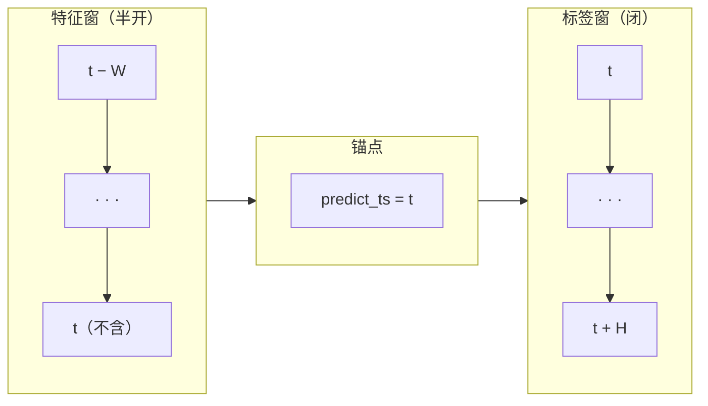
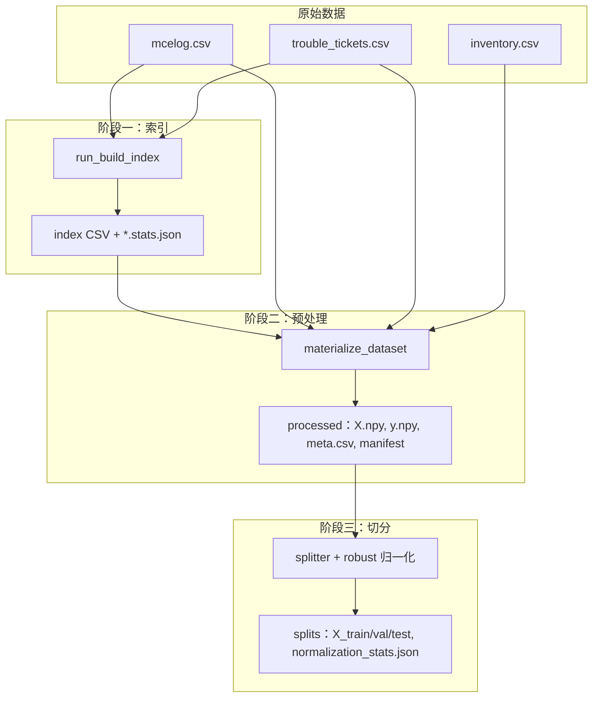
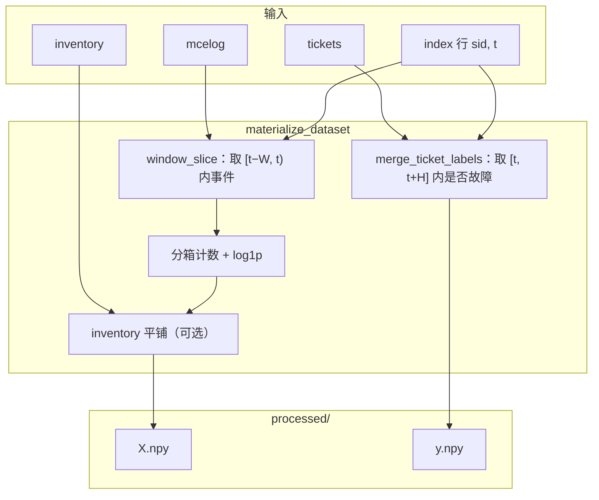

# 数据集处理技术说明（算法与数据层面）

**文档编号**：DRAM2CNN-DATA-2026-001  
**适用范围**：dram2cnn 仓库 · 天池 DRAM 故障预测任务  
**关联文档**：[`data_processing_guide.md`](./data_processing_guide.md)（操作流程说明）、[`data_dictionary.md`](./data_dictionary.md)（字段清单）  
**主要代码**：`dram2cnn.data.index_builder`、`dram2cnn.data.tianchi_build`、`dram2cnn.data.splitter`

---

## 摘要

运维场景下，需要在某一时刻根据**该时刻之前**的内存可纠正错误（CE）日志，判断**未来一段时间内**是否会发生需处置的故障工单。本仓库将该问题建模为二分类监督学习：每条样本由「服务器 \(sid\) + 锚点时刻 \(t\)」唯一确定，输入为锚点前的 CE 与硬件台账，输出为未来 \(H\) 秒内是否故障。

为实现上述建模，数据处理遵循三条主线：（1）用相对秒统一 mcelog、tickets、索引的时间轴，并以半开特征窗、闭标签窗保证「只用过去预测未来」；（2）用索引表显式列出样本锚点，而不是枚举所有 \((sid, t)\) 组合；（3）将窗内 CE 分箱为固定尺寸空间热图，再经 log1p 与 robust 归一化后供 GridCNN 训练。下文按「任务与参数 → 时间与窗口 → 处理流程 → 算例」展开，并在各节说明**为何如此设计**以及**字段、公式与代码的对应关系**。

**关键词**：样本构造；时间窗口；空间热图；索引采样；标签关联；类别不平衡

---

## 1 任务定义与参数体系

本说明与 [`data_processing_guide.md`](./data_processing_guide.md) 及当前源码对照编写，侧重原理与对应关系；具体命令与路径见操作文档。

### 1.1 预测问题：输入、输出与时间窗

**业务问题**：在时刻 \(t\) 对服务器 \(sid\) 做一次预测——未来 \(H\) 秒内是否会出现符合规则的故障工单。

**对应到数据与代码**：

| 概念 | 含义 | 主要数据来源 | 代码字段 / 输出 |
|------|------|--------------|-----------------|
| 锚点 | 预测发生的时刻 | 索引表 `predict_time` → `predict_ts` | `meta.csv` 中的 `predict_ts` |
| 输入特征 | 锚点**之前** \(W\) 秒内的 CE 空间分布 + 硬件属性 | `mcelog.csv`、`inventory.csv` | 预处理输出 `X.npy`（及可选 `tabular.npy`） |
| 监督标签 | 锚点**之后** \(H\) 秒内是否故障 | `trouble_tickets.csv` | 预处理输出 `y.npy` |
| 特征窗长度 | 看多长的历史 CE | `configs/data.yaml` → `window_seconds` | 符号 \(W\)，默认 300 秒 |
| 标签窗长度 | 预测多长的未来 | `label_horizon_seconds`（别名 `label_backtrace_seconds`） | 符号 \(H\)，默认 300 秒 |

**形式化定义**：

- 特征窗（半开，只用过去）：\(\mathcal{W}_{\text{feat}}(t) = [t - W,\, t)\)
- 标签窗（闭，判定未来）：\(\mathcal{W}_{\text{label}}(t) = [t,\, t + H]\)
- 标签：\(y = 1\) 当且仅当存在该 sid 的工单失败时刻 \(\tau\)，满足 \(t \le \tau \le t + H\)，且 `failure_type` 落在配置的 `label_failure_types` 内；否则 \(y = 0\)

特征 \(\mathbf{X}(sid, t) \in \mathbb{R}^{C \times H_g \times W_g}\) 由 \(\mathcal{W}_{\text{feat}}(t)\) 内 CE 分箱聚合得到（默认 \(C=31,\ H_g=128,\ W_g=32\)），供二维卷积学习 row/col/bank 上的空间模式。

**为何用索引表而不是全量枚举**：mcelog 中 \((sid, \text{时间})\) 组合极多，且绝大多数时刻 \(y=0\)。索引表只列出需要参与训练/评估的锚点 \((sid_i, t_i)\)，并由 `run_build_index` 控制正负样本比例与采样密度；预处理 `materialize_dataset` 再对索引**逐行**生成 \(\mathbf{X}_i, y_i\)，行序与索引一致。

### 1.2 核心参数：含义、来源与实现

参数分三组：**时间轴**（全链路须一致）、**索引采样**（仅 `run_build_index` 使用）、**空间网格**（预处理张量形状）。改 \(W/H\) 或网格相关项后，须重建索引并重新预处理（见第 3.1 节表 3）。

**表 1** 时间轴与窗口（索引构建与预处理共用）

| 符号 / 字段 | 默认值 | 解决什么问题 | 配置位置 | 实现位置 |
|-------------|--------|--------------|----------|----------|
| \(t_0\) | 由数据计算 | 各表原始时间量级不同，需统一平移起点 | 自动扫描 raw 文件 | `compute_global_time_epoch_offset` |
| `predict_ts` | — | 锚点的相对秒坐标 | 索引 CSV；伴生 `*.stats.json` | `resolve_index_predict_ts` |
| \(W\) | 300 | 特征看多长历史 | `data.window_seconds` | `window_slice(..., window_sec=W)` |
| \(H\) | 300 | 标签看多长未来 | `data.label_horizon_seconds` | `merge_ticket_labels(..., horizon=H)` |

**表 2** 索引采样（仅影响「有哪些锚点」，不改变标注公式）

| 字段 | 默认值 | 解决什么问题 | 配置位置 | 实现位置 |
|------|--------|--------------|----------|----------|
| `sample_interval_seconds` | 300 | 全局负样本、近故障区锚点有多稀 | `index_build.*` | `_time_range` |
| `positive_sample_interval_seconds` | 60 | 故障前正样本有多密 | `index_build.*` | `_positive_candidates` |
| `positive_prefault_seconds` | 3600（full 预设 86400） | 困难负样本从故障前多远开始采 | `index_build.*` + preset | `_positive_candidates` |
| `target_positive_ratio` | 0.25（smoke 0.08；full 0.15） | 索引表正样本占比 | preset | `build_index_dataframe` |
| `max_rows` | smoke：500 | 限制索引规模 | preset | `_truncate_to_max_rows` |
| `mcelog_scan_rows` | smoke：800000 | 建索引时最多读多少行 mcelog | preset；**须与** `mcelog_max_rows` **一致** | `scan_mcelog_sid_bounds` |

**表 3** 空间网格（决定 `X.npy` 形状，须与 `model.yaml` 一致）

| 字段 | 默认值 | 解决什么问题 | 与张量维度的关系 |
|------|--------|--------------|------------------|
| `grid_representation` | `spatial_heatmap` | 事件如何映射到网格 | 默认 128×32 分箱热图 |
| `row_bin_size` / `col_bin_size` | 1024 / 32 | row/col 地址如何压缩 | \(H_g=\lceil 131072/1024\rceil=128\)，\(W_g=32\) |
| `num_bank_channels` | 16 | 不同 bank 是否分通道 | bankid 0–15 → 16 个平面 |
| `mcelog_error_type_filter` | [1, 2] | 哪些 CE 计入特征 | 仅 Read(1)、Scrub(2) |
| `inventory_as_grid_channels` | true | 硬件信息如何进入模型 | true → 15 维 one-hot 平铺进网格，\(C=31\)；false → 单独 `tabular.npy` |

---

## 2 时间轴与窗口设计

时间处理的目标有两项：**各表可比**（同一 \(t_0\)）与**预测因果**（特征只用 \(t\) 之前，标签只看 \(t\) 之后）。本节说明相对秒如何得到，以及锚点 \(t\) 为何必须落在特定区间内。

### 2.1 相对秒与 `predict_ts`

**问题**：mcelog 的 `error_time`、tickets 的 `failed_time` 可能是不同格式的绝对时间；直接混用不便比较，且绝对值与任务无关。

**做法**：

1. 将所有时间解析为绝对 Unix 秒；
2. 取全局最早时刻作为 \(t_0\)：
   \[
   t_0 = \min\{\text{mcelog 最早时间},\ \text{tickets 最早时间},\ \ldots\}
   \]
3. 各事件时间、锚点时间均改为相对秒：\(t_{\text{rel}} = t_{\text{abs}} - t_0\)。

**对应关系**：

| 存储位置 | 字段 | 含义 |
|----------|------|------|
| 索引 CSV | `predict_time` | 可读字符串：`1970-01-01 00:00:00 + predict_ts` |
| 索引 / 预处理内部 | `predict_ts` | 相对秒数值，即上式读回后的秒数 |
| `preprocess_manifest.json`、索引 `*.stats.json` | `time_epoch_offset_absolute` | 即 \(t_0\)，用于校验索引与预处理是否同一套时间轴 |

**注意**：冒烟实验若 `mcelog_scan_rows=800000`，则 \(t_0\) 仅为**前 80 万行**内的最早时间，不一定是全文件最小值；`time_axis` 会警告。索引附属统计文件中的 `mcelog_scan_rows` 须与预处理 `mcelog_max_rows` 一致，否则 \(t_0\) 或 sid 时间界可能不匹配。

### 2.2 特征窗与标签窗：为何半开与闭区间不同

| 窗口 | 数学区间 | 包含端点 | 原因 | 代码 |
|------|----------|----------|------|------|
| 特征窗 | \([t-W,\, t)\) | 含 \(t-W\)，**不含** \(t\) | 模拟「在时刻 \(t\) 做预测」：当时及之后的事件不可作为输入 | `window_slice` 用 `searchsorted`，右端取 `< t` |
| 标签窗 | \([t,\, t+H]\) | **含** \(t\) 与 \(t+H\) | 锚点当下若已发生故障应算正例；未来 \(H\) 秒内故障也算正例 | `merge_ticket_labels` / `failure_in_horizon` |

因此：**同一时刻 \(t\)** 在特征侧是「预测起点」（不能进 \(\mathbf{X}\)），在标签侧是「观察起点」（可以进 \(y=1\) 的判定）。

### 2.3 合法锚点区间

锚点 \(t\) 不是任意时刻都能作为样本：既要能**用 mcelog 构造特征**，又要能**用 tickets 确定标签**。对每个 sid，设经 CE 过滤后的 mcelog 最早、最晚事件时刻分别为 \(t_{\min}\)、\(t_{\max}\)（即该 sid 在日志中“有 CE 记录”的时间跨度）。

#### 左界：特征窗不能早于日志起点

特征窗为 \([t-W,\, t)\)。若 \(t - W < t_{\min}\)，则窗口左端落在**该 sid 尚无 mcelog 记录**的时段，无法可靠填充网格。因此要求

\[
t \;\ge\; t_{\min} + W.
\]

含义：锚点至少要在**首条 CE 之后 \(W\) 秒**，这样整段特征窗都落在已有日志覆盖的范围内。

#### 右界：全局负采样时标签窗不宜超出日志终点

标签窗为 \([t,\, t+H]\)。对**全局负样本**（在时间上均匀或随机取点、且事先不知道故障时刻 \(ft\) 的采样），若取 \(t > t_{\max} - H\)，则标签窗终点 \(t+H\) 会**晚于**该 sid 最后一条 mcelog 的时间 \(t_{\max}\)——预测所关心的未来 \(H\) 秒里，有一截已超出「该 sid 日志已观测到」的末尾。

此时虽仍可用 tickets 表计算 \(y\)，但在没有已知 \(ft\) 引导时，把锚点放在数据末尾附近，会使「未来 \(H\) 秒内无故障」（\(y=0\)）作为**全局负样本**的语义变弱。因此，对**全局负样本**及**近故障困难负样本**（其实现中右端也会被截断），采用上界

\[
t \;\le\; t_{\max} - H.
\]

合起来，上述两类锚点允许的闭区间为

\[
t_{\min} + W \;\le\; t \;\le\; t_{\max} - H.
\]

若 \(t_{\max} - t_{\min} < W + H\)，区间为空，该 sid 无法放置这类锚点（`_valid_predict_bounds` 返回 `None`）。

#### 正样本区：标签由已知 \(ft\) 确定，右界规则不同

正样本由工单失败时刻 \(ft\) **主动**生成，区间 \([ft-H,\, ft]\)，步长默认 60 秒。此时 \(y=1\) 因已知 \(ft \in [t,\, t+H]\)，**不依赖**日志是否覆盖到 \(t+H\)。

因此正样本**允许** \(ft > t_{\max}\)：\(y=1\) 仍成立，但特征窗可能无 CE（**空窗**）；预处理默认仍保留（`drop_empty_positive_windows=false`）。左端仍满足 \(t \ge t_{\min}+W\)；**上界为 \(ft\)，不受 \(t_{\max}-H\) 限制**。

**表 4** 两类锚点边界对比

| 锚点类型 | 左界 | 右界 | 标签依据 |
|----------|------|------|----------|
| 全局负样本、近故障困难负样本 | \(t \ge t_{\min}+W\) | \(t \le t_{\max}-H\) | tickets 判定 \(y=0\)，且特征、标签窗均落在 mcelog 跨度内 |
| 正样本（工单驱动） | \(t \ge \max(ft-H,\, t_{\min}+W)\) | \(t \le ft\)（可 \(ft>t_{\max}\)） | 已知 \(ft\) 保证 \(y=1\) |

#### 系统时钟整点同步

本仓库**默认不**将锚点同步到系统时钟整 5 分钟（如 03:05:00）；锚点由相对秒步长生成，索引 CSV 中秒数常为 :17、:41 等，属正常现象。任务含义仍是：在 `predict_ts` 用过去 \(W\) 秒预测未来 \(H\) 秒，与 cron 是否整点无关。

---

## 3 数据处理流程

数据处理分三阶段：**建索引**（定锚点）→ **预处理**（生成 \(\mathbf{X}, y\)）→ **切分与归一化**（供训练）。每阶段输入、输出与下一阶段的要求如下。

### 3.1 端到端概览

**表 5** 阶段衔接：改什么就要重跑什么

| 阶段 | 输入 | 输出 | 下游依赖哪些字段 | 若不一致会怎样 |
|------|------|------|------------------|----------------|
| 索引 | mcelog、tickets | `index CSV`、`*.stats.json` | `window_seconds`、`label_horizon_seconds`、`time_epoch_offset_absolute`、`mcelog_scan_rows` | 预处理校验失败或时间/窗口错位 |
| 预处理 | 索引 + mcelog + tickets + inventory | `X.npy`、`y.npy`、`preprocess_manifest.json` | `grid_shape`、`in_channels` ↔ `model.yaml` | 训练/validate 报形状错误 |
| 切分 | processed 输出 | `X_train/val/test.npy`、`normalization_stats.json` | 归一化统计量仅来自训练集 | 验证/测试集泄漏统计量则评估偏乐观 |
| 训练 | splits + model 配置 | checkpoint | `tabular_dim` 与是否有 `tabular_*.npy` 一致 | DataLoader 维度报错 |

**重跑规则**：修改 \(W\)、\(H\)、网格分箱或 `in_channels` 等 → 清空 `processed/`、`splits/` 并重新预处理（索引往往也需重建）。仅改模型 backbone 结构 → 只需重新训练。

### 3.2 索引表构建：三类锚点从何而来

**目的**：生成仅含 `sid`、`predict_time` 的 CSV，列出所有样本锚点；**不在此阶段写** \(\mathbf{X}\)，但会用与预处理相同的规则预标注以控制正负比例。

**流程**（`run_build_index` → `build_index_to_csv`）：

1. 扫描 mcelog → 每个 sid 的 \(t_{\min}, t_{\max}\)（与预处理相同的 CE 过滤）；
2. 读取 tickets → 每个 sid 的故障时刻 \(ft\)；
3. 对每个 \(ft\) 生成**正样本区**与**近故障困难负样本**候选；
4. 用 `merge_ticket_labels` 标注，拆出 \(y=1\) 与近故障 \(y=0\)；
5. 按 `target_positive_ratio` 在 \([t_{\min}+W,\, t_{\max}-H]\) 内补充**全局负样本**；
6. 随机打乱，写入 CSV 及 `*.stats.json`。

**表 6** 三类锚点：区间、步长与动机

| 类型 | 锚点区间 | 步长（默认） | 期望 \(y\) | 为何需要 |
|------|----------|--------------|-----------|----------|
| 正样本 | \([ft-H,\, ft]\) | 60 秒 | 1 | 故障前是模型最关心的时段；步长小于 \(H\) 可增加正样本数（\(H=300\) 时约 6 个/故障） |
| 近故障困难负样本 | \([ft-\text{prefault},\, ft-H)\) | 300 秒 | 0 | CE 往往已升高但 \(ft\) 尚未进入 \([t,t+H]\)；若只采远离故障的负样本，模型易过简 |
| 全局负样本 | \([t_{\min}+W,\, t_{\max}-H]\) | 300 秒 | 0 | 覆盖“正常”时段；与正样本合并后逼近目标正负比 |

**正负样本数量关系**：设保留正样本 \(n_+\)、目标正样本占比 \(\rho=\) `target_positive_ratio`，则目标负样本数

\[
n_- = \mathrm{round}\left( n_+ \cdot \frac{1-\rho}{\rho} \right).
\]

`max_rows` 有限时，若正样本过多，先按 \(\lfloor \text{max\_rows} \cdot \rho / (1-\rho) \rfloor\) 限制正样本，再补负样本至上限（`_truncate_to_max_rows`）。

**表 7** smoke / full 预设差异（`configs/data.yaml` → `index_build_presets`）

| 参数 | smoke | full | 差异原因 |
|------|-------|------|----------|
| `max_rows` | 500 | 不限制 | 冒烟快速验证 |
| `target_positive_ratio` | 0.08 | 0.15 | 全量更接近真实稀少正例 |
| `positive_prefault_seconds` | 3600 | 86400 | 全量覆盖更长“故障前缘” |
| `neg_sample_strategy` | random | uniform | 冒烟省时间；全量覆盖更均匀 |
| `mcelog_scan_rows` | 800000 | 全文件 | 须与实验 `mcelog_max_rows` 一致 |

演示索引 `features_5m_index_demo.csv`：500 行、正样本 43 条（8.6%），与 smoke 预设一致。

### 3.3 预处理：从锚点到 \(\mathbf{X}\) 与 \(y\)

**输入**：索引每一行 \((sid, t)\) + 全量 mcelog（按 sid 索引）+ tickets + inventory。

**输出**：`X.npy`、`y.npy`、`meta.csv`（含 `predict_ts`、`label`、`empty_mcelog_window` 等）。

#### 空间热图：单条 CE 如何变成张量的一个值

**动机**：单条 mcelog 含 \((row, col, bankid)\)；若直接用原始地址作网格下标，尺寸不固定且过于稀疏。分箱后在固定 \(128 \times 32\) 网格上累计计数，便于 CNN 学习**空间聚集**模式。

**步骤与对应**：

| 步骤 | 操作 | 公式 / 规则 | 代码 |
|------|------|-------------|------|
| 1 | 取窗内事件 | `error_time` ∈ \([t-W,\, t)\) | `window_slice` |
| 2 | 过滤类型 | 默认 `error_type ∈ {1,2}` | `mcelog_error_type_filter` |
| 3 | 地址分箱 | \(rb=\lfloor row/1024\rfloor\)，\(cb=\lfloor col/32\rfloor\)，clip 到网格 | `fill_spatial_bank_grid` |
| 4 | 按 bank 计数 | bankid \(b\) → 第 \(b\) 个通道平面位置 \((rb, cb)\) 加 1 | 同上 |
| 5 | 压缩动态范围 | 每格 \(x \leftarrow \log(1+x)\) | 同上 |
| 6 | 拼 inventory | 15 维 one-hot 广播到 \(H_g \times W_g\) | `concat_spatial_and_inventory_channels` |

**通道数对应**（默认 `inventory_as_grid_channels=true`）：

| 通道 | 数量 | 内容 |
|------|------|------|
| Bank 平面 | 16 | bankid 0–15 上的 CE 计数（已 log1p） |
| Inventory | 15 | DRAM 型号(7)+DIMM 档(4)+厂商(4) one-hot |
| **合计** | **31** | 须等于 `model.yaml` 的 `in_channels` |

#### 标签：与第 1.1 节公式一致

对每条索引行，在同一 sid 的 tickets 上判断是否存在 \(\tau\) 满足 \(t \le \tau \le t+H\)。索引构建与预处理**使用同一函数逻辑**（`merge_ticket_labels`）。因此索引 CSV 上的正负比例，与 `y.npy` **在规则上一致**；若预处理开启空窗丢弃，最终正样本占比可能**略高于**索引表（见下）。

#### 空窗样本：为何默认只丢负样本

| 情况 | 含义 | 默认处理 | 原因 |
|------|------|----------|------|
| 特征窗内无 CE | `empty_mcelog_window=1` | — | 网格 mcelog 通道全零 |
| 负样本且空窗 | 无 CE 且 \(y=0\) | **丢弃**（`drop_empty_mcelog_windows=true`） | 全零输入对学「故障空间模式」信息量少 |
| 正样本且空窗 | 无 CE 但 \(y=1\)（如 \(ft>t_{\max}\)） | **保留**（`drop_empty_positive_windows=false`） | 故障可发生在日志结束之后，仍是有标签的正例 |

### 3.4 切分与归一化

#### 数据集切分

**目的**：训练、调参、最终评估须用不同样本，且正例极少时需保证各子集都有正样本。

| 策略 | 做法 | 适用场景 | 配置 |
|------|------|----------|------|
| `time_stratified`（默认） | 按 `predict_ts` 排序后切 70% / 15% / 15%，并分层保证各集有正例 | 检验**时间外推**能力 | `split_strategy`、`time_split.*` |
| `split_by_sid` | 按 sid 整机切分，同一 sid 不跨 train/val/test | 检验**新服务器泛化** | 同上 |

#### 归一化

**问题**：log1p 后各网格位置量级差异大，且稀疏；若用全数据统计量，验证/测试信息会泄漏到训练。

**做法**：默认 `normalization_method: robust`——**仅在训练集**上估计每个 \((c,h,w)\) 的中位数与 IQR，再应用到 val/test；IQR 过小则改用 MAD、标准差；最后按 `normalization_clip` 截断到 \([-20, 20]\)。

| 项目 | 训练集 | 验证 / 测试集 |
|------|--------|----------------|
| 拟合 center/scale | 是 | 否 |
| 应用同一套 center/scale | 是 | 是（来自 `normalization_stats.json`） |

---

## 4 算例与实现参考

以下用一组具体数字串起第 1–3 节：默认 \(W=H=300\) 秒，正样本步长 60 秒，`positive_prefault_seconds=3600`，负样本步长 300 秒。

### 4.1 设定与锚点区间

**服务器** `Server_A`：

| 量 | 取值 | 来源 |
|----|------|------|
| \(t_{\min}\) | 3600 s | 该 sid 首条 CE（经类型过滤） |
| \(t_{\max}\) | 86400 s | 该 sid 末条 CE |
| 工单 \(ft\) | 72000 s | `trouble_tickets.csv`，`failure_type=2` |

**合法全局负样本区间**（第 2.3 节公式）：

\[
t_{\min}+W = 3600+300 = 3900,\qquad t_{\max}-H = 86400-300 = 86100.
\]

故全局负样本只能取 \(t \in [3900,\, 86100]\)。

**三类锚点对照**：

| 采样类型 | 锚点示例 \(t\) | 特征窗 \([t-W,t)\) | 标签窗 \([t,t+H]\) 是否含 \(ft=72000\) | \(y\) | 对应第 3.2 节 |
|----------|----------------|---------------------|----------------------------------------|-------|----------------|
| 正样本区 | 71700 | [71400, 71700) | 是（\(71700 \le 72000 \le 72000\)） | 1 | \([ft-H,ft]\) 内 60 s 步长，共 6 点 |
| 近故障困难负样本 | 71400 | [71100, 71400) | 否（\(72000 > 71700\)） | 0 | \([68400,\,71700)\) 内一点 |
| 全局负样本 | 10000 | [9700, 10000) | 否 | 0 | \([3900,\,86100]\) 内一点 |

\(t=71400\) 距故障仅 600 s，CE 可能已升高但标签窗尚未覆盖 \(ft\)，体现「困难负样本」与正样本区的分界（上界 \(ft-H=71700\)）。

### 4.2 特征窗到网格（锚点 \(t=71700\)）

窗内两条 CE 的处理链（对应第 3.3 节表）：

| error_time | row | col | bankid | \(\lfloor row/1024\rfloor\), \(\lfloor col/32\rfloor\) | 写入位置 |
|------------|-----|-----|--------|--------------------------------------------------------|----------|
| 71500 | 1024 | 64 | 0 | (1, 2) | 通道 0，格点 (1,2) 计数 +1 → log1p |
| 71650 | 2048 | 96 | 1 | (2, 3) | 通道 1，格点 (2,3) 计数 +1 → log1p |

inventory 15 维按 `Server_A` 的台账 one-hot 后，广播至全部 \(128 \times 32\) 格点，与 16 个 bank 平面拼接为 \(31 \times 128 \times 32\) 的 \(\mathbf{X}\)。

### 4.3 代码模块与参考文献

| 功能 | 路径 | 与文档章节对应 |
|------|------|----------------|
| 相对秒、`predict_ts` | `time_axis.py` | 第 2.1 节 |
| 锚点区间、三类采样 | `index_builder.py` | 第 2.3、3.2 节 |
| 窗口切片、热图、标签、清单 | `tianchi_build.py` | 第 2.2、3.3 节 |
| 切分、robust 归一化 | `splitter.py` | 第 3.4 节 |
| inventory one-hot | `inventory_encode.py` | 表 3 |
| 默认参数 | `configs/data.yaml` | 第 1.2 节 |

**参考文献**

1. `reports/基于CNN的内存故障预测算法设计报告.md` 第 4 章  
2. 天池竞赛公开 schema 及 132973 空间建模方案  
3. `tests/test_index_builder.py`、`tests/test_window_and_labels.py`

---

**修订记录**

| 版本 | 日期 | 说明 |
|------|------|------|
| 1.0 | 2026-06-30 | 初版 |
| 1.1 | 2026-06-30 | 修订用语；修正流程图与正负样本比例说明 |
| 1.2 | 2026-06-30 | 合并为 4 章结构 |
| 1.3 | 2026-06-30 | 通篇强化前因后果与字段/公式/代码对应关系 |
