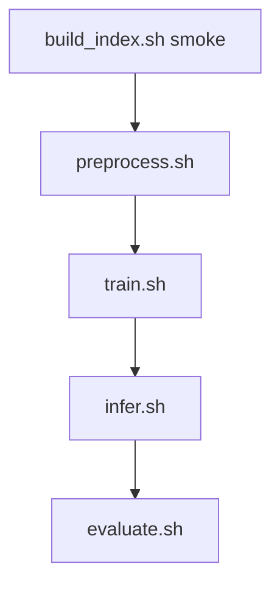

# dram2cnn 使用说明

本文档面向**实际操作**：从环境准备到冒烟验证、全量训练、多卡 DDP、Horizon 对比与超参搜索的**完整流程**。配置字段细节见 [`project_configuration_reference.md`](project_configuration_reference.md)；数据处理原理见 [`data_processing_guide.md`](data_processing_guide.md)；排错见 [`troubleshooting.md`](troubleshooting.md)。

---

## 1. 项目是做什么的

在每条样本的锚点时刻 `predict_time`，利用该时刻**之前**的 mcelog 与 inventory 信息，预测**未来 `label_horizon_seconds` 内**是否会出现符合条件的**工单级**故障（与 `trouble_tickets.csv` 关联）。

| 默认设定 | 值 |
|----------|-----|
| 预测目标（horizon） | 未来 **5 分钟**（300 秒） |
| 特征窗口 | 锚点前 **5 分钟** mcelog，半开区间 `[t−W, t)` |
| 输入张量 `X` | `[N, 31, 128, 32]`（16 bank + 15 inventory 通道的空间热图） |
| 模型 | **GridCNN-Deep**（2D-CNN） |

**重要说明**：修改索引表、horizon、网格表示或 `model.yaml` 中的 C/H/W 后，必须**清空该实验 YAML 所指向的 `processed_dir`、`splits_dir` 并重新执行预处理**（冒烟默认 `data/processed_smoke`、`data/splits_smoke`；全量 F1/工程实验默认 `data/processed`、`data/splits`），否则训练/推理会与磁盘数据不一致。

---

## 2. 环境准备

### 2.1 依赖安装

在仓库根目录执行：

```bash
cd /path/to/workspace
pip install -r requirements.txt
export PYTHONPATH=src
```

所有 `scripts/*.sh` 会自动 `cd` 到仓库根、设置 `PYTHONPATH` 并加载 `scripts/lib/env_perf.sh`（`OMP_NUM_THREADS=1` 等），**从任意目录调用脚本均可**。

### 2.2 验证环境

```bash
export PYTHONPATH=src
python3 -m pytest -q                    # 单元测试
bash scripts/autotune.sh                # 端到端冒烟（约半分钟～数分钟，视机器而定）
```

### 2.3 Docker（可选）

```bash
docker compose up --build
# 浏览器打开 http://localhost:9999（JupyterLab，本地开发无 token）
```

容器内工作目录为 `/root/workspace`，已配置 `PYTHONPATH=/root/workspace/src`。

---

## 3. 数据准备

### 3.1 原始文件

将天池（或等价）数据放入 `data/raw/`：

| 文件 | 必需列（至少） |
|------|----------------|
| `mcelog.csv` | `sid`, `row`, `col`, `error_type`, `error_time`；spatial 模式建议含 `bankid` |
| `trouble_tickets.csv` | `sid`, `failure_type`, `failed_time` |
| `inventory.csv` | `sid` + 厂商/型号等（→ 15 维 one-hot） |

字段说明见 [`data_dictionary.md`](data_dictionary.md)。

### 3.2 索引表

索引表每行一条训练样本，至少含 **`sid`, `predict_time`**。可由本仓库从 raw 数据**真实生成**（非随机 stub 标签）。

**时间轴**：`build_index` / 预处理将 raw 中**全局最早**时间作为 `t=0`；索引 CSV 的 `predict_time` 为 **1970-01-01 + 相对秒** 的可读 ISO 字符串，预处理后的 `meta.csv` 中 `predict_ts` 为 **≥ 0 的相对秒**（详见 [`data_processing_guide.md`](data_processing_guide.md) §4.1）。

**演示 / 冒烟（索引约 500 行 → 预处理后约 294 行，推荐首次使用）：**

```bash
bash scripts/build_index.sh smoke
# 输出：data/index_stubs/features_5m_index_demo.csv
# 与 configs/data.yaml 中 index_features_path 默认一致
```

**全量索引（耗时长，扫描完整 mcelog）：**

```bash
bash scripts/build_index.sh full
# 输出：data/raw/features_index_h300s_step300s_full.csv
# 全量实验 yaml 已默认指向该路径；baseline 仍用演示 stub
```

自定义 horizon / 采样步长示例：

```bash
PYTHONPATH=src python3 scripts/build_index.py --mode full \
  --label-horizon-seconds 1800 \
  --sample-interval-seconds 600 \
  --window-seconds 1800 \
  --out data/raw/features_index_h1800s_step600s_full.csv
```

---

## 4. 配置体系（怎么选实验）

配置分两层：

1. **片段配置**（`configs/data.yaml`、`model.yaml`、`train.yaml` 等）——全局默认。
2. **实验入口**（`configs/experiments/*.yaml`）——通过 `overrides` 覆盖片段，决定本次 run 名称、是否截断数据、是否 DDP 等。

| 实验 YAML | 用途 |
|-----------|------|
| `exp_baseline.yaml` | **冒烟默认**：索引 ~500 行；输出 **`data/processed_smoke/`、`data/splits_smoke/`** |
| `exp_full_f1_ddp.yaml` / `exp_full_f1_sid.yaml` | **全量 F1 最大化**（项目主评价指标）；`early_stop_metric: best_f1`；笔记本**`04_run_pipelines.ipynb`** |
| `exp_full_recall_ddp.yaml` / `exp_full_recall_sid.yaml` | **全量召回率优先**；`threshold_profile: recall_guard`（实验内 `min_precision: 0.55` 覆盖模板默认 0.50）；笔记本 **05** |
| `exp_full_precision_ddp.yaml` / `exp_full_precision_sid.yaml` | **全量精度优先**；`threshold_profile: precision_guard`；笔记本 **05** |
| `exp_full_recall_ddp_balanced.yaml` / `exp_full_recall_sid_balanced.yaml` | 平衡工程实验（`threshold_profile: balanced`；`min_recall≥0.82` 且 `min_precision≥0.58`，见 `threshold_profiles.yaml`） |
| `exp_baseline_sid.yaml` | 冒烟 + **sid 切分** |
| `exp_ddp_verify.yaml` | 短轮次多卡分布式回归（Deep 模型 + 冒烟切分目录；须先完成预处理） |
| `exp_horizon_30m.yaml` / `exp_horizon_1h.yaml` | Horizon 冒烟对比 |
| `exp_optuna_smoke.yaml` | Optuna 超参搜索冒烟 |

训练/推理输出写入 `runs/<run_name>/`（见 `configs/base.yaml` 的 `run_name`）。

---

## 5. 标准流水线（分步执行）

以下以 **baseline 冒烟** 为例；每步均可单独重跑。



> `preprocess.sh` 结束时已自动 **validate**（检查 splits 与 manifest）。下方「步骤 2」的 `validate.sh` 为**可选**重复诊断。

### 步骤 0：生成索引（若尚未有或需重建）

```bash
bash scripts/build_index.sh smoke
```

### 步骤 1：预处理 + 切分（含末尾 validate）

```bash
bash scripts/preprocess.sh configs/experiments/exp_baseline.yaml
```

结束时打印 `Validate after preprocess: ok` 表示 splits 与配置已一致。

产出（以 **`exp_baseline.yaml`** 为例，目录由实验 overrides 决定）：

- `data/processed_smoke/`：`X.npy`, `y.npy`, `meta.csv`, `preprocess_manifest.json`
- `data/splits_smoke/`：`X_train.npy`、`X_val.npy`、`X_test.npy` 等（已按训练集标准化）

全量 F1 / 工程实验默认写入 `data/processed/`、`data/splits/`（sid 实验另用 `data/splits_sid/` 等）。**一律以当前实验 YAML 的 `processed_dir` / `splits_dir` 为准**。

预处理前会自动检查 raw 路径是否存在；Linux 上对「按 sid 排序」「填网格」可多进程加速（见预处理清单中并行标记）。

### 步骤 2：校验（可选）

`preprocess.sh` 已内嵌 validate；仅在**未重新执行预处理**、想单独复查切分与预处理清单时再执行：

```bash
# 已有 splits 时完整校验
bash scripts/validate.sh configs/experiments/exp_baseline.yaml

# 尚未预处理时仅校验配置与 raw 路径
bash scripts/validate.sh configs/experiments/exp_baseline.yaml --no-require-splits
```

### 步骤 3：训练

```bash
bash scripts/train.sh configs/experiments/exp_baseline.yaml
```

权重与日志示例路径：

```
runs/exp_tianchi_baseline/<时间戳>/checkpoints/grid_cnn.pt
runs/exp_tianchi_baseline/.latest_train_session   # 指向最近一次训练目录
```

### 步骤 4：推理

```bash
bash scripts/infer.sh configs/experiments/exp_baseline.yaml
```

产出 `runs/.../infer_<时间戳>/predictions.csv`（含 `y_true`, `y_pred`, `y_prob` 等）。`infer.sh` 与训练共用 `base.yaml` 的 GPU/DDP 策略（`exp_baseline` overrides 中关闭 DDP）。

### 步骤 5：评估

```bash
bash scripts/evaluate.sh configs/experiments/exp_baseline.yaml
```

产出同目录下 `metrics.json`（**部署阶段评价指标**，顶层字段）、`oracle_on_test` 段（测试集事后分析）、PR 曲线、混淆矩阵等。

### 端到端链路检查（上述 1～5 串联；预处理已含步骤 2 的校验）

```bash
bash scripts/autotune.sh
```

等价于：`预处理（含校验）→ 训练 → 推理 → 评估`（不含 build_index）。

内部实验列表在 `src/dram2cnn/pipelines/run_autotune.py` 的 `EXPS`（默认 `exp_baseline`）。autotune 调用 **`train.sh` / `infer.sh`**；默认实验关闭了 DDP 与 auto_batch 以保持冒烟速度。

### 快速查看预处理结果

```bash
bash scripts/inspect_data.sh
```

---

## 6. 全量数据 + 多卡 DDP（生产路径）

「全量」包含两件事，**缺一不可**：

1. 取消 `max_index_rows` / `mcelog_max_rows` 截断（全量实验 yaml 已做）。
2. **`index_features_path` 指向全量索引 CSV**（`data/raw/features_index_h300s_step300s_full.csv`）。

### 6.0 三种全量策略（笔记本对照）

| 目标 | 笔记本 | time YAML | sid YAML | 预处理配置 |
|------|----------|-----------|----------|-----------------|
| **F1 最大化**（项目主评价指标） | `04_run_pipelines.ipynb` | `exp_full_f1_ddp.yaml` | `exp_full_f1_sid.yaml` | `drop_empty_positive_windows: false` |
| **召回率优先** | `05_full_recall_vs_precision.ipynb` | `exp_full_recall_ddp.yaml` | `exp_full_recall_sid.yaml` | `drop_empty_positive_windows: true` |
| **精度优先** | `05_full_recall_vs_precision.ipynb` | `exp_full_precision_ddp.yaml` | `exp_full_precision_sid.yaml` | 同左 |

> **F1 与工程实验预处理 不可混用**：切换策略前须 `rm -rf data/processed/* data/splits/* data/splits_sid/*` 并重新执行预处理。

### 推荐流程（F1 示例）

```bash
bash scripts/build_index.sh full
rm -rf data/processed/* data/splits/*

bash scripts/preprocess.sh configs/experiments/exp_full_f1_ddp.yaml
bash scripts/validate.sh configs/experiments/exp_full_f1_ddp.yaml

CUDA_VISIBLE_DEVICES=0,1,2 bash scripts/train_ddp.sh configs/experiments/exp_full_f1_ddp.yaml
bash scripts/infer.sh configs/experiments/exp_full_f1_ddp.yaml
bash scripts/evaluate.sh configs/experiments/exp_full_f1_ddp.yaml
```

训练启动时 rank0 会打印**数据摘要**；若仍提示 stub 路径，说明 `index_features_path` 未改成功。

### 6.1 按 sid 切分（跨服务器泛化评估）

默认 `time_stratified` 允许同一 sid 跨 train/test。sid 实验使用 **`split_strategy: sid`**（70/15/15 + sid 级正例分层），输出 **`data/splits_sid/`**。

在已完成**相同预处理配置**全量预处理后，可只重切分：

```bash
# F1 sid 示例（04）
bash scripts/resplit.sh configs/experiments/exp_full_f1_sid.yaml
bash scripts/train_ddp.sh configs/experiments/exp_full_f1_sid.yaml
bash scripts/infer.sh configs/experiments/exp_full_f1_sid.yaml
bash scripts/evaluate.sh configs/experiments/exp_full_f1_sid.yaml
```

**指标定义**：`metrics.json` 顶层 = **部署阶段评价指标**（验证集阈值）；`oracle_on_test` 仅作分析。

### 6.2 工程实验配置（低漏报 / 精度优先 / 可调阈值）

召回/精度/平衡实验见 **`05_full_recall_vs_precision.ipynb`** 与下表：

| 项 | 配置 | 作用 |
|----|------|------|
| `drop_empty_positive_windows: true` | data | 丢弃**正样本**空 mcelog 窗（负样本空窗仍由 `drop_empty_mcelog_windows` 处理） |
| `train.threshold_profile` | train | `recall_guard` / `precision_guard` / `balanced`（见 `configs/threshold_profiles.yaml`） |
| `early_stop_metric: avg_precision` | train | 模型选择看排序，与阈值解耦 |
| `infer.threshold_override` | infer | 手动覆盖 `best_threshold.json` |

| 场景 | time | sid |
|------|------|-----|
| 召回率优先 | `exp_full_recall_ddp.yaml` | `exp_full_recall_sid.yaml` |
| 精度优先 | `exp_full_precision_ddp.yaml` | `exp_full_precision_sid.yaml` |
| 平衡（命令行可选） | `exp_full_recall_ddp_balanced.yaml` | `exp_full_recall_sid_balanced.yaml`（`min_recall=0.82`，`min_precision=0.58`） |

Horizon 全量：`exp_horizon_30m_full.yaml`、`exp_horizon_1h_full.yaml`（需 `build_horizon_indexes.sh full`）。

---

## 7. Horizon 对比实验（5min / 30min / 1h）

不同预测窗需要**匹配的索引表**与实验 YAML。

### 7.1 批量生成索引

```bash
# 冒烟 stub → data/index_stubs/
bash scripts/build_horizon_indexes.sh smoke

# 全量 → data/raw/（耗时长）
bash scripts/build_horizon_indexes.sh full
```

生成文件示例：

| Horizon | 冒烟 stub | 全量 |
|---------|-----------|------|
| 5 min | `features_5m_index_demo.csv`（或 `features_index_h300s_step300s_smoke.csv`） | `features_index_h300s_step300s_full.csv` |
| 30 min | `features_index_h1800s_step600s_smoke.csv` | `features_index_h1800s_step600s_full.csv` |
| 1 h | `features_index_h3600s_step1800s_smoke.csv` | `features_index_h3600s_step1800s_full.csv` |

### 7.2 运行对比实验

**前置**：若 `data/index_stubs/features_index_h1800s_step600s_smoke.csv` 等不存在，先执行 §7.1 的 `bash scripts/build_horizon_indexes.sh smoke`。

实验 YAML 已指向 30min/1h 的 stub，输出目录为 **`data/processed_horizon_*_smoke/`** 与 **`data/splits_horizon_*_smoke/`**（与默认 `processed/` 隔离）。**切换 horizon 前请清空对应 processed/splits 目录**（validate 会比对 清单中的 horizon），再执行预处理与训练：

```bash
bash scripts/preprocess.sh configs/experiments/exp_horizon_30m.yaml
bash scripts/train.sh configs/experiments/exp_horizon_30m.yaml

bash scripts/preprocess.sh configs/experiments/exp_horizon_1h.yaml
bash scripts/train.sh configs/experiments/exp_horizon_1h.yaml
```

**全量对比**：先 `bash scripts/build_horizon_indexes.sh full`，再直接使用内置全量实验（已指向 `data/raw/*_full.csv` 与独立 processed/splits 目录）：

```bash
bash scripts/preprocess.sh configs/experiments/exp_horizon_30m_full.yaml
bash scripts/train_ddp.sh configs/experiments/exp_horizon_30m_full.yaml
```

---

## 8. Optuna 超参搜索

**前置**：已对目标实验完成预处理（存在该实验 YAML 的 `splits_dir`；冒烟默认 `data/splits_smoke/`）。

```bash
bash scripts/optuna.sh \
  configs/experiments/exp_optuna_smoke.yaml \
  configs/hpo/hpo.yaml
```

- 搜索空间见 `configs/hpo/hpo.yaml`（backbone 深度、blocks、lr、dropout 等）。
- 最优 trial 摘要：`runs/optuna/<study_name>/best_trial.json`。
- 默认实验为 `exp_optuna_smoke.yaml`（小样本、40 epoch）；**gpu/ddp 继承 `base.yaml`**，≥2 卡时每个 trial 经 `torchrun` 多卡训练（与 `train.sh` 相同策略）。
- 多卡回归：`bash scripts/verify_ddp.sh`（含 optuna 1-trial 检查）。

将最优超参写回 `configs/model.yaml` / `configs/train.yaml` 或新建实验 overrides 后，再跑正式训练。

---

## 9. 脚本速查

| 脚本 | 作用 | 默认实验 YAML |
|------|------|----------------|
| `build_index.sh smoke\|full` | 生成索引表 | — |
| `build_horizon_indexes.sh smoke\|full` | 批量 5m/30m/1h 索引 | — |
| `preprocess.sh [exp]` | 预处理 + 切分 | `exp_baseline.yaml` |
| `validate.sh [exp] [--no-require-splits]` | 配置与数据校验 | `exp_baseline.yaml` |
| `train.sh [exp]` | 单卡或自动 DDP + 显存 batch 探测 | `exp_baseline.yaml` |
| `train_ddp.sh [exp]` | 多卡训练入口（调用 train.sh） | `exp_full_f1_ddp.yaml` |
| `infer.sh [exp]` | 单卡或自动 DDP 推理 + 显存 batch 探测 | `exp_baseline.yaml` |
| `evaluate.sh [exp]` | 指标与图表 | `exp_baseline.yaml` |
| `optuna.sh [exp] [hpo]` | 超参搜索 | `exp_optuna_smoke.yaml` |
| `autotune.sh` | 端到端链路检查全流程 | 见 `src/dram2cnn/pipelines/run_autotune.py` 的 `EXPS` |
| `clean.sh [--notebooks] [--purge-indexes]` | 清理 runs、processed/splits、outputs、缓存；`--notebooks` 清除笔记本输出；`--purge-indexes` 才删 raw 全量索引 | — |
| `run_full_notebook_batch.sh` | 全量：**先工程实验** → 再 F1 六组（须先 `build_index.sh full` 与工程实验预处理） | — |
| `run_full_pipeline_cli.sh` | 全量：**先 F1** → 再工程实验 → 再 notebooks/KPI（自包含） | — |
| `run_full_all_notebooks.sh` | 仅跑全部 notebooks（`DRAM2CNN_RUN_FULL_NOTEBOOKS=1`） | — |
| `verify_ddp.sh` | 多卡 DDP 回归（train/infer/optuna） | `exp_ddp_verify.yaml` |
| `inspect_data.sh` | 查看实验 `processed_dir` 概览 | — |
| `python3 -m dram2cnn.utils.deployment_kpi` | 合并 `outputs/tables/*_deployment_kpi.csv` | — |

等价 Python 模块（需 `PYTHONPATH=src`）：

```bash
python3 -m dram2cnn.pipelines.run_preprocess configs/experiments/exp_baseline.yaml
python3 -m dram2cnn.pipelines.run_validate   configs/experiments/exp_baseline.yaml
python3 -m dram2cnn.pipelines.run_train      configs/experiments/exp_baseline.yaml
python3 -m dram2cnn.pipelines.run_infer      configs/experiments/exp_baseline.yaml
python3 -m dram2cnn.pipelines.run_evaluate   configs/experiments/exp_baseline.yaml
python3 -m dram2cnn.pipelines.run_autotune   # 端到端链路检查：预处理（含校验）→ 训练 → 推理 → 评估
python3 -m dram2cnn.pipelines.run_optuna     configs/experiments/exp_optuna_smoke.yaml configs/hpo/hpo.yaml
python3 -m dram2cnn.utils.deployment_kpi   # 合并 outputs/tables/*_deployment_kpi.csv
# inspect_data.sh 为 shell + 内嵌 Python，无独立 -m 模块
```

---

## 10. 目录与输出

```
workspace/
├── configs/                 # 配置片段 + experiments/
├── data/
│   ├── raw/                 # mcelog、tickets、inventory、全量索引
│   ├── index_stubs/         # 冒烟索引
│   ├── processed/           # 全量默认预处理池（冒烟见 processed_smoke/）
│   ├── processed_smoke/     # exp_baseline 等冒烟输出
│   ├── splits/              # 全量默认切分
│   ├── splits_smoke/        # 冒烟切分
│   └── splits_sid/          # sid 切分（全量 sid 实验）
├── runs/
│   └── <run_name>/          # 训练/推理会话、checkpoint、predictions
├── scripts/                 # 入口 shell
├── src/dram2cnn/            #  Python 包
├── notebooks/               # EDA、特征/误差分析、**04 F1 / 05 召回·精度流水线**
└── docs/                    # 文档
```

| 输出 | 说明 |
|------|------|
| `preprocess_manifest.json` | 预处理基准元数据（grid_shape、horizon、并行开关、`n_empty_grids` 等） |
| `checkpoints/grid_cnn.pt` | 模型权重 |
| `best_threshold.json` | 验证集上搜索的最优分类阈值（推理默认读取） |
| `predictions.csv` | 测试集预测结果 |
| `metrics.json` | 评估指标 |

---

## 11. 常见操作

### 11.1 修改配置后如何重跑

| 改了什么 | 需要重跑 |
|----------|----------|
| `index_features_path` / horizon / 窗口 | 预处理（含校验）→ 训练 → 推理 → 评估 |
| `grid_representation` / C,H,W | 同上 |
| `model.yaml` 仅 backbone 结构 | 仅 train（不必预处理） |
| `train.yaml` 学习率、epoch 等 | 仅 train |

重新执行预处理前建议清空**当前实验**的 `processed_dir` 与 `splits_dir`（全量默认 `data/processed/*`、`data/splits/*`；冒烟为 `processed_smoke/*`、`splits_smoke/*`），避免断点标记或旧文件干扰。

### 11.2 baseline 与 full 并行维护

在**不同实验 YAML** 的 `overrides.data.index_features_path` 分别指向演示表与全量表，可避免来回改 `data.yaml`。

### 11.3 单卡调试 DDP 实验

```bash
CUDA_VISIBLE_DEVICES=0 bash scripts/train.sh configs/experiments/exp_full_f1_ddp.yaml
```

可见 GPU 为 1 时即使用户 YAML 开启 DDP，也会走单进程。

### 11.4 性能调优（Linux 高核 / 多 GPU）

| 阶段 | 建议 |
|------|------|
| 预处理 | `data.yaml` 默认 `ram_budget_frac: 0.5`；全量实验覆盖 **0.85 + `preprocess_workers: 1`**（compact X 单进程填网格） |
| 训练 DataLoader | 全量实验 `num_workers: 2`, `prefetch_factor: 2` |
| 多卡 | `CUDA_VISIBLE_DEVICES=0,1,2 bash scripts/train_ddp.sh` |

---

## 12. 笔记本工作流（含冒烟 / 全量 time / 全量 sid）

笔记本与 `scripts/*.sh` **共用实验 YAML**；**断点标记步骤、三套流程对照表与 mermaid 图见 [`notebooks/README.md`](../notebooks/README.md)**，本节仅保留命令行侧要点。

### 12.1 文件职责

| 笔记本 | 用途 | 建议时机 |
|----------|------|----------|
| `01_eda.ipynb` | raw 表 + 索引列概览 | 冒烟/全量**前** |
| `02_feature_analysis.ipynb` | 完成预处理后的 `X` 统计 | **完成预处理后** |
| `03_error_analysis.ipynb` | `predictions.csv` FP/FN | **infer 后** |
| **`04_run_pipelines.ipynb`** | **冒烟 + 全量 F1（时间分层 + 服务器划分）** 端到端（断点标记续跑） | 环境验证 / **项目主评价指标 F1** / time vs sid 泛化 |
| **`05_full_recall_vs_precision.ipynb`** | **全量召回 / 精度**（时间分层 + 服务器划分，独立实验目录） | 工程部署策略对比 |

### 12.2 冒烟测试（Notebook）

在 Jupyter 中打开 `notebooks/04_run_pipelines.ipynb`，**自上而下**运行 **「冒烟测试」** 小节：

| 单元 | 作用 | 命令行等价 |
|------|------|------------|
| 生成演示索引 | `run_step("smoke", "build_index", ...)` | `bash scripts/build_index.sh smoke` |
| baseline 全流程 | 预处理（含校验）→ 训练 → 推理 → 评估 | 近似 `autotune.sh`（另含 build_index/inspect_data；须先有演示索引） |

- 配置：**`exp_baseline.yaml`**（~500 行索引；**overrides 关闭 DDP/auto_batch**）。
- 输出：`runs/exp_tianchi_baseline/`；日志：`runs/pipeline-logs/smoke__*.log`。
- 可选：笔记本内注释掉的 `autotune.sh` 单元 = 命令行端到端链路检查（无断点标记）。

**推荐**：新 clone / 改代码后**先完成冒烟 Notebook**，再跑全量。

### 12.3 全量 F1（笔记本`04_run_pipelines.ipynb`）

| 步骤 | 操作 |
|------|------|
| 1 | **build_index full** 单元 |
| 2 | 确认 `exp_full_f1_ddp.yaml` 指向全量索引 CSV |
| 3 | 清空 `data/processed/*`、`data/splits/*`；`clear_exp_markers("full_f1")` |
| 4 | **全量 F1 预先检查 + 流水线** 单元（`train_ddp.sh`） |

- 输出：`runs/exp_tianchi_full_f1_ddp/`；对比表：`outputs/tables/full_f1_time_vs_sid_deployment_kpi.csv`
- 正式指标见 `outputs/tables/full_f1_time_vs_sid_deployment_kpi.csv` 与 `reports/算法开发与实验结果.md`

### 12.4 全量 F1 sid（笔记本 04）

需 **§12.3 预处理已完成**（相同预处理配置 `drop_empty_positive_windows: false`）：

| 步骤 | 操作 |
|------|------|
| 1 | 确认 `data/processed/preprocess_manifest.json` 存在 |
| 2 | **F1 sid 1/2** 单元：`resplit` → `train_ddp` → `infer` → `evaluate` |
| 3 | **F1 sid 2/2** 单元：time vs sid 部署阶段评价指标 |

- 配置：`exp_full_f1_sid.yaml`；输出：`runs/exp_tianchi_full_f1_sid/`

### 12.5 全量召回 / 精度（笔记本`05_full_recall_vs_precision.ipynb`）

工程实验预处理（`drop_empty_positive_windows: true`）与 F1 **不可混用**。见 **§6.0**。

- marker：`full_eng` / `full_recall` / `full_precision` 等
- 汇总表：`outputs/tables/full_recall_vs_precision_deployment_kpi.csv`；六组合并：`full_all_strategies_deployment_kpi.csv`
- 工程实验指标见 `outputs/tables/full_recall_vs_precision_deployment_kpi.csv`（**不得**替代 F1 主验收）

### 12.6 中断后续跑与重跑

- 断点标记路径：`runs/pipeline-logs/markers/<exp>__<step>.done`
- 04：`clear_exp_markers("full_f1")` / `clear_exp_markers("full_f1_sid")`
- 05：`clear_exp_markers("full_eng")` / `clear_exp_markers("full_recall")` 等
- F1 ↔ 工程实验切换：清空 processed 与各 splits* + 删除预处理断点标记

### 12.7 推荐顺序

```
01_eda → 04 冒烟 → 02 / 03 分析
                ↓
         04 全量 F1（或 05 工程实验，二选一 预处理配置）
                ↓
         04 F1 sid 或 05 召回/精度 sid
```

修改 Python 源码后请 **重跑 setup 首格**（`notebook_setup()`）或 **Kernel → Restart**，避免缓存旧版 `dram2cnn`。

---

## 13. 推荐学习路径

1. **30 分钟**：终端 `bash scripts/autotune.sh`，或在 **`04_run_pipelines.ipynb` 冒烟单元** 完整执行成功 → 浏览 `runs/exp_tianchi_baseline/`。
2. **1 小时**：读 [`tianchi_pipeline.md`](tianchi_pipeline.md) + 手动跑一遍 §5 分步命令（或与笔记本冒烟对照）。
3. **半天**：笔记本**04 全量 F1** 或 **05 召回/精度**（§6）；sid 对比见各笔记本 sid 单元。
4. **深入**：[`data_processing_guide.md`](data_processing_guide.md) + [`project_configuration_reference.md`](project_configuration_reference.md)。

---

## 14. 遇到问题

优先查阅 [`troubleshooting.md`](troubleshooting.md)，常见项包括：

- `X_train` 与 `model.yaml` 形状不一致 → 重新执行预处理
- `pos_rate=0` 或 AUC 全 nan → 检查 `split_strategy`（默认 `time_stratified`）与索引正例数；全量训练时检查索引与工单标注
- 全量实验样本数仍 ~500 → 未 `build_index.sh full`、未清空 `processed/` 重新执行预处理，或误用 baseline 实验
- `n_empty_grids > 0` → 部分样本 mcelog 窗为空；默认仅丢弃 **负样本** 空窗（见 `drop_empty_mcelog_windows`）
- DDP `nproc > GPU 数` → 调整 `nproc_per_node` 或 `CUDA_VISIBLE_DEVICES`

---

*文档版本与仓库默认配置一致：spatial_heatmap、5 分钟 horizon、GridCNN-Deep。*
