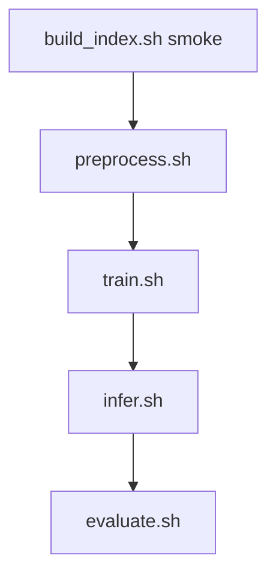

# dram2cnn 使用说明

本文档面向**实际操作**：从环境准备到冒烟验证、全量训练、多卡 DDP、Horizon 对比与超参搜索的**完整流程**。配置字段细节见 [`project_configuration_reference.md`](project_configuration_reference.md)；数据处理原理见 [`data_processing_guide.md`](data_processing_guide.md)；排错见 [`troubleshooting.md`](troubleshooting.md)。

---

## 1. 项目是做什么的

在每条样本的锚点时刻 `predict_time`，利用该时刻**之前**的 mcelog 与 inventory 信息，预测**未来 `label_horizon_seconds` 内**是否会出现符合条件的**工单级**故障（与 `trouble_tickets.csv` 对齐）。

| 默认设定 | 值 |
|----------|-----|
| 预测目标（horizon） | 未来 **5 分钟**（300 秒） |
| 特征窗口 | 锚点前 **5 分钟** mcelog，半开区间 `[t−W, t)` |
| 输入张量 `X` | `[N, 31, 128, 32]`（16 bank + 15 inventory 通道的空间热图） |
| 模型 | **GridCNN-Deep**（2D-CNN） |

**重要约定**：修改索引表、horizon、网格表示或 `model.yaml` 中的 C/H/W 后，必须**清空 `data/processed`、`data/splits` 并重跑 preprocess**，否则训练/推理会与磁盘数据不一致。

---

## 2. 环境准备

### 2.1 依赖安装

在仓库根目录执行：

```bash
cd /path/to/workspace
pip install -r requirements.txt
export PYTHONPATH=src
```

所有 `scripts/*.sh` 会自动 `cd` 到仓库根、设置 `PYTHONPATH` 并加载 `scripts/lib/env_perf.sh`（`OMP_NUM_THREADS=1` 等），**从任意目录调用脚本均可**。

### 2.2 验证环境

```bash
export PYTHONPATH=src
python3 -m pytest -q                    # 单元测试
bash scripts/autotune.sh                # 端到端冒烟（约半分钟～数分钟，视机器而定）
```

### 2.3 Docker（可选）

```bash
docker compose up --build
# 浏览器打开 http://localhost:9999（JupyterLab，本地开发无 token）
```

容器内工作目录为 `/root/workspace`，已配置 `PYTHONPATH=/root/workspace/src`。

---

## 3. 数据准备

### 3.1 原始文件

将天池（或等价）数据放入 `data/raw/`：

| 文件 | 必需列（至少） |
|------|----------------|
| `mcelog.csv` | `sid`, `row`, `col`, `error_type`, `error_time`；spatial 模式建议含 `bankid` |
| `trouble_tickets.csv` | `sid`, `failure_type`, `failed_time` |
| `inventory.csv` | `sid` + 厂商/型号等（→ 15 维 one-hot） |

字段说明见 [`data_dictionary.md`](data_dictionary.md)。

### 3.2 索引表

索引表每行一条训练样本，至少含 **`sid`, `predict_time`**。可由本仓库从 raw 数据**真实生成**（非随机 stub 标签）。

**时间轴**：`build_index` / preprocess 将 raw 中**全局最早**时间作为 `t=0`；索引 CSV 的 `predict_time` 为 **1970-01-01 + 相对秒** 的可读 ISO 字符串，预处理后的 `meta.csv` 中 `predict_ts` 为 **≥ 0 的相对秒**（详见 [`data_processing_guide.md`](data_processing_guide.md) §4.1）。

**演示 / 冒烟（约 500 行，推荐首次使用）：**

```bash
bash scripts/build_index.sh smoke
# 输出：data/index_stubs/features_5m_index_demo.csv
# 与 configs/data.yaml 中 index_features_path 默认一致
```

**全量索引（耗时长，扫描完整 mcelog）：**

```bash
bash scripts/build_index.sh full
# 输出：data/raw/features_index_h300s_step300s_full.csv
# 之后须在 data.yaml 或实验 overrides 中修改 index_features_path
```

自定义 horizon / 采样步长示例：

```bash
PYTHONPATH=src python3 scripts/build_index.py --mode full \
  --label-horizon-seconds 1800 \
  --sample-interval-seconds 600 \
  --window-seconds 1800 \
  --out data/raw/features_index_h1800s_step600s_full.csv
```

---

## 4. 配置体系（怎么选实验）

配置分两层：

1. **片段配置**（`configs/data.yaml`、`model.yaml`、`train.yaml` 等）——全局默认。
2. **实验入口**（`configs/experiments/*.yaml`）——通过 `overrides` 覆盖片段，决定本次 run 名称、是否截断数据、是否 DDP 等。

| 实验 YAML | 用途 |
|-----------|------|
| `exp_baseline.yaml` | **冒烟默认**：索引 ~500 行、mcelog 截断 **800000** 行、20 epoch；**time_split 0.6/0.2/0.2**；**model_smoke.yaml**；**overrides 关闭 DDP/auto_batch** |
| `exp_full_best_ddp.yaml` | **全量 + 多卡**：取消行数截断、`num_workers=8`；**time_split 继承 data.yaml 0.7/0.15/0.15**；**gpu/ddp 继承 base 默认** |
| `exp_ddp_verify.yaml` | 短 epoch 多卡 DDP 回归（配合 `scripts/verify_ddp.sh`） |
| `exp_horizon_30m.yaml` | 30 分钟预测窗；**冒烟 overrides 关闭 DDP/auto_batch**（同 baseline） |
| `exp_horizon_1h.yaml` | 1 小时预测窗；**冒烟 overrides 关闭 DDP/auto_batch** |
| `exp_optuna_smoke.yaml` | Optuna 超参搜索（小样本 data 截断；**完整 model.yaml**）；**gpu/ddp 继承 base 多卡默认** |

训练/推理产物写入 `runs/<run_name>/`（见 `configs/base.yaml` 的 `run_name`）。

---

## 5. 标准流水线（分步执行）

以下以 **baseline 冒烟** 为例；每步均可单独重跑。



> `preprocess.sh` 结束时已自动 **validate**（检查 splits 与 manifest）。下方「步骤 2」的 `validate.sh` 为**可选**重复诊断。

### 步骤 0：生成索引（若尚未有或需重建）

```bash
bash scripts/build_index.sh smoke
```

### 步骤 1：预处理 + 切分（含末尾 validate）

```bash
bash scripts/preprocess.sh configs/experiments/exp_baseline.yaml
```

结束时打印 `Validate after preprocess: ok` 表示 splits 与配置已对齐。

产出：

- `data/processed/`：`X.npy`, `y.npy`, `meta.csv`, `preprocess_manifest.json`
- `data/splits/`：`X_train.npy`、`X_val.npy`、`X_test.npy` 等（已按训练集标准化）

预处理前会自动检查 raw 路径是否存在；Linux 上对「按 sid 排序」「填网格」可多进程加速（见 manifest 中并行标记）。

### 步骤 2：校验（可选）

`preprocess.sh` 已内嵌 validate；仅在**未重跑 preprocess**、想单独复查 splits/manifest 时再执行：

```bash
# 已有 splits 时完整校验
bash scripts/validate.sh configs/experiments/exp_baseline.yaml

# 尚未 preprocess 时仅校验配置与 raw 路径
bash scripts/validate.sh configs/experiments/exp_baseline.yaml --no-require-splits
```

### 步骤 3：训练

```bash
bash scripts/train.sh configs/experiments/exp_baseline.yaml
```

权重与日志示例路径：

```
runs/exp_tianchi_baseline/<时间戳>/checkpoints/grid_cnn.pt
runs/exp_tianchi_baseline/.latest_train_session   # 指向最近一次训练目录
```

### 步骤 4：推理

```bash
bash scripts/infer.sh configs/experiments/exp_baseline.yaml
```

产出 `runs/.../infer_<时间戳>/predictions.csv`（含 `y_true`, `y_pred`, `y_prob` 等）。`infer.sh` 与训练共用 `base.yaml` 的 GPU/DDP 策略（`exp_baseline` overrides 中关闭 DDP）。

### 步骤 5：评估

```bash
bash scripts/evaluate.sh configs/experiments/exp_baseline.yaml
```

产出同目录下 `metrics.json`、PR 曲线、混淆矩阵等。

### 一键冒烟（上述 1～5 串联，preprocess 已含步骤 2 的 validate）

```bash
bash scripts/autotune.sh
```

等价于：`preprocess（含 validate）→ train → infer → evaluate`（不含 build_index）。

内部实验列表在 `src/dram2cnn/pipelines/run_autotune.py` 的 `EXPS`（默认 `exp_baseline`）。autotune 调用 **`train.sh` / `infer.sh`**；默认实验关闭了 DDP 与 auto_batch 以保持冒烟速度。

### 快速查看预处理结果

```bash
bash scripts/inspect_data.sh
```

---

## 6. 全量数据 + 多卡 DDP（生产路径）

「全量」包含两件事，**缺一不可**：

1. 取消 `max_index_rows` / `mcelog_max_rows` 截断（`exp_full_best_ddp` 已做）。
2. 将 **`index_features_path`** 指向全量索引 CSV（**不会自动切换**）。

### 推荐流程

```bash
# 1. 生成全量索引
bash scripts/build_index.sh full

# 2. 指定全量索引（二选一）
#    A) 编辑 configs/data.yaml 的 index_features_path
#    B) 在 exp_full_best_ddp.yaml 的 overrides.data 增加：
#       index_features_path: data/raw/features_index_h300s_step300s_full.csv

# 3. 清空旧预处理产物（重要）
rm -rf data/processed/* data/splits/*

# 4. 预处理（高并行：preprocess_parallel_frac=0.85）
bash scripts/preprocess.sh configs/experiments/exp_full_best_ddp.yaml

# 5. 校验
bash scripts/validate.sh configs/experiments/exp_full_best_ddp.yaml

# 6. 多卡训练（示例：3 卡）
CUDA_VISIBLE_DEVICES=0,1,2 bash scripts/train_ddp.sh

# 7. 推理与评估
bash scripts/infer.sh configs/experiments/exp_full_best_ddp.yaml   # 继承 base 默认多卡 + 显存 batch
bash scripts/evaluate.sh configs/experiments/exp_full_best_ddp.yaml
```

训练启动时 rank0 会打印**数据摘要**；若仍提示 stub 路径，说明 `index_features_path` 未改成功。

---

## 7. Horizon 对比实验（5min / 30min / 1h）

不同预测窗需要**匹配的索引表**与实验 YAML。

### 7.1 批量生成索引

```bash
# 冒烟 stub → data/index_stubs/
bash scripts/build_horizon_indexes.sh smoke

# 全量 → data/raw/（耗时长）
bash scripts/build_horizon_indexes.sh full
```

生成文件示例：

| Horizon | 冒烟 stub | 全量 |
|---------|-----------|------|
| 5 min | `features_5m_index_demo.csv`（或 `features_index_h300s_step300s_smoke.csv`） | `features_index_h300s_step300s_full.csv` |
| 30 min | `features_index_h1800s_step600s_smoke.csv` | `features_index_h1800s_step600s_full.csv` |
| 1 h | `features_index_h3600s_step1800s_smoke.csv` | `features_index_h3600s_step1800s_full.csv` |

### 7.2 运行对比实验

**前置**：若 `data/index_stubs/features_index_h1800s_step600s_smoke.csv` 等不存在，先执行 §7.1 的 `bash scripts/build_horizon_indexes.sh smoke`。

实验 YAML 已指向 30min/1h 的 stub；**切换 horizon 前请清空 `data/processed` 与 `data/splits`**（validate 会比对 manifest 中的 horizon），再 preprocess + train：

```bash
bash scripts/preprocess.sh configs/experiments/exp_horizon_30m.yaml
bash scripts/train.sh configs/experiments/exp_horizon_30m.yaml

bash scripts/preprocess.sh configs/experiments/exp_horizon_1h.yaml
bash scripts/train.sh configs/experiments/exp_horizon_1h.yaml
```

全量对比时：先 `build_horizon_indexes.sh full`，修改对应 YAML 的 `index_features_path` 为 `data/raw/..._full.csv`，清空 processed/splits 后重跑 preprocess。

---

## 8. Optuna 超参搜索

**前置**：已对目标实验完成 preprocess（存在 `data/splits/`）。

```bash
bash scripts/optuna.sh \
  configs/experiments/exp_optuna_smoke.yaml \
  configs/hpo.yaml
```

- 搜索空间见 `configs/hpo.yaml`（backbone 深度、blocks、lr、dropout 等）。
- 最优 trial 摘要：`runs/optuna/<study_name>/best_trial.json`。
- 默认实验为 `exp_optuna_smoke.yaml`（小样本、40 epoch）；**gpu/ddp 继承 `base.yaml`**，≥2 卡时每个 trial 经 `torchrun` 多卡训练（与 `train.sh` 相同策略）。
- 多卡回归：`bash scripts/verify_ddp.sh`（含 optuna 1-trial 检查）。

将最优超参写回 `configs/model.yaml` / `configs/train.yaml` 或新建实验 overrides 后，再跑正式训练。

---

## 9. 脚本速查

| 脚本 | 作用 | 默认实验 YAML |
|------|------|----------------|
| `build_index.sh smoke\|full` | 生成索引表 | — |
| `build_horizon_indexes.sh smoke\|full` | 批量 5m/30m/1h 索引 | — |
| `preprocess.sh [exp]` | 预处理 + 切分 | `exp_baseline.yaml` |
| `validate.sh [exp] [--no-require-splits]` | 配置与数据校验 | `exp_baseline.yaml` |
| `train.sh [exp]` | 单卡或自动 DDP + 显存 batch 探测 | `exp_baseline.yaml` |
| `train_ddp.sh [exp]` | 多卡训练入口（调用 train.sh） | `exp_full_best_ddp.yaml` |
| `infer.sh [exp]` | 单卡或自动 DDP 推理 + 显存 batch 探测 | `exp_baseline.yaml` |
| `evaluate.sh [exp]` | 指标与图表 | `exp_baseline.yaml` |
| `optuna.sh [exp] [hpo]` | 超参搜索 | `exp_optuna_smoke.yaml` |
| `autotune.sh` | 一键冒烟全流程 | 见 `src/dram2cnn/pipelines/run_autotune.py` 的 `EXPS` |
| `clean.sh [--notebooks]` | 清理 runs、processed/splits、outputs 生成物、缓存 | — |
| `verify_ddp.sh` | 多卡 DDP 回归（train/infer/optuna） | `exp_ddp_verify.yaml` |
| `inspect_data.sh` | 查看 processed 概览 | — |

等价 Python 模块（需 `PYTHONPATH=src`）：

```bash
python3 -m dram2cnn.pipelines.run_preprocess configs/experiments/exp_baseline.yaml
python3 -m dram2cnn.pipelines.run_validate   configs/experiments/exp_baseline.yaml
python3 -m dram2cnn.pipelines.run_train      configs/experiments/exp_baseline.yaml
python3 -m dram2cnn.pipelines.run_infer      configs/experiments/exp_baseline.yaml
python3 -m dram2cnn.pipelines.run_evaluate   configs/experiments/exp_baseline.yaml
python3 -m dram2cnn.pipelines.run_autotune   # 一键冒烟：preprocess（含 validate）→ train → infer → evaluate
python3 -m dram2cnn.pipelines.run_optuna     configs/experiments/exp_optuna_smoke.yaml configs/hpo.yaml
PYTHONPATH=src python3 scripts/build_index.py --mode smoke   # 索引构建（或 bash scripts/build_index.sh smoke）
# inspect_data.sh 为 shell + 内嵌 Python，无独立 -m 模块
```

---

## 10. 目录与产物

```
workspace/
├── configs/                 # 配置片段 + experiments/
├── data/
│   ├── raw/                 # mcelog、tickets、inventory、全量索引
│   ├── index_stubs/         # 冒烟索引
│   ├── processed/           # 预处理全量池 X/y/meta/manifest
│   └── splits/              # train/val/test 切分（训练实际读取）
├── runs/
│   └── <run_name>/          # 训练/推理会话、checkpoint、predictions
├── scripts/                 # 入口 shell
├── src/dram2cnn/            #  Python 包
├── notebooks/               # EDA、特征/误差分析、**04 冒烟+全量流水线**
└── docs/                    # 文档
```

| 产物 | 说明 |
|------|------|
| `preprocess_manifest.json` | 预处理权威元数据（grid_shape、horizon、并行开关、`n_empty_grids` 等） |
| `checkpoints/grid_cnn.pt` | 模型权重 |
| `best_threshold.json` | 验证集上搜索的最优分类阈值（推理默认读取） |
| `predictions.csv` | 测试集预测结果 |
| `metrics.json` | 评估指标 |

---

## 11. 常见操作

### 11.1 修改配置后如何重跑

| 改了什么 | 需要重跑 |
|----------|----------|
| `index_features_path` / horizon / 窗口 | preprocess（含 validate）→ train → infer → evaluate |
| `grid_representation` / C,H,W | 同上 |
| `model.yaml` 仅 backbone 结构 | 仅 train（不必 preprocess） |
| `train.yaml` 学习率、epoch 等 | 仅 train |

重跑 preprocess 前建议删除 `data/processed/*` 与 `data/splits/*`，避免 marker 或旧文件干扰。

### 11.2 baseline 与 full 并行维护

在**不同实验 YAML** 的 `overrides.data.index_features_path` 分别指向演示表与全量表，可避免来回改 `data.yaml`。

### 11.3 单卡调试 DDP 实验

```bash
CUDA_VISIBLE_DEVICES=0 bash scripts/train.sh configs/experiments/exp_full_best_ddp.yaml
```

可见 GPU 为 1 时即使用户 YAML 开启 DDP，也会走单进程。

### 11.4 性能调优（Linux 高核 / 多 GPU）

| 阶段 | 建议 |
|------|------|
| 预处理 | `exp_full_best_ddp` 中 `preprocess_parallel_frac: 0.85`；共享集群可降至 `0.3` |
| 训练 DataLoader | 全量实验 `num_workers: 8`, `prefetch_factor: 4` |
| 多卡 | `CUDA_VISIBLE_DEVICES=0,1,2 bash scripts/train_ddp.sh` |

---

## 12. Notebook 工作流（含冒烟 / 全量）

Notebook 与 `scripts/*.sh` **共用实验 YAML**；交互式入口以 **`04_run_pipelines.ipynb`** 为主。详见 [`notebooks/README.md`](../notebooks/README.md)。

### 12.1 文件职责

| Notebook | 用途 | 建议时机 |
|----------|------|----------|
| `01_eda.ipynb` | raw 表 + 索引列概览 | 冒烟/全量**前** |
| `02_feature_analysis.ipynb` | preprocess 后 `X` 统计 | **preprocess 后** |
| `03_error_analysis.ipynb` | `predictions.csv` FP/FN | **infer 后** |
| **`04_run_pipelines.ipynb`** | **冒烟 + 全量**端到端（marker 续跑） | 环境验证 / 正式训练 |

### 12.2 冒烟测试（Notebook）

在 Jupyter 中打开 `notebooks/04_run_pipelines.ipynb`，**自上而下**运行 **「冒烟测试」** 小节：

| 单元 | 作用 | 命令行等价 |
|------|------|------------|
| 生成演示索引 | `run_step("smoke", "build_index", ...)` | `bash scripts/build_index.sh smoke` |
| baseline 全流程 | preprocess（含 validate）→ train → infer → evaluate | 近似 `autotune.sh`（另含 build_index/inspect_data；须先有演示索引） |

- 配置：**`exp_baseline.yaml`**（~500 行索引；**overrides 关闭 DDP/auto_batch**）。
- 产物：`runs/exp_tianchi_baseline/`；日志：`runs/pipeline-logs/smoke__*.log`。
- 可选：Notebook 内注释掉的 `autotune.sh` 单元 = 命令行一键冒烟（无 marker）。

**推荐**：新 clone / 改代码后**先完成冒烟 Notebook**，再跑全量。

### 12.3 全量测试（Notebook）

同一 Notebook 的 **「全量测试」** 小节：

| 步骤 | 操作 |
|------|------|
| 1 | 运行 **build_index full** 单元（耗时长） |
| 2 | **手动**在 `exp_full_best_ddp.yaml`（或 `data.yaml`）设置 `index_features_path: data/raw/features_index_h300s_step300s_full.csv` |
| 3 | 清空 `data/processed/*`、`data/splits/*`；`clear_exp_markers("full_best")` 或删对应 marker |
| 4 | 运行 **全量预检** 单元（仍指向 stub 会报错） |
| 5 | 运行 **全量流水线** 单元（`train_ddp.sh`） |

- 多卡前在终端或 Notebook 外设置：`export CUDA_VISIBLE_DEVICES=0,1,2`。
- 产物：`runs/exp_tianchi_full_best_ddp/`。

### 12.4 断点续跑与重跑

- 每步成功会写 `runs/pipeline-logs/markers/<exp>__<step>.done`；重跑该单元时自动 **SKIP** 已完成步。
- 仅重跑冒烟：`clear_exp_markers("smoke")`；仅重跑全量：`clear_exp_markers("full_best")`。
- 改 horizon / 索引 / 网格：清空 processed/splits + 删除 **preprocess** marker。

### 12.5 推荐顺序

```
01_eda → 04 冒烟 → 02 特征分析 → 03 误差分析
                ↓（可选）
         04 全量（build_index full + 改 YAML + 全量单元）
```

修改 Python 源码后请 **Kernel → Restart** 再执行，避免缓存旧版 `dram2cnn`。

---

## 13. 推荐学习路径

1. **30 分钟**：终端 `bash scripts/autotune.sh`，或在 **`04_run_pipelines.ipynb` 冒烟单元** 跑通 → 浏览 `runs/exp_tianchi_baseline/`。
2. **1 小时**：读 [`tianchi_pipeline.md`](tianchi_pipeline.md) + 手动跑一遍 §5 分步命令（或与 Notebook 冒烟对照）。
3. **半天**：Notebook **全量单元** 或 §6 命令行：全量索引 + `exp_full_best_ddp` + DDP。
4. **深入**：[`data_processing_guide.md`](data_processing_guide.md) + [`project_configuration_reference.md`](project_configuration_reference.md)。

---

## 14. 遇到问题

优先查阅 [`troubleshooting.md`](troubleshooting.md)，常见项包括：

- `X_train` 与 `model.yaml` 形状不一致 → 重跑 preprocess
- `pos_rate=0` 或 AUC 全 nan → 检查 `split_strategy`（默认 `time_stratified`）与索引正例数；全量训练时检查索引与工单打标
- `exp_full_best_ddp` 样本数仍 ~500 → 未改 `index_features_path`
- `n_empty_grids > 0` → 部分样本 mcelog 窗为空；默认仅丢弃 **负样本** 空窗（见 `drop_empty_mcelog_windows`）
- DDP `nproc > GPU 数` → 调整 `nproc_per_node` 或 `CUDA_VISIBLE_DEVICES`

---

*文档版本与仓库默认配置对齐：spatial_heatmap、5 分钟 horizon、GridCNN-Deep。*
