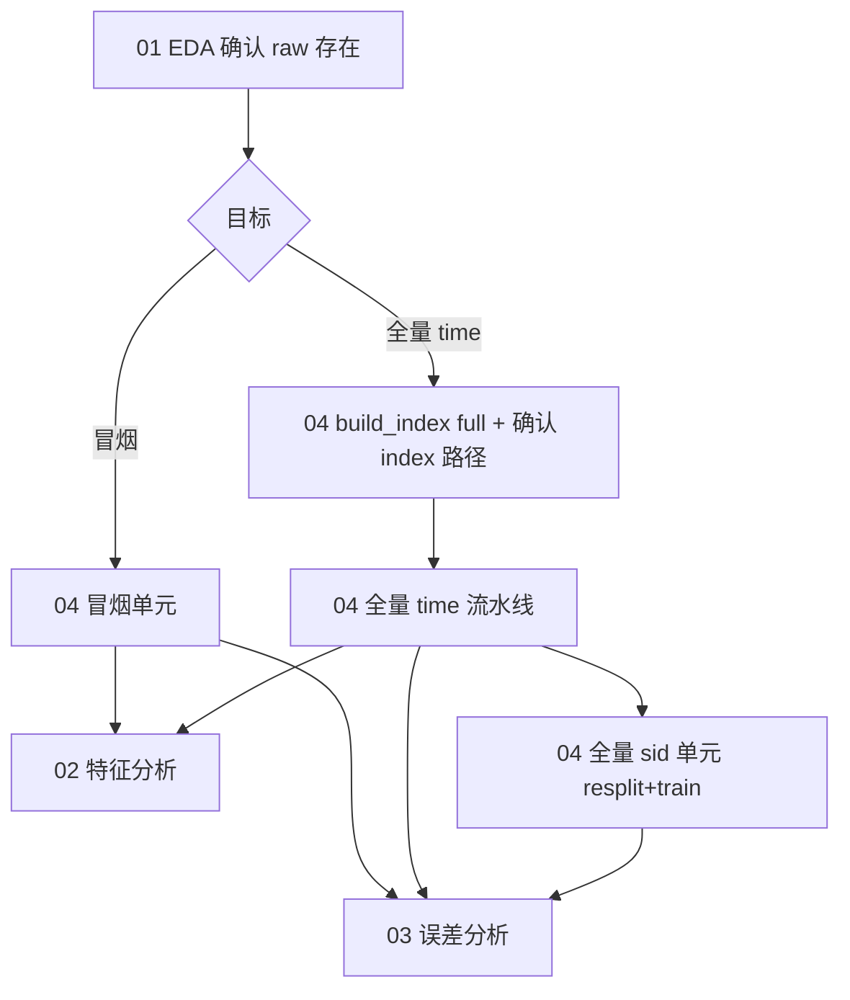

# Notebooks

Jupyter 工作流与命令行 **`scripts/*.sh`** 共用同一套配置（`configs/experiments/*.yaml`）。完整操作说明见 **[`docs/user_guide.md`](../docs/user_guide.md)**。

## 文件一览

| 文件 | 用途 | 典型时机 |
|------|------|----------|
| `01_eda.ipynb` | 原始三表 + **索引表**行数/列概览（不跑 preprocess） | 冒烟/全量**前** |
| `02_feature_analysis.ipynb` | `X` 与 **model.yaml / manifest** 对照 + 按标签统计 | **preprocess 后** |
| `03_error_analysis.ipynb` | 基于 `predictions.csv` 的 FP/FN；**部署 vs oracle KPI**；**空 mcelog / sid 交叉** | **infer + evaluate 之后** |
| `04_run_pipelines.ipynb` | **冒烟 + 全量 time + 全量 sid** 端到端（marker 断点续跑） | 环境验证 / 生产训练 / **泛化对比** |

默认配置：**`spatial_heatmap`** + **5 分钟 horizon** + **`X` [N,31,128,32]**。

---

## 04 — 冒烟 / 全量 time / 全量 sid

`04_run_pipelines.ipynb` 包含三套流程（marker 断点续跑，日志在 `runs/pipeline-logs/`）：

### 冒烟测试（Smoke）

| 步骤 | Notebook 单元 | 命令行等价 |
|------|---------------|------------|
| 生成演示索引 | `smoke` → `build_index` | `bash scripts/build_index.sh smoke` |
| baseline 各步 | `preprocess（含 validate）→ inspect_data → train → infer → evaluate` | 04 冒烟单元比 `autotune.sh` 多 build_index/inspect_data |

- Marker 前缀为 **`smoke` / `full_best` / `full_sid`**（流水线步骤名），与 `run_name`（`exp_tianchi_baseline` 等）不同。
- 流水线日志命名：`{exp}__{step}__{timestamp}.log`（如 `smoke__preprocess__20260613_235559.log`）。
- 单独 `validate.sh` 可选（preprocess 末尾已 validate）。

- 实验配置：**`exp_baseline.yaml`**（~500 行索引；产物 **`data/processed_smoke/`、`data/splits_smoke/`**，与全量目录隔离）。
- 产物：`runs/exp_tianchi_baseline/`。
- **建议**：新环境 / 改代码后**先跑冒烟**，再考虑全量。

### 全量测试（Full + DDP）

| 步骤 | Notebook 单元 | 说明 |
|------|---------------|------|
| 生成全量索引 | `full_best` → `build_index` | `bash scripts/build_index.sh full`（耗时长） |
| 改 `index_features_path` | **已写入 YAML** | `exp_full_best_ddp.yaml` 默认全量 CSV；换索引时改路径并清空 processed |
| 预检 | 全量预检单元 | 若仍指向 stub 则 **fail-fast** |
| preprocess → evaluate | `full_best` 各步 | **`train_ddp.sh`** 多卡训练 |

- 实验配置：**`exp_full_best_ddp.yaml`**（无行数截断；继承 **`ram_budget_frac=0.5`** 系统内存预算；**gpu/ddp 继承 base 默认多卡**）。
- 产物：`runs/exp_tianchi_full_best_ddp/`。
- **sid 泛化**（需先完成全量 time 的 preprocess）：见下方 **「全量 sid」** 小节或 **`docs/user_guide.md` §6.1**。

### 全量 sid 泛化（Full + sid split）

| 步骤 | marker 前缀 | 说明 |
|------|-------------|------|
| resplit → evaluate | `full_sid` | **`bash scripts/resplit.sh`**；需已有 `data/processed/` |

- 实验配置：**`exp_full_best_sid.yaml`** → `data/splits_sid/`，run **`exp_tianchi_full_best_sid`**
- 与 **time_stratified**（`exp_full_best_ddp`）对比部署 KPI：Notebook **「sid 2/2」** 单元或 `outputs/tables/full_best_time_vs_sid_deployment_kpi.csv`
- 详见 **`docs/user_guide.md` §6.1**

### Marker 与重跑

- 已完成步骤写入 `runs/pipeline-logs/markers/<exp>__<step>.done`。
- 重跑：`clear_exp_markers("smoke")` / `clear_exp_markers("full_best")` / **`clear_exp_markers("full_sid")`**
- 修改索引/horizon/网格后：清空 `data/processed/*` 与各 `splits*` 并删除 **preprocess** 的 marker。

---

## 推荐 Notebook 顺序



1. **`01_eda.ipynb`** — 确认 mcelog / tickets / inventory / 索引路径存在。
2. **`04_run_pipelines.ipynb`** — 先 **冒烟**，通过后再 **全量 time**；需跨机泛化对比时再跑 **全量 sid**。
3. **`02_feature_analysis.ipynb`** — 检查 preprocess 后 `X` 与 manifest。
4. **`03_error_analysis.ipynb`** — 训练推理完成后分析预测错误。

---

## 环境与 Docker

```bash
export PYTHONPATH=src   # Notebook 首格通常会自动加入 src
```

- **`docker compose up`** → JupyterLab **http://localhost:9999**（工作目录挂载仓库根）。
- 修改 Python 源码后：**Kernel → Restart** 再跑，避免旧模块缓存。
- 预处理并行度见 `configs/data.yaml` 的 `preprocess_workers` / `preprocess_parallel_frac` / `ram_budget_frac`；manifest 中 `preprocess_workers_requested`、`ram_budget_gib`、`preprocess_estimated_peak_gib`、`split_normalize_estimated_peak_gib`、`preprocess_ram_budget_exceeded` 等标明实际并行与内存预算。

## 输出目录

| 目录 | 内容 |
|------|------|
| `outputs/` | 01–03 分析 Notebook 的表格与图（见 `outputs/README.md`） |
| `runs/` | 训练 checkpoint、predictions、流水线日志 |
| `data/processed/`、`data/splits/`、`data/splits_sid/` | 预处理与切分（time / sid 实验分别读对应 splits_dir） |

演示索引重建：**`bash scripts/build_index.sh smoke`**
