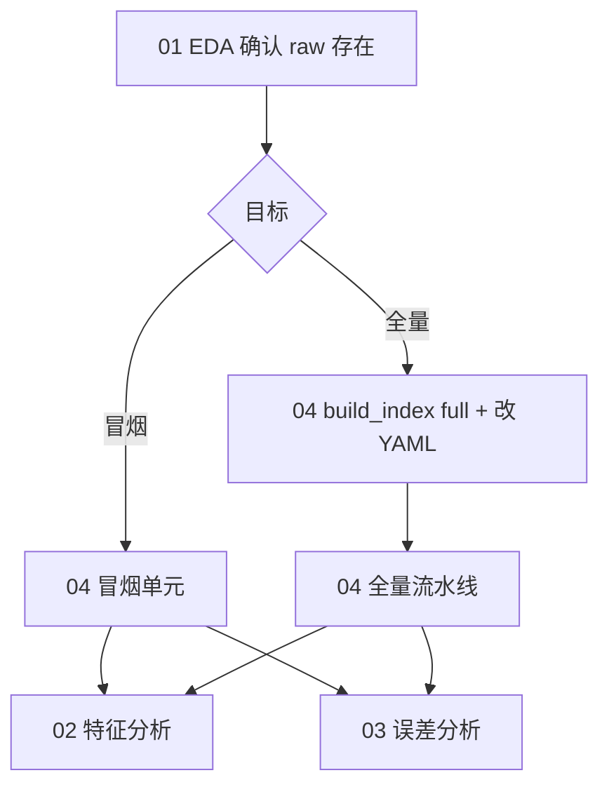

# Notebooks

Jupyter 工作流与命令行 **`scripts/*.sh`** 共用同一套配置（`configs/experiments/*.yaml`）。完整操作说明见 **[`docs/user_guide.md`](../docs/user_guide.md)**。

## 文件一览

| 文件 | 用途 | 典型时机 |
|------|------|----------|
| `01_eda.ipynb` | 原始三表 + **索引表**行数/列概览（不跑 preprocess） | 冒烟/全量**前** |
| `02_feature_analysis.ipynb` | `X` 与 **model.yaml / manifest** 对照 + 按标签统计 | **preprocess 后** |
| `03_error_analysis.ipynb` | 基于 `predictions.csv` 的 FP/FN | **infer 之后** |
| **`04_run_pipelines.ipynb`** | **冒烟 + 全量**端到端（marker 断点续跑） | 环境验证 / 生产训练 |

默认配置：**`spatial_heatmap`** + **5 分钟 horizon** + **`X` [N,31,128,32]**。

---

## 04 — 冒烟测试 vs 全量测试

`04_run_pipelines.ipynb` 包含两套独立流程（均可断点续跑，日志在 `runs/pipeline-logs/`）：

### 冒烟测试（Smoke）

| 步骤 | Notebook 单元 | 命令行等价 |
|------|---------------|------------|
| 生成演示索引 | `smoke` → `build_index` | `bash scripts/build_index.sh smoke` |
| baseline 各步 | `preprocess（含 validate）→ train → infer → evaluate` | 04 冒烟单元比 `autotune.sh` 多 build_index/inspect_data |

- 实验配置：**`exp_baseline.yaml`**（索引 ~500 行、mcelog 截断；**overrides 关闭 DDP/auto_batch** 以加速）。
- 产物：`runs/exp_tianchi_baseline/`。
- **建议**：新环境 / 改代码后**先跑冒烟**，再考虑全量。

### 全量测试（Full + DDP）

| 步骤 | Notebook 单元 | 说明 |
|------|---------------|------|
| 生成全量索引 | `full_best` → `build_index` | `bash scripts/build_index.sh full`（耗时长） |
| 改 `index_features_path` | **手动编辑 YAML** | 指向 `data/raw/features_index_h300s_step300s_full.csv` |
| 预检 | 全量预检单元 | 若仍指向 stub 则 **fail-fast** |
| preprocess → evaluate | `full_best` 各步 | **`train_ddp.sh`** 多卡训练 |

- 实验配置：**`exp_full_best_ddp.yaml`**（无行数截断、`preprocess_parallel_frac=0.85`；**gpu/ddp 继承 base 默认多卡**）。
- 产物：`runs/exp_tianchi_full_best_ddp/`。
- **注意**：仅取消 `max_index_rows` **不会**自动切换全量索引，必须改 `index_features_path` 并清空 `data/processed`、`data/splits`。

### Marker 与重跑

- 已完成步骤写入 `runs/pipeline-logs/markers/<exp>__<step>.done`。
- 重跑某一流程：`clear_exp_markers("smoke")` 或 `clear_exp_markers("full_best")`（见 Notebook 末格），或删除对应 `.done` 文件。
- 修改索引/horizon/网格后：清空 `data/processed/*`、`data/splits/*` 并删除 **preprocess** 的 marker。

---

## 推荐 Notebook 顺序



1. **`01_eda.ipynb`** — 确认 mcelog / tickets / inventory / 索引路径存在。
2. **`04_run_pipelines.ipynb`** — 先 **冒烟** 单元，通过后再 **全量**（可选）。
3. **`02_feature_analysis.ipynb`** — 检查 preprocess 后 `X` 与 manifest。
4. **`03_error_analysis.ipynb`** — 训练推理完成后分析预测错误。

---

## 环境与 Docker

```bash
export PYTHONPATH=src   # Notebook 首格通常会自动加入 src
```

- **`docker compose up`** → JupyterLab **http://localhost:9999**（工作目录挂载仓库根）。
- 修改 Python 源码后：**Kernel → Restart** 再跑，避免旧模块缓存。
- 预处理并行度见 `configs/data.yaml` 的 `preprocess_parallel_frac`；manifest 中 `preprocess_events_finalize_parallel` / `preprocess_grid_fill_parallel` 标明是否启用。

## 输出目录

| 目录 | 内容 |
|------|------|
| `outputs/` | 01–03 分析 Notebook 的表格与图（见 `outputs/README.md`） |
| `runs/` | 训练 checkpoint、predictions、流水线日志 |
| `data/processed/`、`data/splits/` | 预处理与切分（训练实际读取 splits） |

演示索引重建：**`bash scripts/build_index.sh smoke`**
