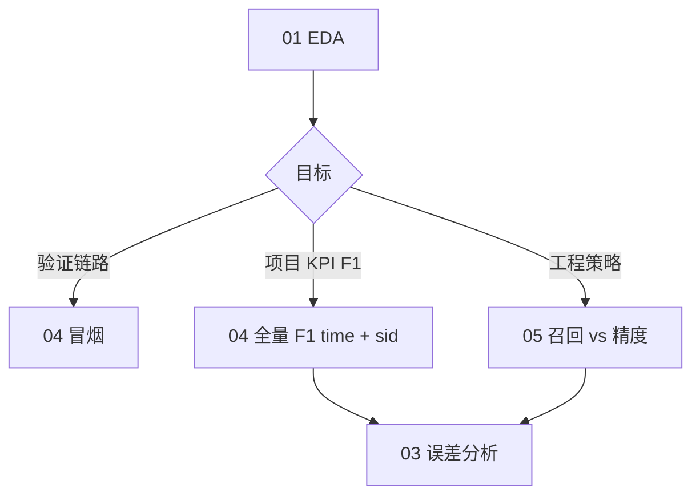

# Notebooks

Jupyter 工作流与命令行 **`scripts/*.sh`** 共用同一套配置（`configs/experiments/*.yaml`）。完整操作说明见 **[`docs/user_guide.md`](../docs/user_guide.md)**。

## 文件一览

| 文件 | 用途 | 典型时机 |
|------|------|----------|
| `01_eda.ipynb` | 原始三表 + **索引表**行数/列概览（不跑 preprocess） | 冒烟/全量**前** |
| `02_feature_analysis.ipynb` | `X` 与 **model.yaml / manifest** 对照 + 按标签统计 | **preprocess 后** |
| `03_error_analysis.ipynb` | 基于 `predictions.csv` 的 FP/FN；**部署 vs oracle KPI**；**空 mcelog / sid 交叉** | **infer + evaluate 之后** |
| `04_run_pipelines.ipynb` | **冒烟 + 全量 F1 最大化（time + sid）** 端到端（marker 断点续跑） | 项目 KPI / 泛化对比 |
| `05_full_recall_vs_precision.ipynb` | **全量召回率优先 vs 精度优先**（time + sid，独立 run_name） | 工程部署策略对比 |

默认配置：**`spatial_heatmap`** + **5 分钟 horizon** + **`X` [N,31,128,32]**。

---

## 04 — 冒烟 / 全量 F1 最大化

`04_run_pipelines.ipynb`：**项目 KPI = 验证集 F1 最大化**（`exp_full_f1_ddp.yaml` / `exp_full_f1_sid.yaml`）。

### 全量 F1（Full + DDP）

| marker | 实验 YAML | run_name |
|--------|-----------|----------|
| `full_f1` | `exp_full_f1_ddp.yaml` | `exp_tianchi_full_f1_ddp` |
| `full_f1_sid` | `exp_full_f1_sid.yaml` | `exp_tianchi_full_f1_sid` |

- 早停：`best_f1`；阈值搜索：`objective: f1`
- `drop_empty_positive_windows: false`（与历史 F1 基线一致）
- 对比表：`outputs/tables/full_f1_time_vs_sid_deployment_kpi.csv`

## 05 — 召回率优先 vs 精度优先

`05_full_recall_vs_precision.ipynb`：工程向两套策略，**模型与日志分目录保存**。

| 策略 | time YAML | sid YAML | run_name |
|------|-----------|----------|----------|
| 召回率优先 | `exp_full_recall_ddp.yaml` | `exp_full_recall_sid.yaml` | `exp_tianchi_full_recall_*` |
| 精度优先 | `exp_full_precision_ddp.yaml` | `exp_full_precision_sid.yaml` | `exp_tianchi_full_precision_*` |

- 共享 preprocess（marker `full_eng`）；`drop_empty_positive_windows: true`
- 对比表：`outputs/tables/full_recall_vs_precision_deployment_kpi.csv`

---

## 04/05 共用说明（marker / 日志）

### 冒烟测试（Smoke，在 04 内）

- Marker 前缀 **`smoke`**；实验 **`exp_baseline.yaml`**；产物 `runs/exp_tianchi_baseline/`、`data/processed_smoke/`
- 日志：`{marker}__{step}__{timestamp}.log`；断点：`runs/pipeline-logs/markers/<exp>__<step>.done`

### Marker 与重跑

- 04：`clear_exp_markers("full_f1")` / `clear_exp_markers("full_f1_sid")`
- 05：`clear_exp_markers("full_eng")` / `clear_exp_markers("full_recall")` 等
- 修改索引/horizon/网格，或 **F1 与工程向 preprocess 切换**时：清空 `data/processed/*` 与各 `splits*` 并删 preprocess marker

---

## 推荐 Notebook 顺序



1. **`01_eda.ipynb`** — 确认 raw 数据
2. **`04_run_pipelines.ipynb`** — 冒烟 → **F1 全量**
3. **`05_full_recall_vs_precision.ipynb`** — **召回/精度**全量（可与 04 独立；preprocess 口径不同需清空 processed）
4. **`03_error_analysis.ipynb`** — 训练完成后分析（按对应 `exp_full_*` YAML 指定 predictions）

---

## 环境与 Docker

```bash
export PYTHONPATH=src   # Notebook 首格通常会自动加入 src
```

- **`docker compose up`** → JupyterLab **http://localhost:9999**（工作目录挂载仓库根）。
- 修改 Python 源码后：**Kernel → Restart** 再跑，避免旧模块缓存。
- 预处理并行度见 `configs/data.yaml` 的 `preprocess_workers` / `preprocess_parallel_frac` / `ram_budget_frac`；manifest 中 `preprocess_workers_requested`、`ram_budget_gib`、`preprocess_estimated_peak_gib`、`split_normalize_estimated_peak_gib`、`preprocess_ram_budget_exceeded` 等标明实际并行与内存预算。

## 输出目录

| 目录 | 内容 |
|------|------|
| `outputs/` | 01–03 分析 Notebook 的表格与图（见 `outputs/README.md`） |
| `runs/` | 训练 checkpoint、predictions、流水线日志 |
| `data/processed/`、`data/splits/`、`data/splits_sid/` | 预处理与切分（time / sid 实验分别读对应 splits_dir） |

演示索引重建：**`bash scripts/build_index.sh smoke`**

## 命令行批量（无 Notebook）

全量 F1 + 召回/精度六组实验一键跑通：

```bash
bash scripts/run_full_notebook_batch.sh
```

日志：`runs/pipeline-logs/full_notebook_batch.log`（`clean.sh` 会清空 `runs/` 内容，脚本本身在 `scripts/`）。
