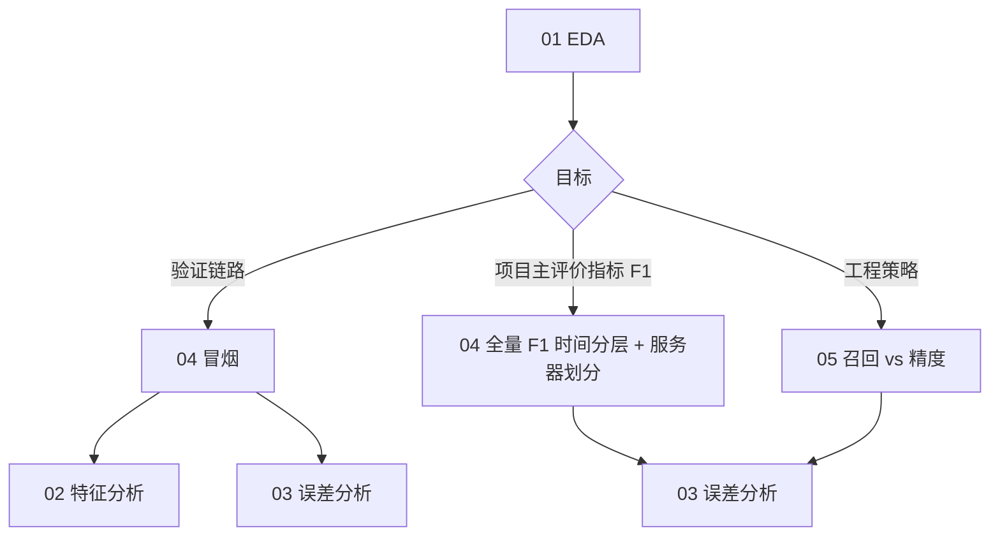

# 笔记本

Jupyter 工作流与命令行 **`scripts/*.sh`** 共用同一套配置（`configs/experiments/*.yaml`）。完整操作说明见 **[`docs/user_guide.md`](../docs/user_guide.md)**。

## 文件一览

| 文件 | 用途 | 典型时机 |
|------|------|----------|
| `01_eda.ipynb` | 原始三表 + **索引表**行数/列概览（不执行预处理） | 冒烟/全量**前** |
| `02_feature_analysis.ipynb` | `X` 与 **model.yaml / manifest** 对照 + 按标签统计 | **完成预处理后** |
| `03_error_analysis.ipynb` | 基于 `predictions.csv` 的 FP/FN；**部署阶段评价与测试集事后分析**；**空 mcelog / sid 交叉** | **完成推理与评估后** |
| `04_run_pipelines.ipynb` | **冒烟 + 全量 F1 最大化（时间分层 + 服务器划分）** 端到端（断点标记中断后续跑） | 项目主评价指标 / 泛化对比 |
| `05_full_recall_vs_precision.ipynb` | **全量召回率优先 vs 精度优先**（时间分层 + 服务器划分，独立实验目录） | 工程部署策略对比 |

默认配置：**`spatial_heatmap`** + **5 分钟 horizon** + **`X` [N,31,128,32]**。

可选压缩实验（命令行，非笔记本）：W8A8 PTQ、三种粒度剪枝、先剪枝后量化，见 `docs/user_guide.md` §9 与 `reports/algorithm_scripts_index.md` §5。

---

## 04 — 冒烟 / 全量 F1 最大化

`04_run_pipelines.ipynb`：**项目主评价指标：验证集 F1 最大化**（`exp_full_f1_ddp.yaml` / `exp_full_f1_sid.yaml`）。

### 全量 F1（全量 + 多卡）

| 断点标记 | 实验 YAML | run_name |
|--------|-----------|----------|
| `full_f1` | `exp_full_f1_ddp.yaml` | `exp_tianchi_full_f1_ddp` |
| `full_f1_sid` | `exp_full_f1_sid.yaml` | `exp_tianchi_full_f1_sid` |

- 早停：`best_f1`；阈值搜索：`objective: f1`
- `drop_empty_positive_windows: false`（与 F1 主实验预处理设定一致）
- 对比表：`outputs/tables/full_f1_time_vs_sid_deployment_kpi.csv`
- 正式指标见 `outputs/tables/full_f1_time_vs_sid_deployment_kpi.csv`；权重在 `runs/exp_tianchi_full_f1_*/<session>/checkpoints/grid_cnn.pt`

## 05 — 召回率优先 vs 精度优先

`05_full_recall_vs_precision.ipynb`：工程实验两套策略，**模型与日志分目录保存**。

| 策略 | time YAML | sid YAML | run_name |
|------|-----------|----------|----------|
| 召回率优先 | `exp_full_recall_ddp.yaml` | `exp_full_recall_sid.yaml` | `exp_tianchi_full_recall_*` |
| 精度优先 | `exp_full_precision_ddp.yaml` | `exp_full_precision_sid.yaml` | `exp_tianchi_full_precision_*` |

- 共享预处理（断点标记 `full_eng`）；`drop_empty_positive_windows: true`
- 对比表：`outputs/tables/full_recall_vs_precision_deployment_kpi.csv`
- 六组汇总：`outputs/tables/full_all_strategies_deployment_kpi.csv`（含 F1 主实验）
- 工程实验指标见 `outputs/tables/full_recall_vs_precision_deployment_kpi.csv`（**不得**替代 F1 主验收）
- **平衡工程实验**（命令行可选）：`exp_full_recall_*_balanced.yaml`（`threshold_profile: balanced`），无独立笔记本单元；阈值见 `configs/threshold_profiles.yaml`

---

## 全量单元开关

04/05 中**全量训练单元默认跳过**，避免误跑数小时任务。开启全量：

```bash
export DRAM2CNN_RUN_FULL_NOTEBOOKS=1
```

冒烟路径（04 前半段）不受此开关影响。

## 04/05 共用说明（断点标记/ 日志）

### 冒烟测试（在 04 内）

- 断点标记前缀 **`smoke`**；实验 **`exp_baseline.yaml`**；输出 `runs/exp_tianchi_baseline/`、`data/processed_smoke/`（索引约 500 行 → 预处理后约 **294** 行）
- 日志：`{marker}__{step}__{timestamp}.log`；断点：`runs/pipeline-logs/markers/<exp>__<step>.done`

### 断点标记与重跑

- 04：`clear_exp_markers("full_f1")` / `clear_exp_markers("full_f1_sid")`
- 05：`clear_exp_markers("full_eng")` / `clear_exp_markers("full_recall")` / `clear_exp_markers("full_recall_sid")` / `clear_exp_markers("full_precision")` / `clear_exp_markers("full_precision_sid")`
- `full_eng` **仅**标记共享工程 preprocess，**无**对应 `run_name`
- 修改索引/horizon/网格，或 **F1 与工程实验预处理 切换**时：清空 `data/processed/*` 与各 `splits*` 并删除预处理断点标记

---

## 推荐笔记本顺序



1. **`01_eda.ipynb`** — 确认 raw 数据
2. **`04_run_pipelines.ipynb`** — 冒烟 →（可选）**F1 全量**（全量需 `DRAM2CNN_RUN_FULL_NOTEBOOKS=1`）
3. **`02_feature_analysis.ipynb`** — 完成预处理后检查 `X` 形状与分布
4. **`03_error_analysis.ipynb`** — infer/evaluate 后做 FP/FN 分析（默认 `exp_baseline`）
5. **`05_full_recall_vs_precision.ipynb`** — **召回/精度**全量（默认跳过；开启同上环境变量；与 F1 preprocess 不同须清空 processed）

---

## 环境与 Docker

各笔记本**setup 首格**应完成三件事：

1. `notebook_setup()` — 设置 `PYTHONPATH`、清除 dram2cnn 模块缓存、返回 canonical `project_root()`  
2. **统一 import** — 本 notebook 后续单元用到的 `load_experiment_config`、`run_step`、`preflight_*` 等  
3. **实验常量** — 如 `FULL_CFG`、`RECALL_TIME_CFG`（04/05），避免跳格运行 `NameError`

`01_eda.ipynb` 仅需推断仓库根目录（不 import 业务模块），setup 仅设置 `sys.path` 并调用 `infer_project_root()`。

```bash
export PYTHONPATH=src   # setup 首格通常会自动设置
```

- **`docker compose up`** → JupyterLab **http://localhost:9999**（工作目录挂载仓库根）。
- 修改 Python 源码后：先重跑各笔记本**setup 首格**（调用 `notebook_setup()`），或 **Kernel → Restart**，避免 `ImportError`（旧 `sys.modules` 缓存）。
- 预处理并行度见 `configs/data.yaml` 的 `preprocess_workers` / `preprocess_parallel_frac` / `ram_budget_frac`；清单中 `preprocess_workers_requested`、`ram_budget_gib`、`preprocess_estimated_peak_gib`、`split_normalize_estimated_peak_gib`、`preprocess_ram_budget_exceeded` 等标明实际并行与内存预算。

## 输出目录

| 目录 | 内容 |
|------|------|
| `outputs/` | 01–03 分析笔记本的表格与图（见 `outputs/README.md`） |
| `runs/` | 训练 checkpoint、predictions、流水线日志 |
| `data/processed/`、`data/splits/` | 全量 F1 / 工程实验默认预处理与切分 |
| `data/processed_smoke/`、`data/splits_smoke/` | 冒烟（`exp_baseline`） |
| `data/splits_sid/`、`data/splits_sid_balanced/` | 全量 sid / 平衡工程 sid |
| `data/splits_sid_smoke/` | 冒烟 sid（`exp_baseline_sid`） |

演示索引重建：**`bash scripts/build_index.sh smoke`**

## 命令行批量（不使用笔记本）

两套全量编排**顺序不同，不可互换**：

| 脚本 | 顺序 | 说明 |
|------|------|------|
| `run_full_notebook_batch.sh` | **先工程实验** preprocess → 再 F1（清空后重 preprocess） | 须先 `build_index.sh full` + 工程实验预处理 |
| `run_full_pipeline_cli.sh` | **先 F1** → 再工程实验（清空后重 preprocess）→ 再跑 notebooks | 自包含 CLI；日志见 `notebooks_run_logs/` |
| `run_full_all_notebooks.sh` | 仅执行全部 notebooks（`DRAM2CNN_RUN_FULL_NOTEBOOKS=1`） | 依赖已有断点标记与输出 |

```bash
bash scripts/build_index.sh full
bash scripts/preprocess.sh configs/experiments/exp_full_recall_ddp.yaml
bash scripts/run_full_notebook_batch.sh
```

日志：`runs/pipeline-logs/full_notebook_batch.log`（`clean.sh` 会清空 `runs/` 内容，脚本本身在 `scripts/`）。
