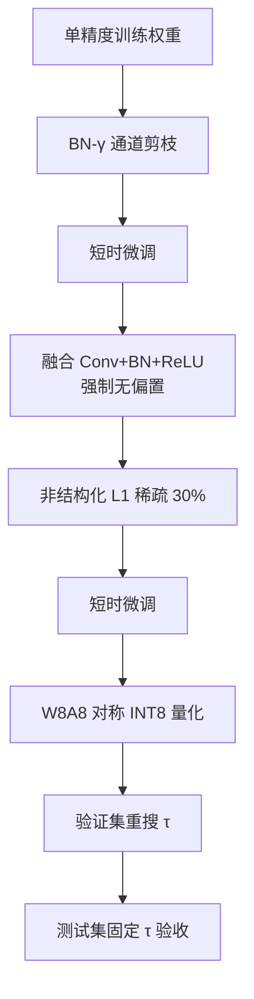
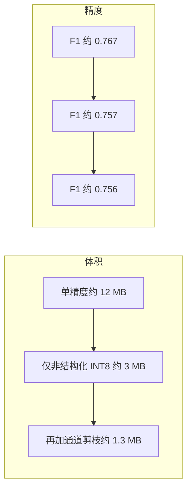
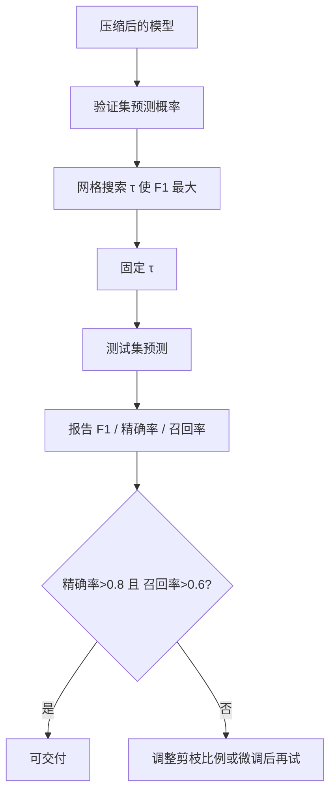

# GridCNN-Deep 单精度模型后处理：剪枝与量化专题报告

## 摘要

本报告面向数据中心动态随机存取存储器（DRAM）故障预测场景，系统说明在单精度卷积神经网络 GridCNN-Deep 训练完成之后，为满足边缘侧整数推理与硬件无偏置约束，所实施的完整后处理过程。后处理并非简单的“压缩文件体积”，而是一条有先后次序、有验收标准、有阈值重标定环节的工程链路：在保留批归一化的前提下完成结构化通道剪枝，将卷积与批归一化及整流线性单元融合并强制去掉偏置，再实施非结构化权重稀疏与短时微调，最后进行整网权重与激活的对称有符号八位整数训练后量化，并在验证集上重新搜索部署决策阈值。

报告首先用较少篇幅交代任务背景、训练选模原理以及压缩前的推理评估效果，使读者理解后处理所服务的对象；随后分章阐述融合无偏置、两类剪枝、量化映射与校准、阈值重标定的原理与具体做法；再给出关键参数、分阶段测试结果，以及“仅非结构化剪枝”“结构化加非结构化组合”“不同通道剪枝比例”等多组对比；最后归纳结论与部署注意点。

在同一套时间分层全量数据与同一无偏置训练权重上，压缩前单精度模型在测试集上的固定验证阈值 F1 约为 **0.767**（精确率约 0.822，召回率约 0.719）。仅实施融合无偏置、非结构化稀疏约百分之三十并整网对称八位量化后，整数模型 F1 约为 **0.757**，打包体积约 **3.04 MB**。进一步叠加批归一化尺度参数通道剪枝（目标比例 0.40）后，整数模型 F1 约为 **0.756**，精确率约 **0.924**，召回率约 **0.639**，打包体积降至约 **1.30 MB**，在“精确率大于 0.8 且召回率大于 0.6”的部署约束下通过验收。五档通道剪枝比例扫参表明：在固定非结构化稀疏与整网量化的前提下，目标比例 0.40 在达标集合中 F1 最高且体积显著下降，故作为现行推荐方案。

全文指标均采用同一评价规则：决策阈值仅在验证集上按 F1 最大化搜索，再固定到测试集报告；禁止以测试集事后搜阈结果作为验收结论。报告表述不涉及工程目录与程序源码，侧重原理、参数、做法与结果对照。

---

## 第 1 章　背景：任务、训练与压缩前效果

### 1.1 预测任务与特征表示

课题以服务器标识与锚点时刻为条件，仅使用锚点之前可观测的机器可纠正错误日志与硬件台账信息，预测未来短时窗内是否出现工单级故障，建模为二分类问题。正类表示“将发生工单级故障”，负类表示“不发生”。特征时间窗与标签时间窗均为五分钟量级：特征窗只看锚点之前的事件，标签窗覆盖锚点及其之后一段时间，工单信息不得写入特征。

特征表示为空间热图。将可纠正错误按逻辑行、列地址分箱，在固定网格上按存储体编号分通道累加，经对数变换后与硬件台账编码拼接，得到通道数为 31、空间尺寸为高 128、宽 32 的三维张量。其中前 16 个通道刻画各存储体上的错误空间密度，后 15 个通道为台账属性在空间上平铺的常数平面。模型输入形状为“样本数 × 31 × 128 × 32”。

### 1.2 网络结构概要

GridCNN-Deep 为纯前馈卷积网络，无残差连接。结构包括：主干首层卷积、四个带最大池化的下采样阶段、自适应全局平均池化、两层全连接分类头。卷积共 11 层，卷积核均为 3×3，同尺寸填充，步长为 1。训练阶段参数量约 318 万（分类头无偏置）。训练时使用批归一化与比例为 0.25 的随机失活；推理时必须关闭随机失活。为满足后续硬件无偏置要求，训练阶段即令分类头不含偏置。

网络输出为二维类别得分。正类概率取 Softmax 后的第二维；当该概率不低于决策阈值时判为正类。Softmax 与阈值比较属于图外后处理，不写入整数卷积图。

### 1.3 训练原理（简要）

全量数据按时间分层划分为训练、验证、测试三份，样本量分别约 24958、5348、5348，正例率约 0.28。输入归一化的中心与尺度仅在训练集估计，验证与测试复用同一套统计量。

损失函数采用加权交叉熵，正类权重取平方根方案并设上限，同时对正样本过采样；本实验未使用 Focal 损失。优化器为 Adam。每一训练轮次结束后，在验证集上对决策阈值做网格搜索，得到该轮的排序类指标与搜阈 F1。早停可监控搜阈 F1，亦可监控与阈值无关的平均精度均值（PR-AUC）。现行推荐训练将早停盯在验证集平均精度均值上，以减轻“搜阈 F1 在前一两轮见顶”带来的观感争议；部署阈值仍在最优权重上按验证集 F1 搜索得到。

须强调三点：第一，磁盘上的检查点是历史最优权重，不是最后一轮；第二，训练损失继续下降不能否定早期最优；第三，固定阈值 0.5 下的 F1 与“搜阈后的 F1”含义不同，不可混读。

### 1.4 压缩前推理评估效果

在无偏置、单精度训练得到的最优权重上，测试集固定验证阈值后的主要指标约为：

| 指标 | 数值（约） |
|------|------------|
| F1 | 0.767 |
| 精确率 | 0.822 |
| 召回率 | 0.719 |
| 决策阈值 | 0.70 |
| ROC-AUC | 0.90 量级 |

该水平明显高于“测试 F1 不低于 0.6”的验收底线，说明算法侧已具备进入压缩与量化的条件。后处理的目标不是继续大幅抬高 F1，而是在可接受的精度损失下，满足无偏置、整网八位整数、体积与算力约束，并保证精确率、召回率同时达到部署门槛。


上图给出从数据到部署的宏观链路。本报告从单精度最优权重出发，详细展开后处理。

---

## 第 2 章　后处理总体流程与设计原则

### 2.1 为何需要后处理

训练得到的单精度模型便于算法迭代，但直接部署到资源受限硬件时存在三类矛盾：

1. **存储与带宽**：单精度权重大约十二兆字节量级，边缘侧往往希望压缩到数兆甚至更低；  
2. **算子形态**：许多整数加速器更希望卷积无偏置、批归一化已折叠、激活为整流线性单元；  
3. **数值格式**：希望权重与层间激活均为有符号八位整数，且缩放规则简单、可离线标定。

因此后处理要同时完成“结构整理、参数稀疏、数值整数化、判决阈值适配”。

### 2.2 推荐总流程

现行推荐顺序如下。

```text
单精度最优权重（含批归一化）
    │
    ▼
① 批归一化尺度参数通道剪枝（结构化）+ 短时微调
    │
    ▼
② 卷积 + 批归一化 + 整流线性单元融合，并强制丢弃偏置
    │
    ▼
③ 非结构化 L1 权重稀疏（约 30%）+ 短时微调
    │
    ▼
④ 整网对称有符号八位训练后量化（权重与激活）
    │
    ▼
⑤ 验证集按 F1 重搜部署阈值 → 测试集固定阈值验收
```



### 2.3 顺序安排的理由

**先结构化剪枝、再融合。** 通道重要性来自批归一化的尺度参数；融合后批归一化不再独立存在，结构化剪枝难以按原定义执行。

**先剪枝与微调、后量化。** 剪枝改变“哪些参数还在、网络多宽”，量化改变“用几比特表示”。应先在单精度上得到接近最终形态的网络，再对最终形态做校准与取整。若先量化再剪枝，已标定的缩放系数会被破坏，通常仍需重新量化。

**融合后必须允许短时恢复。** 强制丢弃偏置会使数值与“完整折叠”不等价，指标可能短暂明显下降；后续稀疏与微调、以及量化前的再搜阈，用于把工作点拉回可部署区间。

**量化后必须重标定阈值。** 压缩改变分数分布，旧阈值不一定仍是最优判决点。阈值只在验证集搜索，再锁到测试集。

### 2.4 评价与验收约定

| 约定 | 内容 |
|------|------|
| 主指标 | 测试集上固定验证阈值后的 F1、精确率、召回率 |
| 阈值来源 | 仅验证集、按 F1 最大化网格搜索 |
| 禁止项 | 用测试集事后搜阈作为验收 |
| 部署附加门槛（现行） | 精确率大于 0.8，且召回率大于 0.6 |
| Softmax | 图外计算；不把类别得分直接与阈值比较 |

---

## 第 3 章　层融合与无偏置约束

### 3.1 原理

训练时常见基本块为：无偏置卷积 → 批归一化 → 整流线性单元。批归一化在推理阶段使用运行均值与方差，可与卷积权重合并，得到等价的“带偏置卷积再加激活”。硬件若明确不支持偏置，则还需在折叠后丢弃偏置项，只保留缩放后的卷积核，再接整流线性单元。此时数值上不再严格等价于标准折叠，属于面向硬件的主动约束。

示意如下：

```text
训练时：
  卷积(无偏置) → 批归一化 → ReLU

标准折叠：
  卷积(含折合偏置) → ReLU

本项目硬件约束下的折叠：
  卷积(无偏置，权重已吸收尺度) → ReLU
  （折合偏置被丢弃）
```

### 3.2 具体做法

1. 在已完成结构化剪枝并微调的模型上，遍历所有“卷积—批归一化—整流”单元；  
2. 将批归一化的尺度与平移吸收进卷积核；平移对应的偏置项置零或删除；  
3. 从图中移除独立批归一化；  
4. 检查全网卷积与全连接均无偏置参数；  
5. 在验证集与测试集上评估；若指标骤降，属预期，进入后续稀疏与微调。

### 3.3 典型现象

融合并丢弃偏置后，若暂不微调，测试指标可能从 F1 约 0.76 量级跌至约 0.44 量级（验证重搜阈值后仍可能表现为极端召回）。这说明偏置项对分数校准有贡献；后续非结构化稀疏后的微调，本质是在无偏置约束下重新学习可用的决策边界。

---

## 第 4 章　剪枝：原理、做法、参数与结果

### 4.1 稀疏化在本项目中的两类含义

| 类型 | 改什么 | 体积与加速 | 本项目用法 |
|------|--------|------------|------------|
| 结构化通道剪枝 | 输出通道数、后续层输入维 | 真正减参数、减稠密乘加 | 批归一化尺度参数通道剪枝 |
| 非结构化权重稀疏 | 部分权值置零，形状不变 | 文件可更小；加速依赖稀疏内核 | 全局 L1，目标约 30% |

二者互补：结构化负责“变窄”，非结构化负责“在保留形状下再挖稀疏”。

### 4.2 结构化剪枝：批归一化尺度参数通道剪枝

#### 4.2.1 原理

批归一化对每个通道学习尺度参数 γ。绝对值较小的 γ 往往对应“贡献较弱”的通道。以 |γ| 为重要性，按比例淘汰输出通道，并同步裁剪后续卷积的输入通道与分类头第一层输入维，即可在不改任务定义的前提下缩小网络宽度。该方法对应网络瘦身思想中的**剪枝阶段**；本实验训练阶段未对 γ 额外施加稀疏正则，因此重要性完全来自训练完成后的现成 γ。

```mermaid
flowchart LR
  A[各层 BN 的 γ] --> B[按 |γ| 排序]
  B --> C[按目标比例保留通道]
  C --> D[切片卷积核与 BN]
  D --> E[同步下一层输入通道]
  E --> F[同步全连接头输入维]
  F --> G[短时微调恢复精度]
```

#### 4.2.2 具体做法

1. 确认模型仍含批归一化；  
2. 对每个卷积—批归一化块提取 |γ|；  
3. 按设定的剪除比例，逐层保留重要性较高的通道（可设每层最少保留通道数）；  
4. 默认保护主干首层与最末卷积层通道，减轻无微调时的崩塌风险；  
5. 按保留索引切片权重并重建层间连接；  
6. 在训练集上短时微调若干轮（本实验为 5 轮），再用验证集评估。

#### 4.2.3 关键参数

| 参数 | 取值 |
|------|------|
| 目标通道剪除比例 | 扫参 0.10～0.50；选用 **0.40** |
| 通道选择方式 | 逐层按相同比例淘汰（非跨层全局排名） |
| 每层最少保留通道数 | 8 |
| 保护主干首层 | 是 |
| 保护末层卷积 | 是 |
| 剪后微调轮数 | 5 |
| 微调优化 | Adam，较小学习率 |

选用 0.40 时，实际通道剪除约 **33%**（因保护层与最少保留通道，实际比例低于名义目标），结构化后参数量约降至 **136 万**量级。

#### 4.2.4 结构化剪枝后的效果（进入融合前）

在目标比例 0.40、微调 5 轮后，测试集验证重搜阈值下的 F1 约 **0.760**，精确率约 **0.831**，召回率约 **0.700**，相对原单精度 F1 约 0.767 仅有小幅下降，说明通道裁剪后仍可通过短训恢复主要判别能力。

### 4.3 非结构化剪枝：全局 L1 幅度稀疏

#### 4.3.1 原理

对全部卷积与全连接的权重张量，按绝对值排序，将全局最小的一部分置零，使非零权重比例下降到目标值。该方法不改变张量形状，实现简单，与后续逐层量化兼容：被置零的位置在取整后仍接近零，有利于压缩存储。

须注意：非结构化稀疏的理论乘加减少不等于通用处理器上的墙钟加速，除非部署栈提供稀疏卷积或稀疏矩阵内核。

#### 4.3.2 具体做法

1. 在融合无偏置之后的模型上，收集所有权重；  
2. 按全局 L1 幅度确定掩码，使目标稀疏度约 30%；  
3. 固化掩码（权重中的零保持为零）；  
4. 短时微调 5 轮，允许非零权重适应稀疏结构；  
5. 验证集重搜阈值并评估测试集。

#### 4.3.3 关键参数

| 参数 | 取值 |
|------|------|
| 方法 | 全局 L1 非结构化稀疏 |
| 目标稀疏度 | **0.30** |
| 作用对象 | 卷积与全连接权重 |
| 是否改形状 | 否 |
| 剪后微调轮数 | 5 |

#### 4.3.4 效果

在“已做通道剪枝 0.40 并融合无偏置”的模型上，再做 30% 非结构化稀疏并微调后，测试集验证重搜阈值下 F1 约 **0.764**，精确率约 **0.852**，召回率约 **0.692**。可见微调后，无偏置带来的崩塌已被明显拉回。

### 4.4 剪枝阶段小结

剪枝阶段回答的问题是：在硬件无偏置与有限容量下，如何先得到一个“够瘦、仍可学”的单精度网络。结构化剪枝贡献主要的参数量下降；非结构化剪枝进一步制造零权重，为整数打包后的体积收益做准备；两次短时微调是精度恢复的关键手段。

---

## 第 5 章　量化：原理、做法、参数与结果

### 5.1 训练后量化与本项目选型

量化把连续浮点映射为有限整数。按训练介入程度，常见有训练后量化与量化感知训练。本项目采用**训练后量化**：在剪枝与微调完成后的单精度模型上，用校准数据估计缩放系数，并对权重做重建优化，不重新进行完整任务训练。

按数值格式，本项目采用：

- 位宽：权重八位、激活八位（常称 W8A8）；  
- 符号：有符号整数，取值范围 \([-128,127]\)；  
- 对称性：零点恒为 0；  
- 粒度：逐层（每个张量一个标量缩放），**不是**逐通道；  
- 覆盖：主干首层与分类末层一并量化，无单精度保护层。

### 5.2 对称量化映射

对浮点值 \(x\) 与正的标量缩放 \(s\)：

\[
q=\mathrm{clip}\big(\mathrm{round}(x/s),\,-128,\,127\big),\qquad
\hat x=q\cdot s
\]

因为零点为 0，反量化无需再减零点。层输入激活与权重均按此形式各自使用本层的 \(s\)。整数乘加之后，再按“激活缩放 × 权重缩放”恢复到下一层所需的浮点或下一级量化域，并在融合单元内施加整流线性单元。

```text
浮点激活 x
   │
   ▼
按 s_act 量化为 int8
   │
   ▼
与 int8 权重做整数卷积/全连接
   │
   ▼
乘以 (s_act × s_weight) 得到近似浮点
   │
   ▼
ReLU（若该层有）
   │
   ▼
进入下一层激活量化
```

分类末层输出两个类别得分，其后**不再**做激活量化，也不在图内做 Softmax。

### 5.3 校准与重建的具体做法

1. **校准数据**：从验证集均匀抽取固定数量样本（本实验为 1024），仅用于观察激活范围与优化权重取整，不参与阈值搜索的验收定义之外的用途混淆；  
2. **激活观察**：对每层输入激活，按绝对值的高分位数估计幅度，再除以 127 得到对称缩放；  
3. **权重**：每层一个缩放，将权重量化到有符号八位；  
4. **逐层重建**：在校准集上对权重取整策略做短时重建（近似四舍五入到整数的可学习松弛），降低重建误差；  
5. **二次校准**：重建后再测一遍激活缩放，减轻权重取整后激活分布漂移；  
6. **打包**：导出整数权重、逐层缩放、通道掩码（若做过结构化剪枝）与部署阈值；  
7. **参考推理**：用整数权重路径在测试集上复核，并与伪量化路径对照。

### 5.4 关键量化参数

| 参数 | 取值 |
|------|------|
| 方案 | 训练后量化，W8A8 |
| 权重 | 逐层对称有符号八位，零点 0 |
| 激活 | 逐层对称有符号八位，零点 0 |
| 整数域 | \([-128,127]\) |
| 是否逐通道 | 否 |
| 是否无符号八位 | 否 |
| 主干首层 | 量化 |
| 分类末层 | 量化 |
| 批归一化 | 已融合，图中不存在 |
| 偏置 | 全无 |
| 校准样本量 | 1024（验证集子集） |
| Softmax | 图外 |

### 5.5 量化结果（现行组合方案）

在“通道剪枝 0.40 + 融合无偏置 + 非结构化 30% + 微调”之后做整网量化，测试集固定验证重搜阈值后：

| 指标 | 数值（约） |
|------|------------|
| F1 | **0.7559** |
| 精确率 | **0.9244** |
| 召回率 | **0.6394** |
| 部署阈值 | **0.50** |
| 打包体积 | 约 **1.30 MB** |

相对量化前同链路的单精度剪枝模型，F1 仅有极小下降；相对压缩前原单精度 F1 约 0.767，绝对下降约 0.011。精确率上升、召回率下降，是八位量化后分数分布变“更保守”的常见表现，需靠阈值重搜在精确率与召回率之间取得可部署折中。

伪量化仿真与整数打包参考推理的 F1 一致，说明打包格式与参考整数前向在任务指标上对齐。

### 5.6 量化与输出后处理的边界

部署实现必须区分两件事：

1. **网络内部**：整数卷积或全连接、逐层缩放、整流线性单元；  
2. **网络外部**：对两个类别得分做 Softmax，取正类概率，与阈值比较得到 0 或 1。

把类别得分直接与阈值比较、或把 Softmax 硬塞进八位层，都会破坏与验收数字的对齐。

---

## 第 6 章　决策阈值为何在压缩后重标定

### 6.1 原理

训练阶段得到的阈值，适配的是当时单精度分数分布。剪枝、丢偏置、量化都会改变正类概率的均值、方差与可分性。若仍使用旧阈值，等于用旧刀切新分数，工作点漂移，报告的精确率与召回率不能代表真实可部署状态。

### 6.2 做法

1. 在压缩后的模型上，于**验证集**网格搜索使 F1 最大的阈值；  
2. 将该阈值写入部署配置；  
3. 在**测试集**上固定该阈值计算 F1、精确率、召回率；  
4. 测试集事后搜阈仅可作分析，不得替代第 3 步。

### 6.3 现象

同一训练权重下，压缩链路不同，最终部署阈值可从约 0.70（训练阶段）变为约 0.52（仅非结构化加量化）或约 0.50（再加通道剪枝）。阈值变化本身不是异常，而是分数重分布后的正常结果。

---

## 第 7 章　分阶段结果总表与对比

### 7.1 现行推荐链路的分阶段测试表现

数据同一、训练权重同一、评价规则同一。下表为测试集结果（剪枝与量化阶段的阈值为各阶段验证重搜所得）。

| 阶段 | F1 | 精确率 | 召回率 | 说明 |
|------|-----|--------|--------|------|
| 单精度训练权重 | 0.7670 | 0.8216 | 0.7192 | 训练阶段阈值约 0.70 |
| 通道剪枝 0.40 + 微调 | 约 0.760 | 约 0.831 | 约 0.700 | 仍含批归一化 |
| 融合并丢弃偏置（未再训） | 明显下降 | — | — | 属预期 |
| 非结构化 30% + 微调 | 约 0.764 | 约 0.852 | 约 0.692 | 阈值重搜 |
| **整网对称 INT8（交付）** | **0.7559** | **0.9244** | **0.6394** | 阈值 **0.50** |

### 7.2 仅非结构化方案与组合方案对比

| 方案 | 结构化剪枝 | 非结构化 | 量化 | 部署阈值 | F1 | 精确率 | 召回率 | 体积约 |
|------|------------|----------|------|----------|-----|--------|--------|--------|
| 压缩前单精度 | 无 | 无 | 无 | 0.70 | 0.7670 | 0.8216 | 0.7192 | 约 12.1 MB（单精度权重） |
| 仅非结构化 + 整网 INT8 | 无 | 30% | 对称 INT8 | 0.52 | 0.7570 | 0.9263 | 0.6401 | 约 3.04 MB |
| **通道 0.40 + 非结构化 30% + INT8** | **有** | **30%** | **对称 INT8** | **0.50** | **0.7559** | **0.9244** | **0.6394** | **约 1.30 MB** |

解读：

- 两种压缩方案相对单精度，F1 损失都约在 0.01 量级，仍远高于 0.6 的底线；  
- 二者精确率与召回率均满足“精确率大于 0.8、召回率大于 0.6”；  
- 组合方案在 F1 几乎持平的情况下，体积从约 3 MB 降到约 1.3 MB，结构化剪枝贡献了主要的额外压缩；  
- 组合方案召回略低于压缩前，但通过阈值重搜仍守住部署门槛。

### 7.3 通道剪枝比例扫参对比（固定非结构化 30% 与整网 INT8）

| 目标比例 | 实际通道剪除约 | INT8 F1 | 精确率 | 召回率 | 部署阈值 | 打包体积约 | 是否达标 |
|----------|----------------|---------|--------|--------|----------|------------|----------|
| 0.10 | 8.4% | 0.7504 | 0.9535 | 0.6186 | 0.56 | 2.53 MB | 是 |
| 0.20 | 16.6% | 0.7504 | 0.9535 | 0.6186 | 0.56 | 2.08 MB | 是 |
| 0.30 | 24.8% | 0.7553 | 0.9184 | 0.6414 | 0.58 | 1.67 MB | 是 |
| **0.40** | **33.0%** | **0.7559** | **0.9244** | **0.6394** | **0.50** | **1.30 MB** | **是** |
| 0.50 | 41.4% | 0.7504 | 0.9535 | 0.6186 | 0.64 | 0.98 MB | 是 |

选用 **0.40** 的理由：五档全部达标；其中 F1 最高；召回仍明显高于 0.6；相对 0.50 不过度追求极限体积，稳定性更好。



### 7.4 与历史单精度搜阈早停方案的对照说明

另有一批次训练以验证搜阈 F1 早停，最优出现在较早轮次，压缩后整数模型 F1 约 0.749、体积约 3.04 MB。其量化约束与“仅非结构化加整网 INT8”相同，但训练选模指标不同，故不宜与本章现行表混为同一条曲线。对照价值在于：无论早停盯搜阈 F1 还是盯平均精度均值，只要压缩链路与评价规则一致，整网对称八位方案均可把测试 F1 维持在 0.75 附近，说明后处理框架具有可重复性。

### 7.5 方法对比：先剪枝后量化相对于其他选择

| 选择 | 优点 | 风险或代价 |
|------|------|------------|
| 先剪枝后量化（本报告） | 拓扑先定形；校准对象明确；与无偏置融合衔接自然 | 需两次或以上短时微调 |
| 先量化后剪枝 | 少见场景下可复用已有整数图 | 剪枝破坏缩放，常需重新量化 |
| 只量化不剪枝 | 流程短 | 体积仍偏大，难以到 1 MB 量级 |
| 只剪枝不量化 | 便于分析结构敏感性 | 不满足整数硬件主路径 |
| 量化感知训练 | 可能进一步回升精度 | 训练成本高，本阶段未作为主交付 |

---

## 第 8 章　原理图示汇总

### 8.1 从训练块到部署块

```text
【训练】
Conv(无偏置) → BN(γ,β,均值,方差) → ReLU → …
                 │
                 │ 结构化剪枝按 |γ| 裁通道
                 ▼
【剪通道后仍训练/微调】
Conv' → BN' → ReLU → …
                 │
                 │ 融合并丢偏置
                 ▼
【部署单精度形态】
Conv''(无偏置) → ReLU → … → 全连接(无偏置) → 得分
                 │
                 │ 非结构化置零 + 微调
                 ▼
【稀疏单精度】
Conv_sparse → ReLU → …
                 │
                 │ 逐层对称 INT8
                 ▼
【部署整数形态】
int8 激活 → int8 卷积 → 反缩放 → ReLU → … → 得分
                 │
                 ▼
            Softmax（图外）→ 与 τ 比较 → 0/1
```

### 8.2 对称八位与非对称八位的差异（概念）

```text
对称有符号（本项目）：
  实数轴 …… -a …… 0 …… +a ……
  整数轴 …… -128 …… 0 …… +127 ……
  零点 = 0，公式简单

非对称无符号（本项目不用）：
  实数轴 …… xmin …… xmax ……
  整数轴 0 …… 255
  通常需要非零零点
```

### 8.3 验收逻辑



---

## 第 9 章　工程实现注意点（不含程序细节）

1. **输入必须已按训练集规则归一化**，部署侧禁止再估计均值方差。  
2. **推理关闭随机失活**。  
3. **若存在通道掩码，加载时必须按掩码重建各层通道**，否则权重形状无法对齐。  
4. **禁止把任何偏置向量加回网络**。  
5. **缩放必须是每层一个标量**，不要误做成逐输出通道向量。  
6. **不要使用无符号八位或非零零点** 去“兼容”本报告的验收数字。  
7. **阈值只对概率生效**，不对原始得分生效。  
8. **软件参考整数推理的耗时**，不能直接当作专用加速器性能结论。

---

## 第 10 章　结论

### 10.1 主要结论

第一，GridCNN-Deep 在无偏置单精度训练后，测试集固定验证阈值 F1 约 0.767，已具备进入压缩的算法基础。

第二，面向硬件的后处理应采用固定顺序：**结构化通道剪枝 → 融合并强制无偏置 → 非结构化稀疏与微调 → 整网对称有符号八位训练后量化 → 验证集重搜部署阈值**。该顺序兼顾批归一化可用性、无偏置约束与量化校准对象的一致性。

第三，量化方案应明确为：逐层对称、有符号八位、零点为 0、权重与激活均量化、首尾层不除外。该方案与“无偏置、无批归一化层、图外 Softmax”的部署边界一致，可复现。

第四，仅非结构化百分之三十加整网量化，可将体积压至约 3 MB，F1 约 0.757；再叠加通道剪枝目标比例 0.40，可将体积压至约 **1.3 MB**，F1 约 **0.756**，精确率约 **0.924**，召回率约 **0.639**，满足“精确率大于 0.8 且召回率大于 0.6”的部署约束。

第五，通道剪枝比例扫参显示 0.10 至 0.50 五档均可达标，其中 **0.40** 在 F1 与体积之间最为均衡，故作为现行推荐。

第六，压缩后重标定阈值合理且必要。阈值是分数分布上的判决超参，必须随模型压缩在验证集更新，再锁到测试集，否则无法公平反映可部署工作点。

### 10.2 价值与边界

本后处理把“算法可达的单精度效果”转化为“硬件可执行的整数模型”，在约一个百分点量级的 F1 代价下，获得约一个数量级的权重存储压缩（相对单精度）以及相对仅非结构化方案再降一半以上的打包体积。边界在于：非结构化稀疏的实际加速依赖部署内核；强制无偏置引入与标准折叠不等价的误差，必须靠微调与搜阈消化；报告中的整数指标来自参考实现语义，专用芯片仍需按其指令集完成联调。

### 10.3 建议

对同类卷积故障预测模型，建议将“融合无偏置、先剪后量化、验证重搜阈值、精确率与召回率双门槛”固化为交付检查单；在体积仍有压力时，优先在结构化剪枝比例上扫参，而不是盲目提高非结构化稀疏或改为非对称无符号八位。若未来硬件允许保留偏置或提供更强的量化感知训练资源，可在不改变评价规则的前提下单独开题，与本报告主方案对照，而不是替换已验收的对称八位定义。

---

## 第 11 章　训练与评价细节补充（支撑后处理理解）

### 11.1 为何压缩前必须先看清“选模指标”

后处理的对象是某一个检查点，而不是“训练到最后一轮的权重”。若选模指标与部署评价不一致，压缩实验会在错误的起点上打转。本项目中：

- 部署关心的是：验证集搜到的阈值固定后，测试集 F1、精确率、召回率；  
- 训练过程中，每一轮都可以计算固定阈值 0.5 的 F1、搜阈后的 F1、ROC-AUC、平均精度均值等。

这些曲线常常不同步：训练损失可一直下降，固定 0.5 的 F1 后期可变好，但排序质量或搜阈 F1 已回落。后处理必须基于“按既定早停规则保存的最优权重”，否则会出现“压缩前看起来一般、压缩后更差，却归咎于量化”的误判。

现行推荐用验证集平均精度均值做早停，是因为它不依赖每轮临时搜阈，曲线更平滑，又能反映正类排序能力；部署阈值仍在该最优权重上按 F1 搜索。这样既减少“第二轮见顶”的误解，又不改变部署评价定义。

### 11.2 类别不平衡如何影响后处理观感

正例率约 0.28，训练使用类别权重与过采样，模型倾向于给出整体偏高的正类分数，因此训练阶段最优阈值常明显高于 0.5（例如约 0.70）。量化后分数往往被“压矮”或分布变尖，最优阈值可能下降到约 0.50。若有人拿训练阶段的 0.70 去切整数模型，会看到召回显著变差，从而误以为量化失败。正确做法是承认分布变了，并在验证集重搜阈值。

### 11.3 时间分层划分与后处理公平性

训练、验证、测试按时间分层切分，避免简单随机划分造成的时间泄漏。后处理校准激活时使用验证集子集，阈值搜索也使用验证集，测试集只做最终一次固定阈值评价。这条隔离规则与“算法训练阶段”完全一致，是压缩实验可被外部评审接受的前提。

---

## 第 12 章　剪枝原理的深入说明

### 12.1 重要性分数的直觉

无论结构化还是非结构化，剪枝都需要回答：删谁损失更小？非结构化用权重绝对值，直觉是“幅度小的连接贡献小”；通道剪枝用 |γ|，直觉是“该通道在批归一化后的放缩很弱，特征图整体被压得很小”。这两种启发式都不是定理，但在卷积网络上反复有效，且计算代价低，适合作为训练后剪枝的第一刀。

### 12.2 为何通道剪枝要同步后续层

若只删除某一层的输出通道而不改下一层输入通道，卷积核形状不匹配，网络无法前向。因此通道剪枝是一次**拓扑手术**：输出切片、输入切片、批归一化通道切片、必要时分类头输入维切片，必须一次完成。这也解释了为何结构化剪枝比“只把权重置零”更“重”，以及为何需要微调。

### 12.3 保护首尾层的工程含义

主干首层直接接触输入热图，末层卷积靠近全局汇聚，二者对稳定特征尺度更敏感。剪枝时保留其全部通道，等于把最容易导致崩塌的两处先按住，把压缩压力留给中间阶段。中间阶段通道数本来更宽，可剪空间更大。扫参中实际剪除比例低于名义比例，部分原因就在此。

### 12.4 非结构化百分之三十的经验位置

过低（例如百分之十）对体积帮助有限；过高（例如百分之七十）在无偏置约束叠加时，微调未必能恢复召回。百分之三十是在“有明显零权重”与“仍可短时恢复”之间的折中，并与历史对照实验一致：在仅非结构化设定下，百分之三十、五十、七十均可在搜阈后维持可接受 F1，但部署主路径无需一上来就走极端稀疏。

### 12.5 剪枝后微调在做什么

微调不是重新做全量训练，而是用较小学习率在训练集上继续若干轮，让留下来的权重适应新的通道组合或稀疏掩码。可以把它理解成“外科手术后的康复期”。没有这一步，融合丢偏置或通道删除造成的临时损伤容易被误写成“该方法不可用”。

---

## 第 13 章　量化原理的深入说明

### 13.1 误差从哪里来

对称八位量化的误差主要来自：

1. **截断**：超出 \([-128s, 127s]\) 的值被夹紧；  
2. **取整**：落到最近整数格点；  
3. **层间累积**：前一层的量化误差成为后一层的输入噪声；  
4. **无偏置约束**：缺少偏置使仿射校准能力变弱，与量化误差叠加。

因此量化不是单独的一步数学映射，而是与前面的融合、剪枝强耦合。这也是必须先剪枝微调、再量化的另一层原因：先把模型放到一个“可被八位表示”的邻域，再取整。

### 13.2 为何坚持对称与有符号

对称零点为 0，整数乘加后的反缩放公式简单，硬件与软件都更不容易实现错。有符号范围覆盖负激活（整流前的卷积输出可为负，尽管本网络许多位置紧接整流，但层输入仍可能为任意实数）。无符号八位常配合非零零点，和本项目验收链路不一致，若混用会导致“同一套阈值对不上同一套概率”。

### 13.3 为何用逐层而不是逐通道

逐通道权重缩放通常更精细，可能略降误差，但：

- 部署与核函数要为每个输出通道携带缩放；  
- 与“简单、可审计、整网统一规则”的交付目标相比，收益不一定值得；  
- 本任务热图纹理相对粗糙，逐层缩放已能把 F1 损失控制在约 0.01。

因此主交付明确写成逐层，并在检查单中禁止误用逐通道向量。

### 13.4 校准集与阈值搜索集的关系

二者都可以来自验证划分，但角色不同：校准集估计激活幅度与辅助权重重建；阈值搜索优化的是分类工作点。不可用测试集做校准，也不可把校准集上的临时指标当成验收。实践中抽取一千量级验证样本足够稳定估计高分位幅度，又控制校准耗时。

### 13.5 伪量化与真整数路径

伪量化：仍用浮点计算，但在前向中插入“量化—反量化”模拟取整。  
真整数路径：权重量化为整数存储，按整数语义计算再缩放。

两者 F1 一致，说明导出与参考实现没有“打包写错、推理读错”的断层。对硬件对接，真整数路径的字段定义（逐层缩放、无偏置、通道掩码）才是契约；伪量化只是算法侧的中间验证手段。

### 13.6 Softmax 为何留在图外

Softmax 需要指数与归一化，不具备“整数点积再乘缩放”的同构形式。更重要的是，验收定义建立在浮点概率与阈值比较上。把 Softmax 塞进八位图，既难保证数值，也会让阈值失去清晰含义。因此图外处理不是遗漏，而是边界设计。

---

## 第 14 章　结果解读与误差归因

### 14.1 精确率升、召回降说明了什么

整数模型相对单精度，往往更“不敢报正类”或正类概率整体下移，于是在重搜阈值后，仍可能落到“更高精确率、更低召回”的工作点。对本业务，精确率过低会造成大量误报工单，精确率门槛大于 0.8 有业务合理性；召回大于 0.6 则保证漏检不至于失控。现行组合方案精确率约 0.92、召回约 0.64，落在约束内偏“稳”的一侧。

### 14.2 体积从十二兆到三点零四兆再到一点三零兆

- 十二兆到三点零四兆：主要来自八位化（约四倍）再叠加非结构化零值的打包收益；  
- 三点零四兆到一点三零兆：主要来自通道变少带来的稠密参数减少，再保持八位与稀疏。  

因此，若只报告“量化压缩四倍”，会低估结构化剪枝的贡献；若只报告“剪枝”，又会忽略没有八位化时文件仍偏大。完整叙事应是二者接力。

### 14.3 融合丢偏置后的低谷为什么可以接受

该低谷出现在中间态，不是交付态。它证明偏置被真正拿掉（而不是口头宣称）。只要后续微调与量化后指标回到约束内，中间低谷反而是过程诚实性的证据。若某次实验融合后不降反升，反而要怀疑是否仍残留偏置。

### 14.4 扫参平台期的含义

百分之十与百分之二十在整数指标上非常接近，说明轻度通道剪枝对任务损失不敏感，体积收益也相对有限。进入百分之三十至百分之四十，F1 略升或持平而体积继续下降，出现“性价比甜区”。百分之五十体积更小，但 F1 回落到与轻度剪枝相近，召回也更紧贴门槛，作为极限方案可以保留，不宜作为默认。

---

## 第 15 章　对照实验的方法论说明

### 15.1 一次只改一个因素

报告中的对比尽量遵循：

- 同一训练权重、同一数据划分、同一评价规则；  
- 扫通道比例时，固定非结构化百分之三十与整网对称八位；  
- 对比“有无结构化”时，其余量化定义保持一致。

这样，F1 或体积的差异才能归因到所改因素，而不是混入重新训练的噪声。

### 15.2 主表与附表

主表始终是：验证重搜阈值后的测试集指标。  
附表可以是：固定旧阈值的对照，用于观察“若不重搜阈会多惨”。主表用于交付，附表用于解释为何必须重搜阈。二者不要在汇报时混读。

### 15.3 与纯剪枝研究、纯量化研究的关系

纯剪枝研究关心结构方法谁更强；纯量化研究关心位宽与校准谁更稳。本报告关心的是**可交付组合**：在真实硬件约束下，怎样串起来仍然达标。因此结论写成“推荐组合与参数”，而不是宣称某一种孤立技术绝对最优。

---

## 第 16 章　部署交付检查清单（文字版）

完成一条后处理链路后，建议按下列条目核对，全部通过再冻结版本：

1. 训练检查点确认为既定早停规则下的历史最优，而非末轮；  
2. 若使用通道剪枝，通道掩码与权重形状一致，首尾保护策略与实验记录一致；  
3. 融合后全网无偏置，抽查卷积与全连接均无偏置向量；  
4. 非结构化稀疏度达到约定目标，微调轮数足够；  
5. 量化为逐层对称有符号八位，零点为 0，首尾层均量化；  
6. 验证集完成阈值搜索，测试集仅用固定阈值评价；  
7. 测试精确率大于 0.8，召回率大于 0.6，F1 不低于项目底线；  
8. 伪量化与整数参考路径的任务指标一致；  
9. 部署说明写清：输入已归一化、关闭随机失活、Softmax 在图外、阈值对概率生效；  
10. 版本说明中写明：通道剪枝比例、非结构化稀疏度、量化定义、部署阈值、测试三项分类指标与体积。

---

## 第 17 章　局限与后续可研方向

1. **训练阶段未对 γ 做稀疏正则**，通道重要性是“事后借用”，若未来在训练中加入对 γ 的惩罚，同样剪除比例下精度可能更好。  
2. **未把量化感知训练作为主路径**，在召回需要再抬升时，可把它作为加分项而不是替换对称八位定义。  
3. **非结构化加速未在专用稀疏内核上实测**，体积收益已证实，墙钟加速需结合具体芯片再测。  
4. **强制无偏置是硬件前提**，若硬件日后支持偏置，可评估“保留折合偏置”能否在同等体积下挽回召回。  
5. **业务阈值策略**若从“F1 最大”改为“精确率约束下最大召回”，扫参优选比例可能变化，但后处理骨架仍可复用。

---

## 第 18 章　全文结构化回顾

回看整条故事线：先有可纠正错误空间热图与 GridCNN-Deep 的单精度学习，再有验证集选模与搜阈保证压缩前效果扎实；随后用通道剪枝把网络变窄，用融合满足无偏置，用非结构化稀疏继续挖零，用对称八位把存储与计算拉进整数域，用验证集重搜阈把工作点对齐部署约束。对比实验表明，体积可以从约十二兆字节降到约一点三兆字节，而测试 F1 仍留在约 0.76 附近，精确率与召回率同时过线。这不是单点技巧，而是原则清楚、顺序固定、参数可扫、结果可复核的后处理体系。

对内，它把算法组与部署组的接口从“要一个模型文件”变成“要一套带掩码、缩放、阈值与验收数字的完整制品”；对外，它证明在严格评价规则下，深度学习故障预测模型可以压缩到边缘可承载的整数形态，而不必回到无法维护的手工规则堆砌。

---

## 附录 A　关键参数速查

| 类别 | 参数 | 推荐取值 |
|------|------|----------|
| 结构化剪枝 | 目标比例 | 0.40 |
| 结构化剪枝 | 微调轮数 | 5 |
| 结构化剪枝 | 保护首尾卷积 | 是 |
| 融合 | 强制无偏置 | 是 |
| 非结构化剪枝 | 目标稀疏度 | 0.30 |
| 非结构化剪枝 | 微调轮数 | 5 |
| 量化 | W8A8 对称有符号 | 是 |
| 量化 | 零点 | 0 |
| 量化 | 逐层 / 非逐通道 | 逐层 |
| 量化 | 首尾层 | 均量化 |
| 阈值 | 搜索集合 | 验证集 |
| 阈值 | 目标 | F1 最大 |
| 验收 | 精确率 / 召回率 | >0.8 / >0.6 |

## 附录 B　关键结果速查

| 模型 | F1 | 精确率 | 召回率 | 阈值 | 体积约 |
|------|-----|--------|--------|------|--------|
| 单精度最优 | 0.7670 | 0.8216 | 0.7192 | 0.70 | 12.1 MB |
| 仅非结构化 INT8 | 0.7570 | 0.9263 | 0.6401 | 0.52 | 3.04 MB |
| 通道 0.40 + 非结构化 INT8 | 0.7559 | 0.9244 | 0.6394 | 0.50 | 1.30 MB |

---

## 附录 C　名词说明

| 名词 | 含义 |
|------|------|
| 单精度 | 常用三十二位浮点训练与推理 |
| 训练后量化 | 训练结束后再估计缩放并取整，不完整重训 |
| 对称量化 | 零点为 0，正负幅度按同一缩放映射 |
| 逐层量化 | 每个权重张量或每层激活共用一个缩放 |
| 结构化剪枝 | 删除通道等结构单元 |
| 非结构化剪枝 | 权重置零但不改形状 |
| 部署阈值 | 正类概率判正的分界 |
| 图外后处理 | Softmax 与阈值比较不在整数卷积图内 |

---

**报告结束。**
