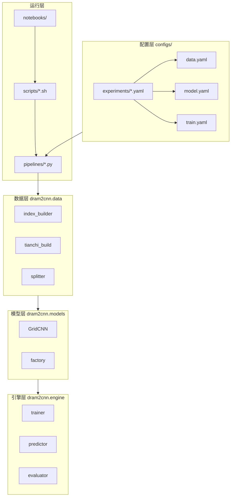

# 基于CNN的内存故障预测算法设计报告

---

**文档编号**：DRAM2CNN-DESIGN-2026-001  
**项目名称**：天池 DRAM 故障预测 · 空间热图 2D-CNN（dram2cnn）  
**版本**：V3.0  
**编制日期**：2026年7月10日  
**密级**：内部技术文档  
**仓库路径**：`/root/workspace`

---

## 摘要

本报告面向服务器 DRAM 可纠正错误（CE）驱动的工单级故障预测任务，阐述基于空间热图与 GridCNN-Deep 卷积网络的端到端算法设计。对每条样本锚点，系统利用半开特征窗 \([t-W,\,t)\) 内的 mcelog 与 inventory，预测闭标签窗 \([t,\,t+H]\) 内是否出现符合筛选条件的工单级故障。默认输入为 \(\mathbf{X}\in\mathbb{R}^{N\times 31\times 128\times 32}\)，\(W=H=300\) 秒。模型采用 Stem（64 通道）与四阶段卷积骨干 \([64,128,256,256]\)，可训练参数约 3.2M。训练以验证集阈值搜索后的 F1（`best_f1`）早停，阈值目标为 F1，并以平方根类别权重与正样本过采样缓解极不平衡。主切分为时间分层（0.7/0.15/0.15），归一化为 robust（median/IQR）。

验收目标为测试集**部署阶段评价 F1 ≥ 0.6**（验证集确定阈值后固定用于测试集）。**2026-07-10 全量实验已达标**：时间分层主实验部署阶段 **F1=0.764**（精确率 0.845，召回率 0.697，阈值 0.80）；按服务器互斥划分的泛化对照 **F1=0.709**。正式指标以 `runs/exp_tianchi_full_f1_ddp/infer_*/metrics.json` 的部署阶段评价段为准；六组策略汇总见 `outputs/tables/full_all_strategies_deployment_kpi.csv`。实验设计与图表归档见配套文档《算法开发与实验结果》。

**关键词**：DRAM 故障预测；空间热图；二维卷积神经网络；GridCNN-Deep；类别不平衡；部署阶段 F1；时间分层切分

---

## 目录

1. [概述](#1-概述)
2. [需求与问题形式化](#2-需求与问题形式化)
3. [总体方案设计](#3-总体方案设计)
4. [数据与样本构建](#4-数据与样本构建)
5. [CNN 模型设计](#5-cnn-模型设计)
6. [训练、推理与工程实现](#6-训练推理与工程实现)
7. [实验方案与验收](#7-实验方案与验收)
8. [风险与后续工作](#8-风险与后续工作)
9. [结论](#9-结论)

参考文献

---

## 1 概述

### 1.1 术语表

| 术语 | 代码/英文 | 含义 |
|------|-----------|------|
| 锚点 | `predict_time` / `predict_ts` | 样本预测发生时刻（相对秒） |
| 特征窗 | feature window | 半开区间 \([t-W,\,t)\)，用于构造 \(\mathbf{X}\) |
| 标签窗 | label horizon | 闭区间 \([t,\,t+H]\)，用于判定标签 \(y\) |
| CE | Correctable Error | mcelog 中可纠正内存错误 |
| 空间热图 | `spatial_heatmap` | 将 CE 分箱累计为固定网格 |
| 部署阶段评价 | deployment | 验证集阈值固定应用于测试集后的指标 |
| 事后最优评价 | `oracle_on_test` | 测试集上事后搜阈，仅供分析 |
| 空窗 | `empty_mcelog_window` | 特征窗内无 CE 事件的样本 |
| 困难负样本 | near-fault negative | 故障前预故障区内 \(y=0\) 的锚点 |
| 分布式数据并行 | DDP | PyTorch 多卡数据并行训练 |

### 1.2 任务背景

数据中心服务器 DRAM 持续产生机器可纠正错误。当 CE 在 row、col、bank 上呈现空间聚集时，往往预示 DIMM 即将引发不可纠正错误或业务侧故障工单。天池相关赛题要求：在已知服务器标识 `sid` 与锚点时刻的条件下，利用该时刻**之前**可观测的日志与硬件台账，预测未来固定时间窗内是否出现符合业务规则的工单级故障。

本仓库将问题建模为二分类监督学习：正类表示锚点之后 horizon 内存在关联 `trouble_tickets` 的故障，负类表示不存在。与手工统计特征不同，本方案将时间窗内 CE 聚合为固定尺寸的空间热图，由二维卷积网络学习多尺度空间模式。

### 1.3 验收目标与范围

| 维度 | 说明 |
|------|------|
| 主评价指标 | 测试集**部署阶段评价 F1** |
| 验收门槛 | **F1 ≥ 0.6**（已达成：时间分层主实验 **0.764**；服务器划分对照 **0.709**） |
| 主实验 | `exp_full_f1_ddp.yaml`（时间分层）及 `exp_full_f1_sid.yaml`（服务器互斥） |
| 工程实验 | `exp_full_recall_*` / `exp_full_precision_*`（正类空窗丢弃，运维策略对照） |
| 连通性验证 | `exp_baseline.yaml`：约 500 行演示索引 + `model_smoke.yaml` |

本报告聚焦本仓库已实现的设计、配置与验收方案，不含文献综述。数值结论一律以 `runs/<run_name>/infer_*/metrics.json` 中 `kpi_scope: deployment` 段为准。

### 1.4 技术路线摘要

- **表示**：空间热图，\(\mathbf{X}\) 形状 \([N,31,128,32]\)
- **时间窗**：特征窗 \(W=300\) 秒（半开），标签窗 \(H=300\) 秒（闭）
- **模型**：GridCNN-Deep，stem=64，骨干 \([64,128,256,256]\)，约 3.2M 参数
- **训练**：早停指标 `best_f1`（验证搜阈 F1）；全量 `patience=50`。高峰常在第 2～6 轮（当前交付第 2 轮、第 52 轮才停），属预期，见 `delivery/evidence/notes/训练早停与第2轮最优说明.md`
- **不平衡**：平方根权重（上限 30）+ 正样本过采样因子 2
- **切分**：时间分层 0.7 / 0.15 / 0.15
- **归一化**：robust（median/IQR），裁剪 \(\pm 20\)

### 1.5 文档结构与阅读建议

第 2 章形式化输入输出与时间约束；第 3 章给出总体架构与流水线；第 4 章说明索引、热图与空窗策略；第 5 章阐述 GridCNN-Deep；第 6 章说明训练推理与脚本体系；第 7 章给出实验矩阵、实测结果与验收清单；第 8 章归纳风险与后续；第 9 章总结。操作细节见 `docs/user_guide.md`、`docs/troubleshooting.md`；实验结果图表见《算法开发与实验结果》。

建议阅读顺序：第 1～2 章建立任务与符号；第 3～4 章理解数据如何变为 \(\mathbf{X}\)；第 5 章理解模型；第 6～7 章对照仓库复现与验收。全量训练前须明确第 4 章空窗策略差异，避免主实验与工程实验预处理输出混用。

---

## 2 需求与问题形式化

### 2.1 输入与输出

**原始数据**（`data/raw/`）：

| 文件 | 作用 |
|------|------|
| `mcelog.csv` | 机器可纠正错误事件（时间、sid、row、col、bank、error_type） |
| `trouble_tickets.csv` | 故障工单（失败时刻、sid、failure_type） |
| `inventory.csv` | 硬件台账（型号、规格、厂商等） |
| 索引 CSV | `(sid, predict_time)` 样本锚点表 |

**模型输入输出**：输入为四维张量 \(\mathbf{X}\in\mathbb{R}^{N\times C\times H_g\times W_g}\)，默认 \(C=31\)、\(H_g=128\)、\(W_g=32\)；输出为二分类 logits，经 softmax 得正类概率 \(p\)，再以阈值 \(\tau\) 得到 \(\hat{y}=\mathbb{I}[p\ge\tau]\)。

空间模式下 inventory 以 one-hot 常数平面拼入通道（`inventory_as_grid_channels=true`），`tabular_dim=0`，不另写 `tabular.npy`。

### 2.2 时间窗口与因果约束

时间轴以全数据最早原始时间戳为原点，平移为相对秒，保证 `predict_ts ≥ 0`。

| 窗口 | 区间 | 默认长度 | 语义 |
|------|------|----------|------|
| 特征窗 | \([t-W,\,t)\) | 300 秒 | 仅用锚点之前 CE；右端不含锚点时刻 |
| 标签窗 | \([t,\,t+H]\) | 300 秒 | 锚点及之后 \(H\) 秒内是否故障 |

**因果性**：锚点及之后的 CE 不得进入 \(\mathbf{X}\)。负样本锚点须满足 \(t_{\min}+W \le t \le t_{\max}-H\)。正样本可在工单失败时刻 \(f_t\) 前的 \([f_t-H,\,f_t]\) 密集采样；\(f_t\) 可晚于 mcelog 观测末尾，此时特征窗可能为空，是否保留由空窗策略决定（见第 4.4 节）。

mcelog 默认过滤 `error_type ∈ {1,2}`（Read/Scrub CE）。标签由 `label_failure_types`（默认 `[1,2,3]`）筛选工单后，在标签窗内是否命中失败时刻决定 \(y\in\{0,1\}\)。

### 2.3 评价指标形式化

\[
\mathrm{Precision}=\frac{\mathrm{TP}}{\mathrm{TP}+\mathrm{FP}},\quad
\mathrm{Recall}=\frac{\mathrm{TP}}{\mathrm{TP}+\mathrm{FN}},\quad
\mathrm{F1}=\frac{2\cdot\mathrm{P}\cdot\mathrm{R}}{\mathrm{P}+\mathrm{R}}.
\]

训练阶段在验证集上对 \(\tau\in[0.1,0.9]\)（步长 0.02）网格搜索，目标为最大化 F1，结果写入 `best_threshold.json`。推理将该 \(\tau\) 固定应用于测试集。

| 评价类型 | 定义 | 用途 |
|----------|------|------|
| 部署阶段评价 | 验证集 \(\tau\) 作用于测试集 | **正式验收与对外报告** |
| 事后最优评价 | 测试集上再搜最优 \(\tau\) | 仅分析上界，**禁止作验收** |

极不平衡下准确率易虚高，故以 F1 为主判据，并同时记录精确率、召回率、混淆矩阵绝对数与 ROC-AUC。

### 2.4 符号与业务约束

| 符号 | 配置键 | 默认 | 说明 |
|------|--------|------|------|
| \(W\) | `window_seconds` | 300 | 特征窗长度（秒） |
| \(H\) | `label_horizon_seconds` | 300 | 标签窗长度（秒） |
| \(C\) | `in_channels` | 31 | 输入通道数 |
| \(H_g,W_g\) | `grid_height/width` | 128 / 32 | 网格高宽 |
| \(\tau\) | `best_threshold.json` | 验证集搜索 | 二分类决策阈值 |

业务与工程约束：（1）特征窗半开，禁止泄漏；（2）\(W\)、\(H\)、\(C/H_g/W_g\) 全链路一致；（3）主评价用时间分层切分，服务器互斥切分作泛化对照；（4）负样本空窗丢弃，正样本空窗在 F1 主实验中保留；（5）部署评价禁止使用测试集事后最优阈值。

---

## 3 总体方案设计

### 3.1 设计原则

流水线原则为：**索引驱动采样 → 空间热图特征生成 → 时间分层切分 → 深度 CNN 分类 → 验证集阈值校准 → 部署阶段评价**。DRAM CE 在物理地址上具有空间聚集性，映射到固定网格后等价于多通道「故障密度图像」，使二维卷积可捕获多尺度空间模式。

### 3.2 系统架构



**图 3-1** 系统分层架构

| 层次 | 目录 | 职责 |
|------|------|------|
| 配置层 | `configs/` | 数据、模型、训练、推理与实验覆盖 |
| 数据层 | `src/dram2cnn/data/` | 索引、特征生成、切分、台账编码 |
| 模型层 | `src/dram2cnn/models/` | GridCNN、损失、工厂 |
| 引擎层 | `src/dram2cnn/engine/` | 训练、推理、评估、不平衡处理 |
| 运行层 | `scripts/`、`pipelines/`、`notebooks/` | 命令行与交互复现 |

### 3.3 端到端流水线


**图 3-2** 端到端数据流

典型命令链（主验收）：

```bash
export PYTHONPATH=src
bash scripts/build_index.sh full
rm -rf data/processed/* data/splits/*
bash scripts/preprocess.sh configs/experiments/exp_full_f1_ddp.yaml
bash scripts/validate.sh configs/experiments/exp_full_f1_ddp.yaml
bash scripts/train_ddp.sh configs/experiments/exp_full_f1_ddp.yaml
bash scripts/infer.sh configs/experiments/exp_full_f1_ddp.yaml
bash scripts/evaluate.sh configs/experiments/exp_full_f1_ddp.yaml
```

### 3.4 配置与目录布局

实验配置由 `base/data/model/train/infer` 片段合并，再经 `configs/experiments/*.yaml` 的 `overrides` 覆盖。关键目录：

| 路径 | 说明 |
|------|------|
| `data/raw/` | 原始表与全量索引 CSV |
| `data/processed/`、`data/splits/` | 预处理与切分输出（主实验默认） |
| `data/splits_sid/` | 服务器互斥切分 |
| `runs/<run_name>/` | 训练会话、权重、推理与 `metrics.json` |
| `outputs/tables/` | 笔记本汇总表与 KPI |
| `reports/` | 本报告与实验结果配套文档 |

权重路径：`runs/<run_name>/<训练会话>/checkpoints/grid_cnn.pt`（可用 `latest_train` 软链）。

### 3.5 可复现性与校验机制

复现需固定：随机种子（默认 42）、同一索引与附属统计文件、同一预处理清单与切分清单、同一归一化统计量、成对的 `grid_cnn.pt` 与 `best_threshold.json`。

分层校验：（1）配置加载时检查路径与枚举；（2）预处理入口检查索引存在；（3）预处理末尾与训练前校验清单形状、\(W/H\)、切分行数；（4）推理前校验检查点与实验配置一致；（5）评估前校验预测表与实验一致。任一层失败均给出可操作的修复提示（通常为清空对应 `processed/splits` 后重新执行预处理）。

---

## 4 数据与样本构建

### 4.1 索引表设计与采样

索引由 `scripts/build_index.sh`（`run_build_index.py`）生成，核心字段为 `(sid, predict_time)`。全量预设目标正例比例约 0.15，正样本区步长 60 秒，负样本步长 300 秒，近故障预故障窗 86400 秒；冒烟预设约 500 行演示索引。

| 预设 | 输出路径 | 用途 |
|------|----------|------|
| smoke | `data/index_stubs/features_5m_index_demo.csv` | 连通性验证 |
| full | `data/raw/features_index_h300s_step300s_full.csv` | 全量训练与验收 |

索引附属统计文件（`*.csv.stats.json`）固定记录 \(W\)、\(H\)、时间轴原点与扫描行数等；预处理启动时与当前配置交叉核对，防止索引与实验 YAML 错配。

正样本在 \([f_t-H,\,f_t]\) 采样（上界取工单失败时刻，不强制截断到 mcelog 观测末尾）。近故障困难负样本取自 \([f_t-\mathrm{prefault},\,f_t-H)\)，迫使模型区分「已有 CE 聚集但 horizon 内尚未故障」的边界。其余负样本在合法区间内逼近目标正例比例。

### 4.2 时间窗设计动机

**特征窗 \(W=300\) 秒（半开）**：与默认巡检粒度一致；半开右端排除锚点时刻事件，满足「用过去预测未来」。过短则空间模式不足，过长则引入过时噪声并增大内存。

**标签窗 \(H=300\) 秒（闭）**：与赛题默认 5 分钟预测窗保持一致；闭区间使锚点时刻故障计入正类。更长 horizon（30 分钟 / 1 小时）须独立索引与独立预处理目录，不得与 300 秒主实验共用输出。

### 4.3 空间热图构建

对特征窗内 CE 事件：

1. 过滤 `error_type ∈ {1,2}`；
2. 分箱：\(\mathrm{row\_bin}=\lfloor\mathrm{row}/1024\rfloor\)，\(\mathrm{col\_bin}=\lfloor\mathrm{col}/32\rfloor\)，裁剪到 \(128\times 32\)；
3. 按 bankid（0–15）累加计数，经 \(\log(1+x)\) 变换；
4. 将 15 维 inventory one-hot 广播为常数平面，与 16 个 bank 通道拼接，得 \(C=31\)。

| 设计点 | 选择 | 理由 |
|--------|------|------|
| 网格 128×32 | row/1024、col/32 | 在分辨率与稀疏性之间折中 |
| 16+15 通道 | bank + inventory | 同时编码「何处出错」与「何种硬件」 |
| log1p + robust | 计数变换 + 训练集 median/IQR | 抑制长尾并避免测试集泄漏统计量 |

相对序列模型，空间热图将变长事件序列压成固定张量，直接匹配二维卷积的平移局部归纳偏置，更适合 CE 热点与条带模式；序列模型需额外处理变长与时序匹配，本仓库主路径未采用。

### 4.4 空窗策略与标签生成

标签在预处理阶段由索引与工单动态合并：若标签窗内存在符合类型的失败时刻，则 \(y=1\)。特征窗无 CE 时标记 `empty_mcelog_window=1`。

| 配置项 | F1 主实验 | 工程实验（召回/精度） |
|--------|-----------|------------------------|
| `drop_empty_mcelog_windows` | true | true |
| `drop_empty_positive_windows` | **false** | **true** |
| 样本规模（本次全量） | \(N\approx 35654\) | \(N\approx 31060\) |

负样本空窗两类实验均丢弃（无 CE 的负样本几乎无可学空间模式）。正样本空窗在 F1 路径保留：竞赛标签关心「未来 \(H\) 秒是否故障」，而非「过去 \(W\) 秒必有 CE」。工程路径丢弃正类空窗，使训练分布更接近「有 CE 才告警」的在线策略。

**严禁混用**：切换主实验与工程实验前须清空 `data/processed`、`data/splits`（及 sid 目录）并重新预处理；或依赖预处理配置不一致时的自动清空。混用将导致清单字段与磁盘样本不一致，评价指标不可比。

### 4.5 数据集切分与归一化

| 策略 | 配置 | 目录 | 用途 |
|------|------|------|------|
| 时间分层 | `time_stratified` 0.7/0.15/0.15 | `data/splits/` | **主评价**（允许同 sid 跨切分） |
| 服务器互斥 | `split_strategy: sid` | `data/splits_sid/` | 泛化对照（`resplit.sh` 复用同一 processed） |

归一化仅在训练集上拟合 robust 统计量，写入 `normalization_stats.json`，验证/测试与推理复用。`meta_*.csv` 保留 `sid`、`predict_ts`、`label`、`empty_mcelog_window`，供误差分层分析。

### 4.6 预处理实现要点与资源约束

预处理主干：流式读取 mcelog → 按 sid 聚合排序 → 按索引行填网格 → 空窗过滤 → 写出 `X.npy`/`y.npy`/`meta.csv`/`preprocess_manifest.json` → 切分与归一化。全量特征张量体积大（约十余 GiB 量级），全量实验 YAML 将 `ram_budget_frac` 设为 0.85、`preprocess_workers` 设为 1，建议在终端执行而非 Jupyter 内核内叠加内存。预处理清单记录 `n_samples`、`pos_rate`、空窗丢弃计数等，供验收摘录。

---

## 5 CNN 模型设计

### 5.1 选型动机

CE 故障在地址平面上表现为局部热点与跨区域扩展。将事件聚合为多通道热图后，二维卷积的局部连接与层级下采样与该物理图像一致。相对 RNN/Transformer：无需对变长事件做显式时序匹配；参数量与算力更可控；与固定网格输入天然匹配。本仓库生产模型为纯卷积 GridCNN-Deep，不以序列骨干作为主验收路径。

### 5.2 GridCNN-Deep 结构

配置见 `configs/model.yaml`，实现见 `src/dram2cnn/models/grid_cnn.py`。

| 模块 | 设定 |
|------|------|
| 输入 | \([N,31,128,32]\) |
| Stem | \(31\to 64\)，Conv-BN-ReLU |
| 骨干 | 四阶段通道 \([64,128,256,256]\)，每阶段 2 个卷积块 + MaxPool(2) |
| 分类头 | 全局平均池化 → MLP（隐层 256，Dropout 0.25）→ 2 类 logits |
| 规模 | 约 11 个 Conv2d，约 **3.2M** 可训练参数 |

四次 MaxPool 累计下采样 16 倍，浅层偏局部热点，深层偏条带与跨区域模式；全局池化汇总空间异常。训练前 `validate_model_input_shape` 核对 \(\mathbf{X}\) 与配置中的 \(C/H_g/W_g\) 一致。

### 5.3 损失函数与不平衡学习

默认加权交叉熵，`focal_gamma=0`（生产禁用 focal，避免在默认学习率下出现非有限损失）。类别权重采用平方根方案并设正类权重上限 30；正样本过采样因子为 2，但权重仍按**原始**训练集标签计数，避免权重与采样双重放大。梯度裁剪 `max_grad_norm=1.0`。

三件套职责划分：损失权重调节梯度贡献；过采样提高正例曝光；阈值搜索在验证集上校准决策边界。三者不可互相替代。

### 5.4 与轻量模型对照

| 项 | GridCNN-Deep（`model.yaml`） | 冒烟（`model_smoke.yaml`） |
|----|------------------------------|----------------------------|
| stem / 骨干 | 64 / [64,128,256,256] | 32 / [32,64,128,128] |
| 每阶段块数 | 2 | 1 |
| 参数量 | ~3.2M | 约 Deep 的 1/7 |
| 用途 | 全量主实验与工程实验 | 仅连通性验证 |

输入形状相同，但检查点**不可互换**。冒烟结果不得作为 F1≥0.6 验收依据。

---

## 6 训练、推理与工程实现

### 6.1 包结构与脚本入口

| 模块 | 功能 |
|------|------|
| `pipelines/run_build_index.py` | 索引生成 |
| `pipelines/run_preprocess.py` | 特征生成与切分 |
| `pipelines/run_validate.py` | 配置与张量校验 |
| `pipelines/run_train.py` | 训练并写阈值文件 |
| `pipelines/run_infer.py` | 加载权重推理 |
| `pipelines/run_evaluate.py` | 写出 `metrics.json` |
| `pipelines/run_quantize.py` | W8A8 PTQ（BN Fold + AdaRound；导出 packed INT8） |
| `pipelines/run_infer_int8.py` | 加载 packed INT8 参考推理 |
| `pipelines/run_prune.py` | 三种粒度剪枝对比（主指标=val 重搜 τ） |
| `pipelines/run_prune_quantize.py` | 先剪枝后 W8A8 量化总对比 |

对应脚本：`build_index.sh`、`preprocess.sh`、`validate.sh`、`train.sh` / `train_ddp.sh`、`infer.sh`、`evaluate.sh`、`resplit.sh`，以及可选压缩实验 `quantize.sh`、`infer_int8.sh`、`prune.sh`、`prune_quantize.sh`（详见 §8.4 与 `reports/algorithm_scripts_index.md`）。统一 `export PYTHONPATH=src`。笔记本 04/05 与命令行共用实验 YAML；全量训练单元默认受 `DRAM2CNN_RUN_FULL_NOTEBOOKS=1` 开关保护。

### 6.2 训练流程与早停

训练读取切分后的 memmap 张量，按配置构造 DataLoader；多卡时由 `train_ddp.sh` / `train.sh` 按可见 GPU 启动分布式进程。每个训练轮次记录损失与验证指标；早停监控 `early_stop_metric`（F1 主实验为 `best_f1`，即验证集阈值搜索后的 F1，而非固定 0.5 阈值下的 F1）。全量实验 `patience=50`。最优权重写入 `checkpoints/grid_cnn.pt`，并保存 `config_snapshot.json`、`epoch_metrics.csv`、验证曲线等。

**全量上验证搜阈 F1 常在前几轮见顶（当前无偏置交付为第 2 轮）属于预期，不是「只训了 2 轮」或 patience 设错。** 训练仍会继续到连续 50 轮无提升（例如第 52 轮）才停；checkpoint 保存历史最优。训练损失继续下降、后期 `f1@0.5` 升高，同时验证 AUC 回落，表示主分界面已学到、再训过拟合。CE 热图信号粗、Adam 默认学习率与类别权重/过采样会加速早期拟合。应用独立测试集部署口径核对（本次测试 F1≈0.7679，与历史全量一致），而不是用「轮次太少」否定权重。详见 `docs/troubleshooting.md` 与 `delivery/evidence/notes/训练早停与第2轮最优说明.md`。

无效早停分数（如验证集无法定义 AUC 时的占位值）不得用于更新最优检查点；若整轮无合法提升，仅在权重有限时回退写入最后一轮，否则中止，避免产出非有限权重文件。

### 6.3 阈值搜索与部署评价

验证集网格搜索 \(\tau\in[0.1,0.9]\)、步长 0.02：F1 主实验最大化 F1；工程召回实验可走 `recall_guard`（在精确率约束下最大化召回）；工程精度实验走 `precision_guard`。结果写入训练目录 `best_threshold.json`。

推理读取该阈值对测试集概率二值化，写出 `predictions.csv`。评估直接使用推理得到的 `y_pred` 计算部署阶段指标，并另算测试集事后最优段供分析。`deployment_kpi.py` 可聚合多策略 KPI 表，但**主验收仍以** `exp_tianchi_full_f1_ddp` **单次** `metrics.json` 顶层 F1 为准。

### 6.4 分布式训练与推理评估

`ddp.enabled=auto`：可见 GPU≥2 时启用分布式数据并行。推理可多卡分片后合并。评估为纯后处理，不加载模型，但要求预测表与当前实验的切分、检查点来源一致。环境变量 `DRAM2CNN_BATCH_SIZE` 可覆盖自动探测的批大小。

### 6.5 实验配置体系

| 实验 YAML | 角色 | 预处理要点 |
|-----------|------|------------|
| `exp_baseline.yaml` | 冒烟 | 演示索引 + `model_smoke` |
| `exp_full_f1_ddp.yaml` | **主验收** | 全量索引；正类空窗保留；`best_f1` + `objective=f1` |
| `exp_full_f1_sid.yaml` | 泛化对照 | 同预处理，服务器互斥切分 |
| `exp_full_recall_*.yaml` | 召回优先 | 正类空窗丢弃；`recall_guard`；早停 `avg_precision` |
| `exp_full_precision_*.yaml` | 精度优先 | 正类空窗丢弃；`precision_guard`；早停 `avg_precision` |

Horizon 探索实验使用独立索引与 `processed_horizon_*` 目录，不改变主验收路径。超参搜索（Optuna）默认在冒烟数据上验证流程，获胜配置须在全量数据上重训后方可进入验收。

---

## 7 实验方案与验收

### 7.1 实验矩阵

| 层次 | 实验 | 目的 |
|------|------|------|
| 连通性 | `exp_baseline` | 验证预处理→训练→推理→评估可衔接 |
| 主评价 | `exp_full_f1_ddp` | 时间分层，部署阶段 F1≥0.6 |
| 泛化 | `exp_full_f1_sid` | 未见服务器上的 F1 |
| 工程对照 | recall / precision × time / sid | 运维策略权衡，**不替代主评价** |

### 7.2 冒烟与主实验差异

| 项 | 冒烟 | 全量 F1 主实验 |
|----|------|----------------|
| 索引 | ~500 行演示 | 全量 CSV |
| 模型 | `model_smoke` | GridCNN-Deep |
| 早停耐心 | 较小（如 6） | **50**（显式；冒烟的 6 不得用于全量） |
| 验证最优轮次 | 可很早 | 常在第 2～6 轮见顶（当前交付为第 **2** 轮）；训练仍跑到约 50+ 轮才停，不是只训了 2 轮 |
| 并行 | 通常单卡 | 多卡分布式并行 |
| 结论用途 | 仅证链路 | **正式性能与验收** |

冒烟实测部署阶段 F1≈0.242（阈值 0.32），表明流水线可运行，但不足以推断泛化性能。

### 7.3 全量实测结果（2026-07-10）

正式指标汇总表：`outputs/tables/full_all_strategies_deployment_kpi.csv`。

**表 7-1** 主实验与泛化对照（部署阶段）

| 指标 | 时间分层（主实验） | 服务器互斥（泛化） |
|------|-------------------|-------------------|
| F1 | **0.764** | **0.709** |
| 精确率 | 0.845 | 0.878 |
| 召回率 | 0.697 | 0.594 |
| ROC-AUC | 0.894 | 0.867 |
| 决策阈值 | 0.80 | 0.72 |

主实验推理会话：`infer_20260710_124549_794972`。混淆矩阵：TP=1040，FP=191，FN=452，TN=3665。

**表 7-2** 六组策略部署阶段指标

| 优化目标 | 划分 | F1 | 精确率 | 召回率 | ROC-AUC | 阈值 |
|----------|------|-----|--------|--------|---------|------|
| F1 最大化 | 时间 | **0.764** | 0.845 | 0.697 | 0.894 | 0.80 |
| F1 最大化 | 服务器 | 0.709 | 0.878 | 0.594 | 0.867 | 0.72 |
| 召回优先 | 时间 | 0.392 | 0.250 | 0.907 | 0.776 | 0.37 |
| 召回优先 | 服务器 | 0.468 | 0.320 | 0.874 | 0.812 | 0.31 |
| 精度优先 | 时间 | 0.448 | 0.595 | 0.359 | 0.767 | 0.78 |
| 精度优先 | 服务器 | 0.394 | 0.636 | 0.285 | 0.804 | 0.78 |

工程实验与主实验预处理规则不同，**不得直接横向比较「谁更好」**；其价值在于量化漏报与虚警的权衡。配图与误差分层见《算法开发与实验结果》及 `reports/figures/fig7_*.png`。

### 7.4 验收方案与检查清单

**标准**：时间分层主实验测试集部署阶段 **F1 ≥ 0.6**。

**验证步骤与状态（2026-07-10）**：

| 步骤 | 操作 | 状态 |
|------|------|------|
| V1 | 全量索引构建 | 已完成 |
| V2 | 清空旧预处理/切分输出 | 已完成 |
| V3 | 按 `exp_full_f1_ddp` 预处理 | 已完成 |
| V4 | 校验通过 | 已完成 |
| V5 | 多卡训练，写出权重与阈值 | 已完成 |
| V6 | 推理，概率有限 | 已完成 |
| V7 | 评估，生成 `metrics.json` | 已完成 |
| V8 | 读取部署阶段 F1 | **通过：0.764** |
| V9 | 服务器划分泛化（可选） | **完成：0.709** |

**检查清单**：

- [x] 使用全量索引而非演示桩
- [x] 校验通过，清单与模型形状一致
- [x] 预测概率有限
- [x] `kpi_scope=deployment`
- [x] 部署阶段 F1≥0.6（实测 0.764）
- [x] 未将事后最优评价作主指标
- [x] 未混用 F1 与工程实验预处理输出
- [x] 全量 `patience=50`；验证搜阈 F1 第 2 轮见顶属预期（训练至第 52 轮才停），见 `delivery/evidence/notes/训练早停与第2轮最优说明.md`

**验收完成条件**：`runs/exp_tianchi_full_f1_ddp/infer_*/metrics.json` 存在且部署阶段 F1≥0.6，并完成材料存档。当前已满足。建议存档：索引与清单、切分与归一化统计、`config_snapshot` 与权重哈希、`best_threshold.json`、`predictions.csv`、`metrics.json`。

验收报告结论模板：「在 `exp_full_f1_ddp` 下，测试集部署阶段 F1=**0.764**，阈值 τ=**0.80** 来自验证集；混淆矩阵 TP/FP/FN/TN=**1040/191/452/3665**；服务器划分对照 F1=**0.709**。已满足 F1≥0.6。」

### 7.5 对照实验与误差分析

对照执行顺序建议：（1）F1 时间分层全流程；（2）同预处理上 `resplit` 后跑服务器划分；（3）清空后另跑工程召回/精度路径。Horizon 与超参搜索不改变 V1–V8 主路径。

误差分析（笔记本 03）基于 `predictions.csv` 统计混淆与 FN/FP 清单，并可按空窗标志、服务器标识分层。全量主实验标准计数见 `confusion_matrix.json` 与 `outputs/tables/error_confusion_counts_full_f1.csv`。若磁盘切分目录已被工程实验覆盖，须以对应 `runs/.../infer_*/` 为准，或指定主实验配置重新分析。

---

## 8 风险与后续工作

### 8.1 数据与配置风险

| 风险 | 缓解 |
|------|------|
| 时间解析错误 / 四位年缺失 | 优先重建索引；附属统计文件与配置交叉校验 |
| 索引与实验 \(W/H\) 不一致 | 预处理入口校验；切换 horizon 用独立目录 |
| 演示索引误配全量训练 | 全量守卫拦截演示索引路径 |
| 正类空窗策略混用 | 切换实验前清空 processed/splits |
| 极不平衡导致指标虚高 | 以部署阶段 F1 为主，并记录 TP/FP/FN |

### 8.2 泛化与评价风险

时间分层允许同服务器跨切分，指标通常高于服务器互斥切分。部署前应参考 sid 对照（本次 0.709）作为泛化下界。禁止用事后最优评价、工程实验指标或固定 0.5 阈值 F1 替代主验收。

### 8.3 训练稳定性与运维

保持 `focal_gamma=0`、梯度裁剪与有限权重检查。多卡时核对进程数与可见 GPU。`clean.sh` 清理前备份检查点与指标文件。原始数据含服务器标识与时间戳，须限制访问。

常见故障与处置详见 `docs/troubleshooting.md`（horizon 错配、采样器互斥、预测表不一致、预处理内存、损失非有限、Jupyter 模块缓存等）。设计变更时的最小重跑范围：改模型结构或训练超参可同预处理重训；改 \(W/H\)、分箱、空窗或索引则须自预处理起全链路重做。

### 8.4 后续工作

| 事项 | 状态 / 方向 |
|------|-------------|
| 全量 F1 主实验 | **已完成**（F1=0.764） |
| 服务器划分泛化 | **已完成**（F1=0.709） |
| W8A8 PTQ / packed INT8 | **已提供**（`quantize.sh` / `infer_int8.sh`；专题见 `reports/GridCNN-Deep_W8A8量化报告.md`） |
| 三种粒度剪枝对比 | **已提供**（`prune.sh`；主指标=val 重搜 τ；见 `reports/GridCNN剪枝对比*.md`） |
| 先剪枝后量化 | **已提供**（`prune_quantize.sh`；仅此顺序；见 `reports/GridCNN先剪枝后量化*.md`） |
| 实验跟踪 | 当前以 `runs/` 文件为准；可扩展 MLflow / W&B |
| 在线服务 | 当前批推理；可扩展定时批推理或服务化 |
| 模型更新 | 新模型与旧模型并行对比部署阶段 F1 后切换，保留上一版权重与阈值 |

剪枝与「先剪枝后量化」对比表的主指标与训练一致（各模型验证集重搜阈值后再评测试集）；单独 W8A8 专题报告历史数字多为固定基线部署 τ，二者勿混读。固定高 τ 下量化模型可能出现 Precision=1.0（FP=0），属阈值错配对照，详见 `docs/troubleshooting.md` 与先剪枝后量化说明。

---

## 9 结论

本报告基于 `/root/workspace` 真实实现，给出 DRAM 工单级故障预测的 CNN 方案：以空间热图将 CE 聚合为 \([N,31,128,32]\)，由 GridCNN-Deep（约 3.2M 参数）学习空间模式，在 300 秒半开特征窗与 300 秒闭标签窗下完成二分类。数据侧采用索引驱动、时间分层切分与 robust 归一化；训练侧采用平方根权重、正样本过采样、`best_f1` 早停与 F1 阈值搜索，并严格区分部署阶段评价与测试集事后最优评价。

主验收实验 `exp_full_f1_ddp` 在 2026-07-10 全量重跑中取得部署阶段 **F1=0.764**，满足 **F1≥0.6**；服务器互斥对照 **F1=0.709**。工程召回/精度实验服务于不同运维目标，其预处理与主实验隔离，不得混用输出或替代主判据。本方案具备完整配置化流水线、分布式训练与可追溯评价指标，可作为天池 DRAM 及同类工业场景的技术基线。

---

## 参考文献

1. 本仓库源码与配置：`/root/workspace/src/dram2cnn/`，`/root/workspace/configs/`
2. 操作文档：`docs/user_guide.md`，`docs/data_processing_guide.md`，`docs/troubleshooting.md`，`docs/tianchi_pipeline.md`
3. 实验结果配套：`reports/算法开发与实验结果.md`，`reports/algorithm_scripts_index.md`
4. 实测汇总：`outputs/tables/full_all_strategies_deployment_kpi.csv`
5. PyTorch Distributed Data Parallel 文档：https://pytorch.org/docs/stable/generated/torch.nn.parallel.DistributedDataParallel.html
6. 天池相关赛题说明（赛道 132973）及竞赛方公开材料

---

**版本说明**：V3.0 对正文结构作整体重组——统一九章编号、合并原散落的碎片小节、删除交错标题，并与 2026-07-10 实测结果保持一致；技术事实以仓库配置与 `metrics.json` 为准。
