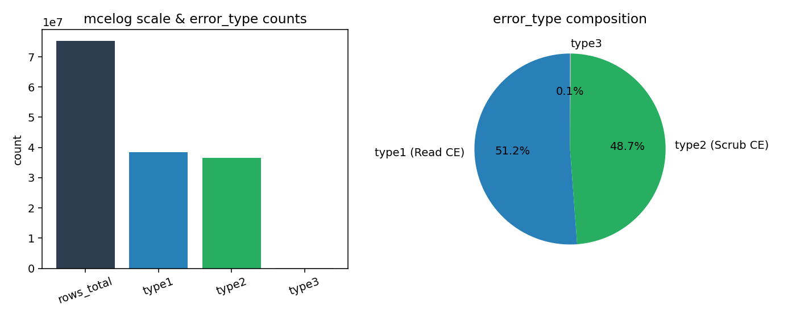
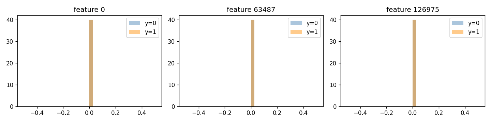
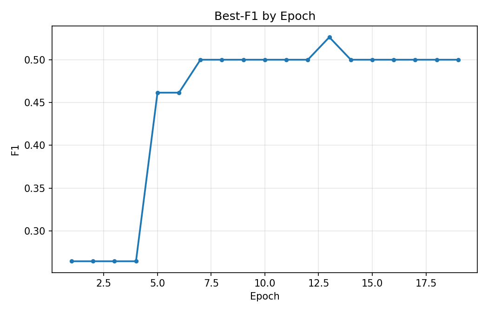
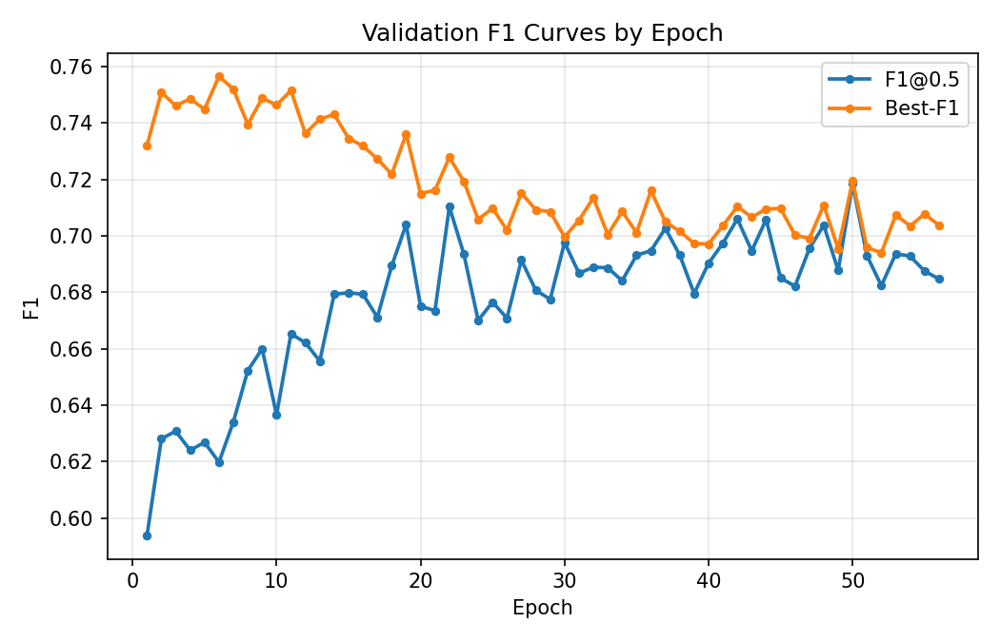
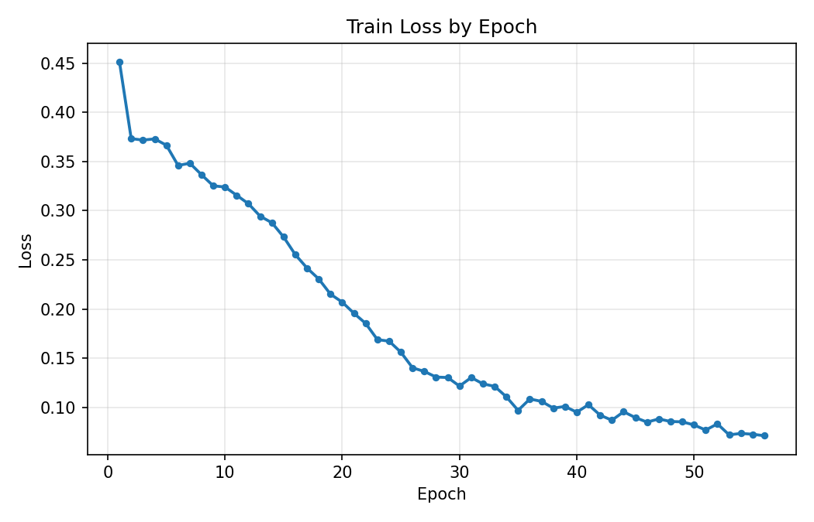
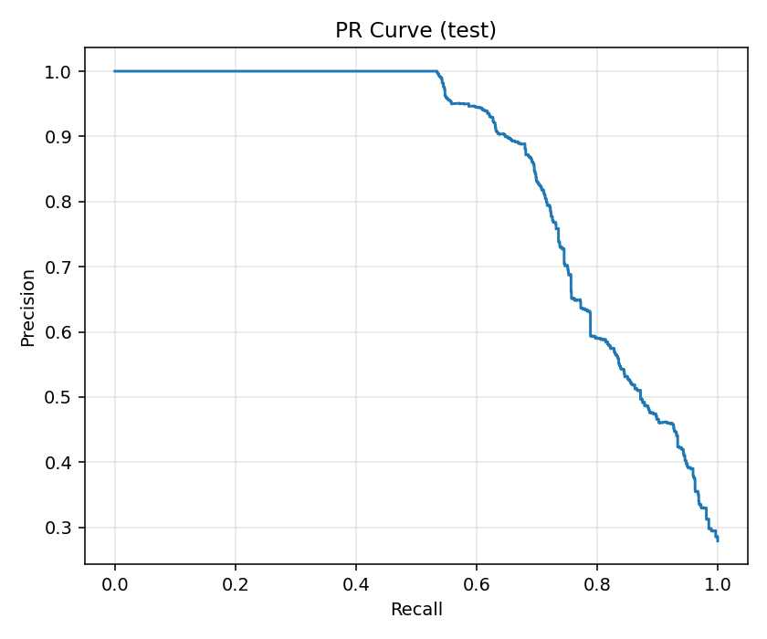
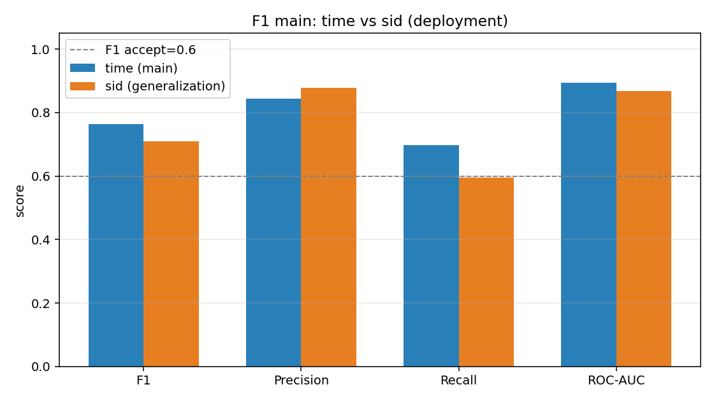
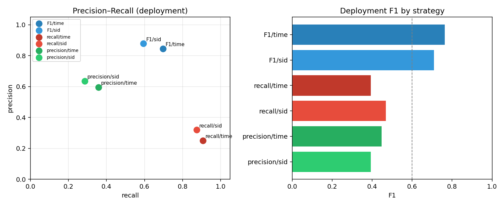
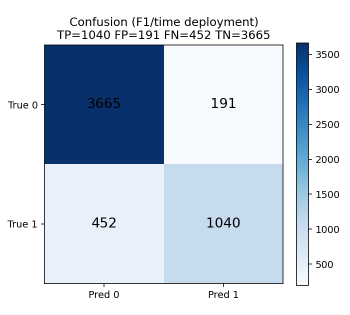
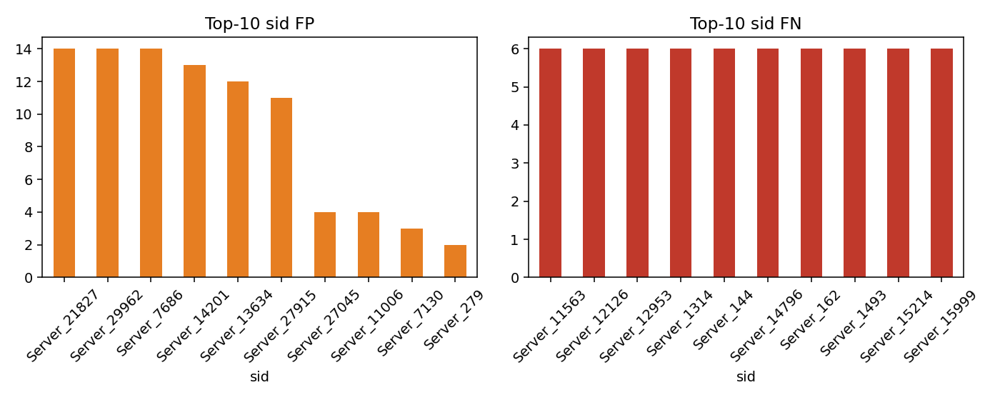

# 算法开发与实验结果

**文档性质**：算法设计报告配套章节  
**适用项目**：天池服务器动态随机存取存储器故障预测 · 空间热图卷积网络方案  
**编制说明**：本章说明实验层次、评价方法与 **2026-07-10** 全量重新执行实测结果。正式指标一律取自 `runs/<run_name>/infer_*/metrics.json` 的部署阶段评价段（`kpi_scope=deployment`）；汇总表见 `outputs/tables/full_all_strategies_deployment_kpi.csv`。

---

## 7.1 实验设计与评价方法

本研究将实验验证划分为三个层次。**其一，链路可行性验证**：在小规模样本索引与轻量网络结构下，检验数据构建、模型训练、推理及评估各环节能否稳定衔接。**其二，主实验与泛化评估**：在全量数据与 GridCNN-Deep（约 3.2M 参数，VGG 式纯卷积骨干）条件下，以 **F1 值**最大化为优化目标，报告测试集上的精确率、召回率、F1 值及 ROC 曲线下面积；并增设按服务器互斥切分的对照实验，以考察跨设备泛化能力。**其三，运维策略对比实验**：在统一全量数据基础上，分别采用召回优先与精度优先的阈值与预处理设定，量化不同告警策略下的性能权衡。

项目验收标准为：测试集**正式评价 F1 不低于 0.6**。正式评价指在验证集上确定决策阈值后，将该阈值固定应用于测试集进行推理与评估；测试集上事后搜索最优阈值所得结果仅作理论参考，不纳入项目验收依据。

下列表格归纳各笔记本的主要职能及结果归档位置，便于复现与查阅。

| 序号 | 笔记本 | 研究内容 | 主要输出 |
|------|----------|----------|----------|
| 1 | 01 原始数据探查 | 原始表规模、检错日志类型构成 | `outputs/tables/eda_*.csv` |
| 2 | 02 特征分析 | 特征张量维度、正负样本特征分布 | `outputs/tables/feature_summary_by_label.csv` |
| 3 | 03 误差分析 | 混淆结构、误报漏报及分层统计 | `outputs/tables/error_*.csv`；全量主实验见 `error_*_full_f1.csv` |
| 4 | 04 端到端流水线 | 冒烟验证与全量 F1 主实验 | `outputs/tables/full_f1_time_vs_sid_deployment_kpi.csv` |
| 5 | 05 策略对比 | 召回优先与精度优先六组对照 | `outputs/tables/full_all_strategies_deployment_kpi.csv` |

**表 7-1** 实验笔记本职能与结果归档对照

---

## 7.2 数据基础与样本构建结果

笔记本 01 对原始数据进行不依赖预处理的描述性统计：机器检错日志经分块流式读取，合计约 **7.52×10⁷** 行；可纠正错误类型一与类型二构成主体（约 3.85×10⁷ / 3.66×10⁷），支持后续以该两类事件构建空间热图特征。故障工单与硬件台账规模分别为数千级与数万级，与「工单事件稀疏、台账按服务器展开」的任务特征相符。

全量实验（笔记本 04 / `exp_full_f1_ddp`）中，索引由 `bash scripts/build_index.sh full` 生成；经预处理与数据集划分后，F1 主路径（`drop_empty_positive_windows=false`）样本规模约 **N≈35654**；工程实验路径（`drop_empty_positive_windows=true`）约 **N≈31060**。特征张量维度为三十一通道、一百二十八乘三十二空间网格，与 `configs/model.yaml` 的输入设定一致。

冒烟实验采用约 **500** 行演示索引（`data/index_stubs/`），用于验证软件链路，样本量不足以支撑对泛化性能的推断。

**图 7-1** 原始数据规模与检错日志 error_type 构成（来源：`01_eda.ipynb` → `outputs/tables/eda_mcelog_summary.csv`）

---

## 7.3 输入特征统计分析

笔记本 02 在预处理完成后，对特征矩阵进行维度核对及正负样本上的描述统计。分析将网格展平后在正负标签上分别计算均值、标准差及分位数；单维边际统计对分类性能的指示有限，更充分的可分性证据体现在下文主实验的分类指标与误差结构中。

**图 7-2** 选定特征维度上正负样本对比（笔记本 02 生成；报告引用 `reports/figures/fig7_2_feature_example_pos_neg.png`，原图亦见 `outputs/figures/feature_example_pos_neg.png`）

---

## 7.4 端到端实验结果

### 7.4.1 链路可行性验证（冒烟实验）

冒烟实验采用轻量网络（`model_smoke.yaml`）、单卡训练，以验证集阈值搜索后的 F1 作为早停依据。实测测试集部署阶段评价：**F1≈0.242**（精确率≈0.167，召回率≈0.444，阈值=0.32；`runs/exp_tianchi_baseline/infer_20260710_120519_060887/metrics.json`）。**冒烟实验结论应限定为：算法流水线可正常运行，不宜作为性能评价依据。**

**图 7-3** 冒烟实验验证集 best_f1 随训练轮次变化（`runs/exp_tianchi_baseline/.../figures/`）

### 7.4.2 主实验：F1 最大化（时间分层划分）

全量主实验采用 GridCNN-Deep（Stem + 四阶段纯卷积骨干，约 3.2M 参数）及多卡并行训练，通过类别加权损失与正样本过采样缓解类别不平衡。测试集**正式评价结果**如下（推理会话 `infer_20260710_124549_794972`）。

| 评价指标 | 数值 |
|----------|------|
| F1 值 | **0.764** |
| 精确率 | 0.845 |
| 召回率 | 0.697 |
| ROC 曲线下面积 | 0.894 |
| 决策阈值（由验证集确定） | 0.80 |

**表 7-2** 全量主实验测试集正式评价指标（时间分层划分）

验收判据：表 7-2 中正式评价 F1 **不低于 0.6**——**已达标（0.764≥0.6）**。测试集事后最优阈值分析仅作参考，不纳入验收。混淆矩阵：TP=1040，FP=191，FN=452，TN=3665。

**图 7-4** 全量主实验训练曲线与测试集 PR 曲线（`runs/exp_tianchi_full_f1_ddp/`）

### 7.4.3 泛化评估：按服务器互斥划分

在相同特征基础上，将数据集按服务器标识互斥划分（`exp_full_f1_sid` + `resplit.sh`），使测试集设备未参与训练，以评估跨服务器泛化性能。结果与时间分层主实验对比如表 7-3（来自 `outputs/tables/full_f1_time_vs_sid_deployment_kpi.csv`）。

| 评价指标 | 时间分层（主实验） | 按服务器划分（泛化对照） |
|----------|-------------------|-------------------------|
| F1 值 | **0.764** | **0.709** |
| 精确率 | 0.845 | 0.878 |
| 召回率 | 0.697 | 0.594 |
| ROC 曲线下面积 | 0.894 | 0.867 |
| 决策阈值 | 0.80 | 0.72 |

**表 7-3** 主实验与跨服务器泛化对照

验收目标 **F1≥0.6** 以时间分层主实验为准；按服务器划分结果（0.709）作为跨服务器泛化参考，不替代主判据。

**图 7-5** 主实验与泛化对照分组柱状图

---

## 7.5 面向不同运维目标的策略对比

笔记本 05 在工程实验预处理规则（含正类空窗丢弃等）下，分别训练召回优先与精度优先两类策略，并在时间分层与按服务器划分下各完成一组实验，与笔记本 04 主实验一并汇总。六组实验的测试集正式评价结果见表 7-4（来自 `outputs/tables/full_all_strategies_deployment_kpi.csv`）。

| 优化目标 | 数据划分方式 | F1 | 精确率 | 召回率 | ROC-AUC | 决策阈值 |
|----------|--------------|-----|--------|--------|---------|----------|
| F1 最大化 | 时间分层 | **0.764** | 0.845 | 0.697 | 0.894 | 0.80 |
| F1 最大化 | 按服务器 | 0.709 | 0.878 | 0.594 | 0.867 | 0.72 |
| 召回优先 | 时间分层 | 0.392 | 0.250 | 0.907 | 0.776 | 0.37 |
| 召回优先 | 按服务器 | 0.468 | 0.320 | 0.874 | 0.812 | 0.31 |
| 精度优先 | 时间分层 | 0.448 | 0.595 | 0.359 | 0.767 | 0.78 |
| 精度优先 | 按服务器 | 0.394 | 0.636 | 0.285 | 0.804 | 0.78 |

**表 7-4** 六组实验测试集正式评价指标汇总

工程实验与主实验的预处理规则（如 `drop_empty_positive_windows`）不同，**不得直接与主评价指标数值类比**。**项目验收仍以笔记本 04 的 F1 最大化主实验为准**；本组对照为运维策略选型提供量化依据。

**图 7-6** 六组实验精确率—召回率分布与 F1 对照

---

## 7.6 预测误差分析

笔记本 03 基于推理输出的预测表与评估指标，开展混淆矩阵统计及误报、漏报样本剖析。全量主实验（`exp_full_f1_ddp`）部署阶段混淆矩阵与按服务器分层的 FP/FN 分布如下；标准计数见 `runs/exp_tianchi_full_f1_ddp/infer_20260710_124549_794972/confusion_matrix.json` 与 `outputs/tables/error_confusion_counts_full_f1.csv`。

> **说明**：当前磁盘 `data/splits/` 为工程实验最后一次预处理输出，与 F1 主实验测试集行数不一致；`outputs/tables/error_metrics_kpi.csv` 等若未指定全量 YAML 重新执行，可能仍为冒烟 baseline 小样本结果，**全量验收请以 `*_full_f1.csv` 与主实验 `infer_*/` 输出为准**。

**图 7-7** 测试集混淆矩阵热力图（全量主实验）

**图 7-8** 按服务器标识分层的误报、漏报 Top-10 计数（主实验预测结果）

该笔记本所采用的方法——区分正式评价与事后最优分析、将误差分解至可解释维度——对全量实验分析具有方法论价值。

---

## 7.7 结论

综合实验设计与 2026-07-10 全量重新执行结果，可得出如下结论（指标以 `outputs/tables/full_all_strategies_deployment_kpi.csv` 为准）。

**（1）算法全流程可验证。** 自大规模检错日志与索引构建，经样本特征生成、深度网络多卡训练至推理评估，笔记本 04 提供完整复现路径；冒烟与全量链路均已完整执行。

**（2）主实验验收标准已达成。** 在时间分层划分、GridCNN-Deep 及 F1 最大化训练设定下，测试集正式评价 **F1=0.764≥0.6**。按服务器互斥划分的泛化对照 **F1=0.709**，作为辅助参考。

**（3）不同运维目标下性能呈现可预期的权衡关系。** 召回优先（时间分层召回率≈0.907）与精度优先（时间分层精确率≈0.595）配置服务于不同告警成本；业务部署应在漏报风险与虚警成本之间择一，且不得与主实验 F1 直接横向「谁更好」。

**（4）冒烟实验定位应严格限定。** 冒烟仅表明软件链路可用（部署阶段 F1≈0.242）；**性能结论以全量主实验为准**，轻量网络结果不得用于验收陈述。

---

## 7.8 结果归档与复现说明

各实验正式评价指标可追溯至 `runs/<run_name>/infer_*/metrics.json` 中的部署阶段评价字段；笔记本 04、05 可将核心结果汇总至 `outputs/tables/` 下对照表。复现时须固定实验配置文件、预处理输出目录及随机种子；切换主实验与工程对照实验前，应清空预处理与切分目录（或依赖预处理配置不一致时的自动清空），避免因数据构建规则混用导致指标不可比。

权重路径说明：`runs/<run_name>/<train_session>/checkpoints/grid_cnn.pt`；可用 `latest_train` 软链定位最近一次训练会话。

> **关于「第 2 轮最优」**：当前无偏置 INT8 交付（2026-08-18）验证搜阈 F1 在第 2 轮见顶、`patience=50` 下训练至第 52 轮才停。这不等于训练失败；测试集部署 F1≈0.7679。完整说明见 `delivery/nobias-symint8-20260818/evidence/notes/训练早停与第2轮最优说明.md`。本章表 7-2 等数字仍为 2026-07-10 主实验归档，勿与本次交付会话混读。

| 验证项 | 结论 |
|--------|------|
| 端到端链路（冒烟） | **已通过**；部署阶段 F1≈0.242（仅验链路） |
| 端到端链路（全量） | **已通过**；`exp_tianchi_full_f1_ddp` 全流程完成 |
| 验收标准：正式评价 F1 ≥ 0.6（时间分层） | **已达标**：F1=**0.764**（`infer_20260710_124549_794972`） |
| 泛化对照：正式评价 F1（按服务器划分） | **已完成**：F1=**0.709** |
| 召回/精度策略对照 | **已完成**；见 `full_all_strategies_deployment_kpi.csv` |

**表 7-5** 算法开发验收结论汇总

---

**关联文档**：《基于CNN的内存故障预测算法设计报告》主报告；`algorithm_scripts_index.md`（复现命令）；`notebooks/README.md`（笔记本说明）。

**模型压缩与 INT8 部署（可选，非主验收）**：在主实验权重基础上另提供 W8A8 PTQ（`quantize.sh` / `infer_int8.sh`）、三种粒度剪枝对比（`prune.sh`）与先剪枝后量化（`prune_quantize.sh`）。其评估口径与训练一致（各模型验证集重搜阈值后再评测试集），单独成篇见 `reports/GridCNN-Deep_W8A8量化报告.md`、`reports/GridCNN剪枝对比*.md`、`reports/GridCNN先剪枝后量化*.md`，不纳入本章 F1 验收结论。
